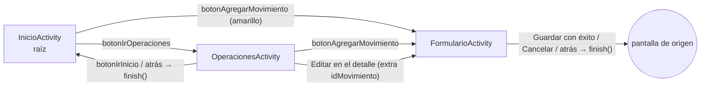
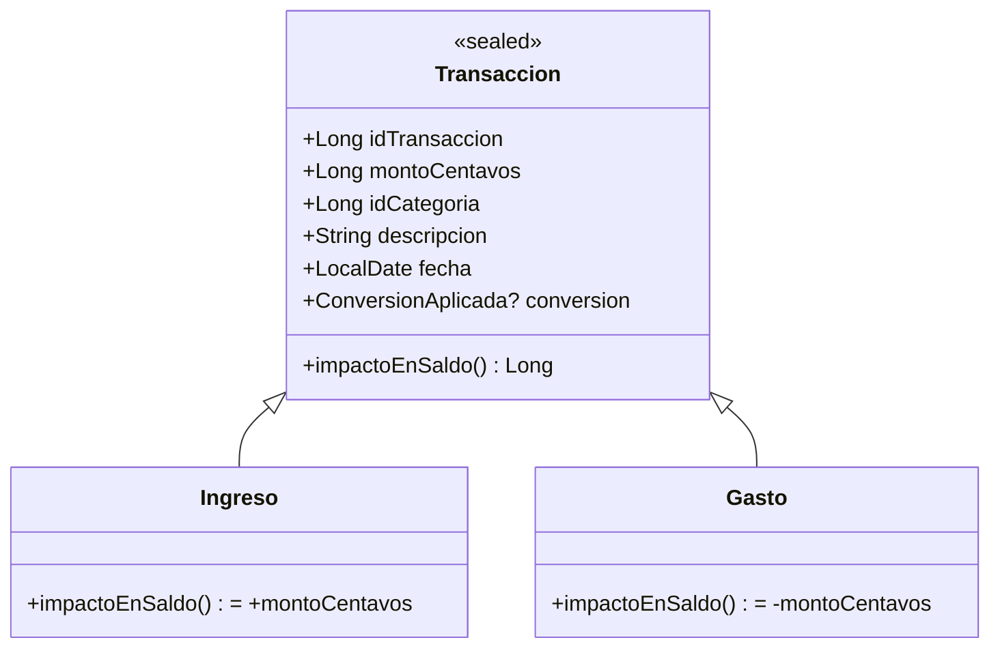
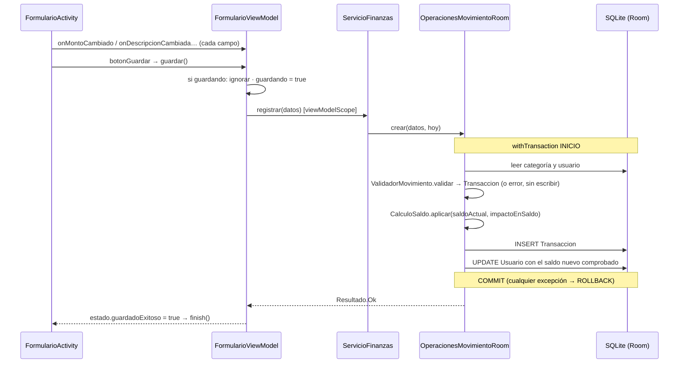

# Diseño — App de finanzas personales (Kotlin · Android)

> **Versión 3.4 · 23/10/2026.** Existen la pantalla de diagnóstico del Incremento 0, las reglas del core del Incremento 1 y la persistencia Room v1 del Incremento 2, todas con pruebas. Las pantallas financieras y las APIs todavía son diseño; las comprobaciones de construcción y ejecución están en el [README](../README.md#estado-real).
> **Referencias revisadas:** captura de Canva y HTML compartidos en el chat; documentación Mi Pisto y guía de clase 14. La captura principal y las decisiones de adaptación están en [referencias/INTERFAZ.md](referencias/INTERFAZ.md). Los ejemplos del curso y del compañero sirven como apoyo; las reglas de este documento definen nuestro proyecto.
> **Esqueletos y pseudocódigo** de este documento no están compilados.
> Mapa del código y preguntas de defensa: **[MAPA_DEL_CODIGO.md](MAPA_DEL_CODIGO.md)**. Construcción en Windows: **[GUIA_WINDOWS.md](GUIA_WINDOWS.md)**.

---

## 1. Propósito y alcance

**Propósito.** Una persona sin conocimientos técnicos registra ingresos y gastos y entiende tres cosas: cuánto tiene disponible, cuánto entró y cuánto salió en un período.

**Alcance:** finanzas que funcionan **sin conexión**, con consultas **opcionales** de información por internet. Sin backend propio, sin cuentas en la nube, sin sincronización de movimientos.

| Incluido en esta versión | Fuera de esta versión |
|---|---|
| Un usuario local sin login; tres tablas `Usuario`, `Categoria`, `Transaccion` | Perfiles familiares, cuentas, transferencias, presupuestos, metas |
| Registrar, editar y eliminar ingresos y gastos; saldo acumulado en `Usuario` | Notificaciones, Firebase, servidores, sincronización remota |
| Inicio con saldo disponible, filtros de período, ingresos, gastos y anillo de gastos por categoría | Lluvia de monedas, vibración, comparación de seis meses |
| Operaciones: historial, filtros, detalle, edición, eliminación con confirmación | SQLiteOpenHelper o un interruptor Room/SQLite |
| Movimientos en GTQ; USD con tasa de referencia del Banguat (Inc. 6) | Otras monedas (EUR, MXN…), saldos por divisa |
| Clima de Jutiapa y una reflexión diaria, opcionales (Inc. 7) | Dos integraciones distintas de frases y Biblia |
| Tema Sistema/Claro/Oscuro | Pantalla de administración de categorías |

### Qué tomamos de la referencia Mi Pisto (según tu resumen)

| Elemento | Decisión |
|---|---|
| Mapa de archivos y responsabilidades | Lo reforzamos: `MAPA_DEL_CODIGO.md` |
| Estados de carga y error por API | Los adoptamos: cada tarjeta tiene estado propio (§11) |
| Caché con fecha y uso sin internet | Lo concretamos por servicio (§11) |
| Tema claro/oscuro; categorías con texto e icono | Lo mantenemos (§12) |
| Esquema de dos tablas con categorías en un `enum` | **No.** Tres tablas; el `enum` solo representa el tipo |
| Room y SQLite directo intercambiables | **No.** Solo Room; Room ya guarda en SQLite |
| Reemplazar categorías desconocidas por `OTRO_GASTO` | **No.** Puede convertir un ingreso en gasto (§6.4) |
| Perfiles familiares, lluvia de monedas, seis meses | Fuera de alcance |
| Sus versiones y coordenadas Maven | No sustituyen las nuestras |

### Supuestos (no bloquean)
- El saldo puede quedar negativo y se muestra con signo y color; no se bloquean gastos.
- No se aceptan fechas futuras en un movimiento.
- La semana va de **domingo a sábado** (convención de Guatemala en los datos CLDR; se fija como constante, no se deduce del teléfono).
- Zona horaria fija `America/Guatemala` para saber qué día es "hoy".
- La app es independiente del ejercicio `gastos`; no migra sus datos.

---

## 2. Decisiones principales

| Decisión | Por qué | Cómo ayuda a explicarlo | Costo |
|---|---|---|---|
| Core Kotlin/JVM con Maven + app Android con Gradle | Las reglas se prueban sin Android | "El core no importa nada de Android" se comprueba mirando sus imports | Republicar el JAR al cambiar el core |
| XML + View Binding + RecyclerView | Continuidad con el curso | Cada botón tiene un ID en un XML concreto | Más verboso que Compose |
| MVVM: una Activity y un ViewModel por pantalla | El estado sobrevive a rotación y cambio de tema | Activity = presenta y recibe; ViewModel = coordina | Una clase más por pantalla |
| Pantallas como Activities, barra inferior compartida | Es el patrón ya elegido; no añadimos Navigation ni Fragments | Volver = `finish()`; no hay otra pila que explicar | Barra incluida en dos layouts |
| Datos de pantalla observados con `Flow` de Room | Al guardar, todas las vistas se actualizan solas | No existe un "refrescar" manual que olvidar | Requiere entender `Flow` y `stateIn` |
| Dinero en `Long` de centavos; `BigDecimal` para texto y conversión | Sin errores de `Double` | Un solo archivo convierte texto ↔ centavos | Formatear al mostrar |
| `Transaccion` sellada con `Ingreso`/`Gasto` | Herencia y polimorfismo con función real | `impactoEnSaldo()` decide el signo | Mapear a una sola tabla |
| Saldo guardado en `Usuario` y ajustado dentro de `withTransaction` | Inicio no recorre el historial | Un método contiene la operación completa | Exige atomicidad cuidadosa |
| Validación que construye la `Transaccion` | Una sola puerta para datos crudos | "¿Quién valida el monto?" tiene una respuesta | — |
| GTQ como moneda base; USD guarda una fotografía de la conversión | El saldo nunca cambia por una tasa nueva | El registro muestra qué tasa se usó y cuándo | Cinco columnas más en `Transaccion` |
| Red con `HttpURLConnection`, XML con `javax.xml`, JSON con `org.json` | Incluidos en Android: sin bibliotecas nuevas | Un único `ClienteHttp` con tiempos de espera | Código algo más manual que Retrofit |
| Caché de servicios en `SharedPreferences` | Pocos valores por servicio; no son datos financieros | Ninguna temperatura entra en tablas financieras | No sirve para historiales grandes |
| Inyección manual en `Dependencias` | Se lee quién crea a quién | Ningún framework oculto | Se escribe a mano |

---

## 3. Navegación y pantallas

Referencia visual: verde oscuro `#1E463E`, amarillo de acento `#FFC229`, fondo claro `#F2F5F3`. Se recrea con componentes nativos (Material Components); **no** se usa WebView ni scripts de Canva.

### 3.0 Contraste con las referencias visuales

La captura de Inicio está guardada en [referencias/canva-inicio.png](referencias/canva-inicio.png). Se revisó también el HTML de Canva compartido en el chat para entender las tres vistas. [INTERFAZ.md](referencias/INTERFAZ.md) conserva la distribución y las diferencias acordadas; el HTML del editor y sus SDK no forman parte de la aplicación.

| Elemento de la maqueta | Adaptación acordada |
|---|---|
| Cabecera verde, acentos amarillos, tarjetas claras y botón central Añadir | Se conservan con recursos de tema nativos |
| Inicio, Añadir y Operaciones | Tres vistas; Formulario vuelve a su origen al guardar o cancelar |
| Cuadrícula de categorías con icono y nombre | Se conserva; “Más” abre la lista completa |
| Balance y anillo con valores de ejemplo | Saldo disponible histórico arriba; gasto del período en el centro del anillo |
| Selector de varias monedas del HTML | Solo dos sentidos: USD → GTQ y GTQ → USD |
| Datos en memoria y tasas fijas | SQLite/Room para movimientos y una tasa Banguat con fecha desde el Inc. 6 |

La lista, las tarjetas y el anillo se alimentan de los mismos datos persistidos. En el Inc. 3 se comparará la pantalla Android con la referencia en el emulador; esa comprobación visual todavía está pendiente.

### 3.1 Barra inferior y regreso



- `barra_navegacion.xml` se incluye en Inicio y Operaciones. `NavegacionPrincipal.conectar(...)` asigna sus tres botones para no repetir código.
- La pila máxima es Inicio → Operaciones → Formulario. Tocar el destino actual no hace nada.
- Ninguna pantalla "recarga" al volver: Inicio y Operaciones observan `Flow` de Room, así que un guardado ya cambió sus datos.

### 3.2 Inicio (`ui/inicio`)
- Encabezado **Saldo disponible** (`textoSaldoDisponible`): saldo acumulado de `Usuario`, siempre en Q y sin filtrar por período.
- Filtros `chipDia`, `chipSemana`, `chipMes` (por defecto), `chipAnio` y `chipPersonalizado` (abre un selector de rango de fechas).
- Tarjetas **Ingresos**, **Gastos** y **Resultado del período** (ingresos − gastos del intervalo; no se confunde con el saldo).
- Anillo **Gastos por categoría del período**: el centro muestra el gasto total del período. Sin gastos, aparece el texto "Sin gastos en este período" y no se dibuja ningún anillo.
- Debajo (Inc. 6–7): tarjeta de tasa, tarjeta de clima y tarjeta de reflexión, cada una independiente.
- Menú superior: Tema (Inc. 5). Aviso **Recalcular saldo** solo si `reconstruccionPendiente` (Inc. 5).

**Intervalos** (fechas reales; hoy en `America/Guatemala`). Ejemplo para el jueves 22/10/2026:

| Filtro | Desde | Hasta |
|---|---|---|
| Día | 22/10/2026 | 22/10/2026 |
| Semana (dom–sáb) | 18/10/2026 | 24/10/2026 |
| Mes | 01/10/2026 | 31/10/2026 |
| Año | 01/01/2026 | 31/12/2026 |
| Personalizado | elegido | elegido (`desde ≤ hasta`, ambos inclusive) |

### 3.3 Formulario (`ui/formulario`) — crear y editar
- `grupoTipo` (Ingreso/Gasto), `campoMonto`, `grupoMoneda` (GTQ/USD: **solo aparece desde el Inc. 6**), categorías en una cuadrícula de iconos y nombres + `botonMasCategorias` (abre la lista completa; "Más" nunca se guarda), `campoFecha`, `campoDescripcion` (obligatoria, 1–60 caracteres).
- Accesos rápidos `chipSumar5/10/20/50`, como en la maqueta: suman en la moneda elegida y no evitan la validación.
- Con USD: `textoConversionPrevia` = "Equivale a Q 94.56 · tasa 7.66285 · Banguat 21/10/2026" (valores de ejemplo).
- `botonGuardar` queda deshabilitado mientras `guardando = true`; `botonCancelar` cierra sin guardar.
- En edición, el título cambia a "Editar movimiento" y los campos vienen del movimiento guardado.

### 3.4 Operaciones (`ui/operaciones`)
- `listaOperaciones` (RecyclerView) ordenada por fecha descendente, con encabezados por día. Esta versión **solo ordena por fecha**, así que los encabezados nunca engañan.
- Filtros: tipo (`chipTodos`, `chipIngresos`, `chipGastos`) y rango, con las mismas reglas de fecha que Inicio. Por defecto, el mes actual.
- Cada fila muestra icono y nombre de la categoría, descripción, fecha, monto y tipo, con signo (+/−) y color.
- Al tocar una fila se abre el detalle, que en movimientos USD muestra el original, la tasa, su fecha y la fuente. Desde el detalle: `botonEditar` y `botonEliminar` (este último pide confirmación).
- La consulta se carga **por intervalo**; Inicio nunca necesita el historial completo. Si un intervalo creciera demasiado, se evaluaría Paging, pero no se añade ahora.

---

## 4. Árbol de archivos

Leyenda: **[0]** existe hoy · **[n]** se crea en el incremento n.

### 4.1 `finanzas-core/` — paquete `gt.edu.umg.finanzas.core` (sin Android, Room, HTTP, XML ni JSON)
```
pom.xml                                   [0]
src/main/resources/.../finanzas-core.properties   [0] versión del JAR (filtrada por Maven)
src/main/kotlin/gt/edu/umg/finanzas/core/
  InfoCore.kt                             [0] diagnóstico: versión y mensaje de conexión
  dominio/
    TipoMovimiento.kt                     [1] enum INGRESO, GASTO
    Transaccion.kt                        [1] sealed + Ingreso/Gasto; impactoEnSaldo()
    Categoria.kt                          [1] id, clave, nombre, tipo, activa
    CategoriasIniciales.kt                [1] CategoriaInicial (clave, nombre, tipo) y la lista sembrada
    Usuario.kt                            [1] saldoCentavos, reconstruccionPendiente
    DatosMovimiento.kt                    [1] lo escrito en el formulario, sin validar
    CampoMovimiento.kt                    [1] campo que marca un error de validación
    FiltroPeriodo.kt                      [1] enum DIA, SEMANA, MES, ANIO
    Periodo.kt                            [1] intervalo, filtros Día/Semana/Mes/Año, zona GT
    ResumenPeriodo.kt                     [1] saldo disponible + ingresos, gastos, resultado
    TotalesPeriodo.kt                     [1] ingresosCentavos y gastosCentavos, sin Pair
    TotalCategoria.kt                     [1] categoría y total antes de calcular porcentajes
    SegmentoGasto.kt                      [1] categoría, total, porcentaje del anillo
    MovimientoVista.kt                    [1] fila de Operaciones
    Moneda.kt                             [1] enum GTQ, USD
    TasaCambio.kt                         [1] GTQ por 1 USD, fecha de referencia, fuente
    ConversionAplicada.kt                  [1] monto original USD y tasa histórica aplicada
  reglas/
    Dinero.kt                             [1] texto ↔ centavos y formato "Q 1,000.00"
    ConversorMoneda.kt                    [1] USD↔GTQ con BigDecimal y redondeo único
    ValidadorMovimiento.kt                [1] DatosMovimiento + Categoria → Transaccion o error
    CalculoSaldo.kt                       [1] deltas, aplicar al saldo y suma de reconstrucción
    DistribucionGastos.kt                 [1] totales por categoría → porcentajes del anillo
  contratos/
    RepositorioUsuario.kt                 [1]
    RepositorioCategoria.kt               [1]
    RepositorioTransaccion.kt             [1]
    OperacionesMovimiento.kt              [1] límite atómico crear/editar/eliminar
    ReconstructorSaldo.kt                 [1]
  servicio/ServicioFinanzas.kt            [1] única entrada para los ViewModels
  resultado/Resultado.kt                  [1]
src/test/kotlin/...                       [1] pruebas + dobles en memoria (fakes/)
```
Todo el árbol anterior ya existe (Inc. 1). `Moneda`, `TasaCambio` y `ConversorMoneda` se crean en el Inc. 1 porque son reglas puras y se prueban ahí. La interfaz no ofrece USD hasta el Inc. 6. La descripción de cada clase y sus conexiones están en el [mapa del código](MAPA_DEL_CODIGO.md#2-core-qué-hace-cada-clase).

### 4.2 `finanzas-app/` — paquete `gt.edu.umg.finanzas.app`
```
settings.gradle.kts, build.gradle.kts, gradle.properties, gradle/libs.versions.toml, gradle/wrapper/, gradlew(.bat)  [0]
app/build.gradle.kts                      [0] (se amplía en 2, 3)
app/schemas/                              [2] esquemas exportados por Room (versionados en Git)
app/src/main/AndroidManifest.xml          [0] (+ permiso INTERNET en 6)
app/src/main/java/gt/edu/umg/finanzas/app/
  FinanzasApp.kt                          [2] Application: Dependencias, tema, inicialización
  Dependencias.kt                         [2] construcción manual; sin lógica
  datos/local/
    AppDatabase.kt                        [2] versión 1; versión 2 y Migracion1a2 en 6
    Migraciones.kt                        [6] Migration(1,2) explícita
    Convertidores.kt                      [6] BigDecimal ↔ TEXT
    entidades/{UsuarioEntity, CategoriaEntity, TransaccionEntity}.kt   [2]
    dao/{UsuarioDao, CategoriaDao, TransaccionDao, MovimientoFila}.kt  [2]
    Mapeos.kt                             [2] entity ↔ dominio
    RepositorioUsuarioRoom.kt, RepositorioCategoriaRoom.kt, RepositorioTransaccionRoom.kt  [2]
    OperacionesMovimientoRoom.kt          [2] withTransaction: el límite atómico
    InicializadorDatos.kt                 [2] usuario 1 + categorías, idempotente
    ReconstructorSaldoRoom.kt             [5]
  datos/preferencias/
    PreferenciaTema.kt                    [5] Sistema/Claro/Oscuro
    CacheServicios.kt                     [6] última tasa, clima y reflexión con sus fechas
  datos/remoto/
    ClienteHttp.kt                        [6] GET/POST, tiempos de espera, hilo de E/S
    tipocambio/{ClienteBanguat, LectorRespuestaBanguat}.kt   [6]
    clima/{ClienteOpenMeteo, LectorRespuestaClima}.kt        [7]
    reflexion/…                           [7] solo el proveedor elegido
  datos/repositorios/
    ConsultaRemota.kt                     [6] Actual / Guardada / SinDatos
    RepositorioTipoCambio.kt              [6] caché diaria + Banguat
    RepositorioClima.kt                   [7] caché 30 min + Open-Meteo
    RepositorioReflexion.kt               [7] caché diaria + catálogo local
  ui/comun/
    NavegacionPrincipal.kt                [3] conecta barra_navegacion.xml
    RecursosCategoria.kt                  [3] clave → icono y color; genérico si es desconocida
    EstadoTarjeta.kt                      [6] Cargando / ConDatos / SinDatos
  ui/inicio/
    InicioActivity.kt                     [0] provisional: muestra InfoCore; real en 3
    InicioViewModel.kt, InicioUiState.kt  [3]
    GraficoAnilloView.kt                  [3] solo dibuja segmentos ya calculados
    ConversorDialogo.kt                   [6]
  ui/formulario/{FormularioActivity, FormularioViewModel, FormularioUiState}.kt   [3]
  ui/operaciones/{OperacionesActivity, OperacionesViewModel, OperacionesUiState, OperacionesAdapter}.kt  [4]
app/src/main/res/
  layout/activity_inicio.xml              [0] (rediseñado en 3)
  layout/{activity_formulario, activity_operaciones, item_operacion, item_encabezado_dia,
          dialogo_detalle_movimiento, barra_navegacion}.xml          [3–4]
  layout/{tarjeta_tasa, dialogo_conversor}.xml [6] · tarjeta_clima.xml, tarjeta_reflexion.xml [7]
  values/{strings, themes}.xml            [0] · values/colors.xml, values-night/colors.xml, drawable/ic_categoria_*.xml [3]
```

**Cambios respecto de la versión 2:**
- `resumen/ResumenActivity` pasa a `ui/inicio/InicioActivity` para usar el mismo nombre que ve el usuario ("Inicio"). Ya renombrado.
- `movimiento/` pasa a `ui/formulario/` e `historial/` a `ui/operaciones/`.
- `datos/db`, `entidades`, `mapeo` y `repos` se agrupan en `datos/local/`.
- Se eliminan `FormatoQuetzal` (lo cubre `Dinero.formatear` en el core) y `EventoUnaVez` (el éxito se representa en el estado, §9.5).

---

## 5. Responsabilidades por archivo

| Archivo | Responsabilidad única | Recibe → entrega | Lo usa |
|---|---|---|---|
| `reglas/Dinero.kt` | Convertir texto ↔ centavos y formatear `Q`/`US$` | `"12.50"` → `1250` / error | Validador, ViewModels |
| `reglas/ConversorMoneda.kt` | USD↔GTQ con la tasa recibida y redondeo `HALF_UP` | centavos + `TasaCambio` → centavos | Validador, ViewModel del formulario, conversor |
| `reglas/ValidadorMovimiento.kt` | Validar todo y construir `Ingreso`/`Gasto` con el monto base en Q | `DatosMovimiento`, `Categoria`, hoy → `Resultado<Transaccion>` | `OperacionesMovimientoRoom`, servicio (vista previa) |
| `reglas/CalculoSaldo.kt` | Deltas y saldo final con `Math.addExact` | saldo actual + delta → saldo nuevo | `OperacionesMovimientoRoom`, reconstructor |
| `reglas/DistribucionGastos.kt` | Porcentajes que suman exactamente 100 % (mayor residuo) | totales por categoría → `List<SegmentoGasto>` | Servicio |
| `dominio/Periodo.kt` | Límites de Día/Semana/Mes/Año/Personalizado | filtro + hoy → `Periodo` | ViewModels |
| `servicio/ServicioFinanzas.kt` | Punto de entrada: observa resumen y listas, registra, edita, elimina, reconstruye | — | ViewModels |
| `contratos/*` | Qué necesita el core del almacenamiento, sin decir cómo | — | Implementaciones Room y fakes |
| `datos/local/dao/*Dao.kt` | SQL: lecturas `Flow`, escrituras `suspend`, `SUM`/`GROUP BY` | parámetros → filas | Repositorios Room, operaciones |
| `datos/local/OperacionesMovimientoRoom.kt` | **Único** lugar que abre `withTransaction` para movimientos | `DatosMovimiento` → `Resultado` | Servicio |
| `datos/local/InicializadorDatos.kt` | Usuario 1 y categorías iniciales, sin duplicar | — → listo / error | `FinanzasApp` |
| `datos/remoto/ClienteHttp.kt` | Una petición con tiempos de espera fuera del hilo principal | URL → texto o excepción | Clientes de cada API |
| `datos/remoto/tipocambio/LectorRespuestaBanguat.kt` | Leer `CambioDolar/VarDolar` y crear `TasaCambio` | XML → `TasaCambio` o error | `ClienteBanguat` |
| `datos/repositorios/RepositorioTipoCambio.kt` | Decidir entre caché y red; guardar la última tasa válida | — → `ConsultaRemota<TasaCambio>` | Inicio, Formulario |
| `datos/preferencias/CacheServicios.kt` | Leer/escribir caché auxiliar con su fecha de consulta | — | Repositorios remotos |
| `Dependencias.kt` | Crear y conectar objetos; nada de reglas ni SQL | — | Activities (vía fábricas de ViewModel) |
| `ui/*/…Activity.kt` | Inflar XML, enviar acciones al ViewModel, pintar el estado, navegar | eventos de vista → llamadas al ViewModel | — |
| `ui/*/…ViewModel.kt` | Estado de su pantalla; llama al servicio o repositorio | acciones → `StateFlow<UiState>` | Activity |
| `ui/inicio/GraficoAnilloView.kt` | Dibujar arcos y tomar colores de recursos; no consulta ni calcula totales financieros | `List<SegmentoGasto>` → dibujo | `InicioActivity` |

---

## 6. Modelo de datos (Room sobre SQLite)

### 6.1 Tablas y columnas por incremento

**`Usuario`** [2]: `idUsuario INTEGER PK` (siempre 1) · `nombrePerfil TEXT NOT NULL` · `saldoCentavos INTEGER NOT NULL` · `reconstruccionPendiente INTEGER NOT NULL DEFAULT 0`.

**`Categoria`** [2]: `idCategoria INTEGER PK` · `clave TEXT NOT NULL UNIQUE` (identificador estable, p. ej. `ALIMENTACION`) · `nombre TEXT NOT NULL` · `tipo TEXT NOT NULL` (`INGRESO`/`GASTO`, inmutable) · `activa INTEGER NOT NULL DEFAULT 1`.

**`Transaccion`**:

| Columna | Inc. | Tipo SQLite | Significado |
|---|---|---|---|
| `idTransaccion` | 2 | INTEGER PK | — |
| `idUsuario` | 2 | INTEGER NOT NULL, FK → Usuario | — |
| `idCategoria` | 2 | INTEGER NOT NULL, FK → Categoria (`RESTRICT`) | — |
| `tipo` | 2 | TEXT NOT NULL | redundancia controlada (§6.3) |
| `montoCentavos` | 2 | INTEGER NOT NULL, > 0 | **monto base en centavos de GTQ**; el único que usan saldo, totales y anillo |
| `descripcion` | 2 | TEXT NOT NULL | 1–60 caracteres |
| `fechaEpochDay` | 2 | INTEGER NOT NULL | `LocalDate.toEpochDay()` |
| `monedaOriginal` | 6 | TEXT NOT NULL DEFAULT `'GTQ'` | `GTQ` o `USD` |
| `montoOriginalCentavos` | 6 | INTEGER NOT NULL DEFAULT 0 | centavos en la moneda original; en GTQ es igual a `montoCentavos` |
| `tasaGtqPorUsd` | 6 | TEXT NOT NULL DEFAULT `'1'` | `BigDecimal.toPlainString()`, sin pérdida |
| `fechaTasaEpochDay` | 6 | INTEGER NULL | fecha de referencia del proveedor; NULL en GTQ |
| `fuenteTasa` | 6 | TEXT NULL | p. ej. `"Banco de Guatemala — referencia"`; NULL en GTQ |

**Índices:** `Transaccion(fechaEpochDay)`, `Transaccion(tipo, fechaEpochDay)` y `Transaccion(idCategoria)` (Room pide indexar la columna hija de una FK). Las sumas por período **no** cuestan lo mismo siempre: recorren las filas del intervalo, y los índices evitan recorrer toda la tabla.

### 6.2 Migraciones
- `exportSchema = true` y el plugin Gradle de Room guarda `app/schemas/gt.edu.umg.finanzas.app.datos.local.AppDatabase/1.json` (y `2.json` en el Inc. 6). Nunca `fallbackToDestructiveMigration`.
- **`Migracion1a2` (Inc. 6), manual y explícita**, dentro de la transacción que Room abre para migrar:
  ```sql
  ALTER TABLE Transaccion ADD COLUMN monedaOriginal TEXT NOT NULL DEFAULT 'GTQ';
  ALTER TABLE Transaccion ADD COLUMN montoOriginalCentavos INTEGER NOT NULL DEFAULT 0;
  ALTER TABLE Transaccion ADD COLUMN tasaGtqPorUsd TEXT NOT NULL DEFAULT '1';
  ALTER TABLE Transaccion ADD COLUMN fechaTasaEpochDay INTEGER;
  ALTER TABLE Transaccion ADD COLUMN fuenteTasa TEXT;
  UPDATE Transaccion SET montoOriginalCentavos = montoCentavos;
  ```
  Solo usa `ADD COLUMN`, que SQLite admite en todas las versiones de Android desde API 24. **No** usa `RENAME COLUMN` (requiere SQLite 3.25, que no viene en todos los Android desde API 24). Los `DEFAULT` se declaran igual en la entidad (`@ColumnInfo(defaultValue = …)`) para que Room valide el esquema. La migración no toca `montoCentavos` ni `saldoCentavos`.
- Prueba con `MigrationTestHelper`: insertar filas en v1, migrar y comprobar montos, tipo, categoría, saldo y `montoOriginalCentavos = montoCentavos`.

### 6.3 Tipo y categoría
- `tipo` se repite en `Transaccion` para reconstruir `Ingreso`/`Gasto` sin JOIN y para filtrar con el índice `(tipo, fechaEpochDay)`.
- **Garantía:** `ValidadorMovimiento` compara el tipo con el de la categoría leída **dentro** de `withTransaction`, al crear y al editar. Las categorías tienen tipo inmutable.
- Una FK simple solo comprueba que el ID exista. Un `CHECK` no puede consultar otra tabla. El esquema **podría** reforzar la regla con una FK compuesta `(idCategoria, tipo) → Categoria(idCategoria, tipo)` y `UNIQUE(idCategoria, tipo)` en el padre. No la adoptamos en esta versión; la validación protege todas las escrituras que pasan por `OperacionesMovimientoRoom`.
- **Categoría archivada** (`activa = 0`): no aparece al elegir, pero un movimiento que ya la usa conserva su categoría al editarse. Esta versión no archiva ninguna categoría; la regla queda lista.

### 6.4 Categorías iniciales y categorías desconocidas
- `CategoriasIniciales` (core): GASTO → `ALIMENTACION`, `TRANSPORTE`, `VIVIENDA`, `SERVICIOS`, `SALUD`, `EDUCACION`, `ENTRETENIMIENTO`, `OTROS_GASTOS`. INGRESO → `SALARIO`, `NEGOCIO`, `REGALO`, `OTROS_INGRESOS`. Los nombres visibles llevan tildes ("Alimentación"); las claves, no.
- `InicializadorDatos` inserta con `INSERT OR IGNORE` por `idUsuario = 1` y por `clave`, dentro de un `withTransaction`. Repetirlo no duplica nada.
- **Clave sin icono en `RecursosCategoria`:** se muestran el nombre guardado y un icono genérico; el movimiento no cambia.
- **Equivalencias en una migración** (si alguna vez se renombra o fusiona una clave): una tabla explícita `claveAntigua → claveNueva` del **mismo tipo**. Si una clave no tiene equivalente, va a `OTROS_INGRESOS` u `OTROS_GASTOS` **según el tipo del propio movimiento**. Nunca se cruza de tipo y nunca se borra un movimiento.

---

## 7. Dinero y monedas

`Moneda` contiene exactamente `GTQ` y `USD`. El conversor ofrece dos direcciones: **USD → GTQ** y **GTQ → USD**, con un selector de sentido. No se ofrecen conversiones a la misma moneda ni otras divisas. GTQ es siempre la moneda base del saldo y los reportes. La captura conserva los símbolos del prototipo; la interfaz Android utilizará Q y US$.

### 7.1 Entrada y límites (`Dinero.desdeTexto`)
- Formato aceptado: dígitos con punto decimal opcional y hasta 2 decimales: `12`, `12.5`, `12.50`.
- Se **rechaza** la coma, con el mensaje "Usa punto para los decimales". Así `12,50` nunca se convierte en `1250`.
- También se rechazan el signo, los espacios internos, más de dos decimales y el cero.
- Máximo por movimiento: 9,999,999.99 (`999_999_999` centavos), tanto en la moneda original como en el equivalente en Q.
- Dentro de `withTransaction` se lee el saldo actual y se calcula el saldo final con `CalculoSaldo.aplicar(saldoActual, delta)`, que usa `Math.addExact`. Se escribe ese valor ya comprobado; no se delega la suma a un `UPDATE saldo = saldo + delta`. Un desborde devuelve `ErrorNegocio` antes de la primera escritura.

### 7.2 Tasa y conversión (`ConversorMoneda`)
- `t` = **quetzales por 1 USD**, guardada como `BigDecimal` sin recortar.
- USD → GTQ: `centavosQ = centavosUSD × t`, redondeado a entero con `RoundingMode.HALF_UP`.
- GTQ → USD: `centavosUSD = centavosQ ÷ t`, con escala 0 y `HALF_UP`.
- Ese es el **único** redondeo; ocurre una vez, al final. Ejemplos con una tasa ficticia `t = 7.66285`: US$ 12.34 → 1234 × 7.66285 = 9455.9569 → **Q 94.56**. Q 100.00 → 10000 ÷ 7.66285 = 1304.997… → **US$ 13.05**.
- `TasaCambio` exige `t > 0`, fecha de referencia y fuente no vacía.

### 7.3 Fotografía de la conversión
- En un movimiento USD, `ValidadorMovimiento` calcula `montoCentavos` con `ConversorMoneda` a partir del monto original y la `TasaCambio` que viaja en `DatosMovimiento`. La pantalla **nunca** envía el monto en Q ya calculado.
- En GTQ: `montoOriginalCentavos = montoCentavos`, tasa `1`, fecha y fuente NULL.
- **Una tasa nueva no recalcula nada guardado.** El saldo y los totales usan `montoCentavos`, que no cambia.
- **Editar:**
  - Cambiar solo la descripción, fecha o categoría conserva la conversión.
  - Cambiar el monto USD usa la **tasa histórica** del movimiento y lo indica en pantalla ("Se conserva la tasa del 21/10/2026").
  - Usar una tasa nueva requiere tocar **"Usar tasa actual"** (opcional del Inc. 6).
  - Cambiar USD → GTQ elimina la conversión. GTQ → USD necesita una tasa disponible.

### 7.4 Sin internet
| Situación | Comportamiento |
|---|---|
| Registrar en GTQ | Siempre disponible |
| Hay una tasa guardada | Se puede usar USD; se muestran fuente y fecha, y "última disponible" si no es de hoy |
| Nunca se obtuvo una tasa | USD se deshabilita con "Sin tasa disponible. Conéctate para obtenerla"; todo lo demás funciona |
| Siempre | No se inventa ninguna tasa ni se presenta una guardada como recién consultada |

---

## 8. POO



| Pilar | Dónde | Para qué |
|---|---|---|
| Encapsulamiento | `ValidadorMovimiento` construye desde el formulario y `Mapeos` reconstruye datos persistidos respetando las invariantes; el saldo cambia mediante operaciones atómicas de movimientos o reconstrucción | Montos válidos y escritura controlada |
| Abstracción (interfaces) | `contratos/*` | El core no conoce Room; las pruebas usan fakes |
| Herencia | `Ingreso` y `Gasto` heredan monto, fecha, categoría y conversión | Sin duplicar campos |
| Polimorfismo | `CalculoSaldo`: `saldo + nuevo.impactoEnSaldo()` | El cálculo no pregunta "¿es gasto?" |

Las dos subclases se guardan en **una** tabla con la columna `tipo`; `Mapeos` reconstruye la subclase correcta al leer.

---

## 9. Flujos completos

### 9.1 Registrar (GTQ)

Después del commit, los observadores de Room actualizan el saldo, los totales y la lista de las pantallas visibles.

### 9.2 Límite transaccional (pseudocódigo; se implementa en el Inc. 2)
```
suspend fun editar(id, datos, hoy): Resultado<Unit> =
  try {
    db.withTransaction {
      val anteriorEnt = transaccionDao.obtenerPorId(id) ?: return@withTransaction Resultado.NoEncontrado
      val categoria = categoriaDao.obtenerPorId(datos.idCategoria)
        ?: return@withTransaction Resultado.ErrorNegocio("Categoría inexistente")
      val nueva = when (val validacion = ValidadorMovimiento.validar(datos, categoria, hoy)) {
        is Resultado.Ok -> validacion.valor
        is Resultado.ErrorNegocio -> return@withTransaction validacion
        else -> throw EstadoInconsistente("resultado del validador")
      }
      val usuario = usuarioDao.obtenerPorId(1) ?: throw EstadoInconsistente("usuario")
      val anterior = Mapeos.aDominio(anteriorEnt)
      val delta = CalculoSaldo.deltaEditar(anterior, nueva)
      val saldoNuevo = when (val saldo = CalculoSaldo.aplicar(usuario.saldoCentavos, delta)) {
        is Resultado.Ok -> saldo.valor
        is Resultado.Fallo -> return@withTransaction saldo   // desborde: todavía no se escribió nada
      }
      if (transaccionDao.actualizar(Mapeos.aEntity(id, nueva)) != 1) throw EstadoInconsistente("transaccion")
      if (usuarioDao.actualizarSaldo(saldoNuevo) != 1) throw EstadoInconsistente("usuario")
      Resultado.Ok(Unit)
    }
  } catch (e: CancellationException) { throw e }
    catch (e: Exception) { Resultado.ErrorAlmacenamiento(e) }   // ya se aplicó el ROLLBACK
```
- **crear:** leer categoría y usuario → validar → comprobar saldo actual + efecto → insertar → escribir el saldo nuevo.
- **eliminar:** leer movimiento y usuario → comprobar saldo actual − efecto anterior → borrar → escribir el saldo nuevo. Si el movimiento no existe, se devuelve `NoEncontrado` antes de escribir.
- **Regla:** solo se retorna normalmente antes de la primera escritura o al terminar con éxito. Después de escribir, toda anomalía **lanza**, y el bloque completo se revierte.
- El delta se calcula dentro del bloque, nunca en la pantalla. Si se pide editar un ID inexistente, se responde `NoEncontrado`; nunca se inserta.

### 9.3 Registrar en USD (Inc. 6)
1. El usuario elige USD.
2. `FormularioViewModel` pide a `RepositorioTipoCambio` la tasa guardada o actual **antes** de guardar y la deja en el estado.
3. Cada cambio de monto actualiza `textoConversionPrevia` con `ConversorMoneda`.
4. `guardar()` envía `DatosMovimiento` con esa `TasaCambio`. La escritura en Room no espera a la red.
5. El validador recalcula el monto base con la misma regla y el flujo sigue como en 9.1.

### 9.4 Inicio: filtro y anillo
```
chipSemana → InicioViewModel.seleccionarFiltro(SEMANA)   (se guarda en SavedStateHandle)
  periodo = Periodo.de(SEMANA, hoy)
  flatMapLatest {
    servicio.observarResumen(periodo)            // combine(saldo de Usuario, SUM por tipo del intervalo)
    servicio.observarDistribucionGastos(periodo) // SUM … GROUP BY categoría → DistribucionGastos.calcular
  }.stateIn(viewModelScope)
InicioActivity (repeatOnLifecycle STARTED) → pinta las tarjetas
  → GraficoAnilloView.mostrar(segmentos)          // solo dibuja
```
```sql
SELECT COALESCE(SUM(CASE WHEN tipo='INGRESO' THEN montoCentavos END),0) AS ingresos,
       COALESCE(SUM(CASE WHEN tipo='GASTO'   THEN montoCentavos END),0) AS gastos
FROM Transaccion WHERE fechaEpochDay BETWEEN :desde AND :hasta;

SELECT c.idCategoria, c.clave, c.nombre, SUM(t.montoCentavos) AS total
FROM Transaccion t JOIN Categoria c ON c.idCategoria = t.idCategoria
WHERE t.tipo = 'GASTO' AND t.fechaEpochDay BETWEEN :desde AND :hasta
GROUP BY c.idCategoria ORDER BY total DESC;
```

### 9.5 Estado del formulario
- Cada campo llama al ViewModel (`doAfterTextChanged`, cambios de chip). El estado guarda el texto del monto **como lo escribió el usuario**. La Activity solo reescribe un `EditText` si su texto difiere del estado, para no mover el cursor.
- **Rotación o cambio de tema:** el ViewModel sobrevive y la Activity vuelve a pintar desde el estado.
- **Muerte del proceso:** `SavedStateHandle` guarda tipo, texto del monto, moneda, categoría, fecha, descripción, `idEnEdicion` y `usarTasaActual`. Las listas de categorías y la tasa se vuelven a leer. El ViewModel solo no sobrevive a la muerte del proceso; por eso se usa `SavedStateHandle`.
- Un error conserva todos los campos y marca el campo con problema (`campoMonto.error`).
- **Doble toque:** el estado `guardando` hace que `guardar()` ignore la segunda llamada, además de deshabilitar el botón.
- **Éxito:** `guardadoExitoso = true` en el estado. La Activity hace `finish()` al verlo; si se recrea, lo ve de nuevo y vuelve a cerrar, lo cual es correcto. El ViewModel no guarda ninguna referencia a la Activity.

### 9.6 Reconstrucción excepcional del saldo (Inc. 5)

`ReconstructorSaldoRoom` abre una transacción, lee al usuario y comprueba `reconstruccionPendiente`. Si la bandera está apagada, devuelve el saldo actual sin modificarlo. Si está encendida, lee el historial una sola vez, calcula el saldo con `CalculoSaldo.saldoDesde` y asigna ese resultado junto con `reconstruccionPendiente = false` en la misma transacción. Nunca suma el resultado al saldo anterior ni utiliza `saldo == 0` como condición.

Un fallo revierte saldo y bandera. Repetir la llamada tras el éxito no cambia los datos. Esta lectura completa es una operación excepcional; Inicio sigue leyendo el saldo guardado y agregaciones del intervalo.

---

## 10. Contratos y firmas esenciales (esqueletos)

```kotlin
// dominio
enum class Moneda { GTQ, USD }
data class TotalesPeriodo(val ingresosCentavos: Long, val gastosCentavos: Long)
data class TotalCategoria(val clave: String, val nombre: String, val totalCentavos: Long)
data class DatosMovimiento(            // tal como lo escribió el usuario
  val tipo: TipoMovimiento, val montoTexto: String, val moneda: Moneda,
  val tasa: TasaCambio?,               // obligatoria si moneda == USD
  val idCategoria: Long, val descripcion: String, val fecha: LocalDate)
data class TasaCambio(val gtqPorUsd: BigDecimal, val fechaReferencia: LocalDate, val fuente: String)
data class ConversionAplicada(val montoOriginalCentavos: Long, val tasa: TasaCambio)  // solo USD
data class Periodo(val desde: LocalDate, val hasta: LocalDate)
data class ResumenPeriodo(val saldoDisponibleCentavos: Long, val ingresosCentavos: Long,
                          val gastosCentavos: Long) { val resultadoCentavos get() = ingresosCentavos - gastosCentavos }
data class SegmentoGasto(val clave: String, val nombre: String, val totalCentavos: Long, val puntosBasicos: Int)

// reglas (puras)
object Dinero { fun desdeTexto(t: String): Resultado<Long>; fun formatear(c: Long, m: Moneda): String }
object ConversorMoneda { fun usdAGtq(c: Long, t: TasaCambio): Long; fun gtqAUsd(c: Long, t: TasaCambio): Long }
object ValidadorMovimiento { fun validar(d: DatosMovimiento, c: Categoria, hoy: LocalDate,
                                         idCategoriaAnterior: Long? = null): Resultado<Transaccion> }  // anterior: solo al editar
object CalculoSaldo { fun deltaCrear(n: Transaccion): Long; fun deltaEditar(a: Transaccion, n: Transaccion): Long
                      fun deltaEliminar(a: Transaccion): Long
                      fun aplicar(saldoActual: Long, delta: Long): Resultado<Long>   // ErrorNegocio si desborda
                      fun saldoDesde(ts: Sequence<Transaccion>): Resultado<Long> }

// contratos: Flow para lo que se observa; suspend para lecturas puntuales y escrituras
interface RepositorioUsuario { fun observarUsuario(): Flow<Usuario> }
interface RepositorioCategoria { fun observarActivasPorTipo(t: TipoMovimiento): Flow<List<Categoria>>
                                 suspend fun obtenerPorId(id: Long): Categoria? }
interface RepositorioTransaccion {
  suspend fun obtenerPorId(id: Long): Transaccion?
  fun observarTotales(p: Periodo): Flow<TotalesPeriodo>
  fun observarGastosPorCategoria(p: Periodo): Flow<List<TotalCategoria>>
  fun observarMovimientos(p: Periodo, tipo: TipoMovimiento?): Flow<List<MovimientoVista>> }
interface OperacionesMovimiento {
  suspend fun crear(d: DatosMovimiento, hoy: LocalDate): Resultado<Long>
  suspend fun editar(id: Long, d: DatosMovimiento, hoy: LocalDate): Resultado<Unit>
  suspend fun eliminar(id: Long): Resultado<Unit> }
interface ReconstructorSaldo { suspend fun reconstruirSiPendiente(): Resultado<Long> }

class ServicioFinanzas(usuarios: RepositorioUsuario, categorias: RepositorioCategoria,
                       transacciones: RepositorioTransaccion, operaciones: OperacionesMovimiento,
                       reconstructor: ReconstructorSaldo) {
  fun observarResumen(p: Periodo): Flow<ResumenPeriodo>
  fun observarDistribucionGastos(p: Periodo): Flow<List<SegmentoGasto>>
  fun observarMovimientos(p: Periodo, tipo: TipoMovimiento?): Flow<List<MovimientoVista>>
  fun observarCategorias(t: TipoMovimiento): Flow<List<Categoria>>
  suspend fun obtenerParaEditar(id: Long): Resultado<Transaccion>
  suspend fun registrar(d: DatosMovimiento, hoy: LocalDate): Resultado<Long>
  suspend fun editar(id: Long, d: DatosMovimiento, hoy: LocalDate): Resultado<Unit>
  suspend fun eliminar(id: Long): Resultado<Unit>
  suspend fun reconstruirSaldo(): Resultado<Long> }
```
- `Flow` viene de `kotlinx-coroutines-core` 1.10.2, una biblioteca JVM sin Android, declarada en el `pom.xml` del core.
- Los fakes de prueba (`src/test/.../fakes`) implementan **estos** contratos y usan `ValidadorMovimiento` y `CalculoSaldo`, sin repetir los cálculos. Comparten un único almacén de prueba para que las lecturas, los movimientos y el saldo representen el mismo estado.
- `Resultado` = `Ok` o un `Fallo`: `ErrorNegocio(mensaje, campo: CampoMovimiento?)`, `NoEncontrado`, `ErrorAlmacenamiento(causa: Exception)`. Agrupar los fallos permite propagarlos con un solo `is Resultado.Fallo -> return`; `campo` dice qué control marca el formulario.
- `Transaccion` valida sus invariantes al construirse (monto entre 1 y 999 999 999 centavos, descripción de 1 a 60 caracteres), también al reconstruirse desde la base. `conId(id)` devuelve la misma transacción con el ID asignado al insertar.

---

## 11. Servicios externos

### 11.1 Ubicación y reglas

| Servicio | Inc. | Dónde se ve | Archivos | Caché (`CacheServicios`) | Sin red |
|---|---|---|---|---|---|
| Tipo de cambio Banguat | 6 | `tarjeta_tasa.xml` en Inicio (abre el conversor); vista previa en el formulario USD | `ClienteBanguat`, `LectorRespuestaBanguat`, `RepositorioTipoCambio` | valor, fecha de referencia, fuente y momento de consulta; se actualiza 1 vez por día | Usa la última tasa con su fecha; sin tasa, USD queda deshabilitado |
| Clima de Jutiapa (Open-Meteo) | 7 | `tarjeta_clima.xml` bajo el resumen | `ClienteOpenMeteo`, `LectorRespuestaClima`, `RepositorioClima` | temperatura, condición, hora de la medición y de la consulta; cada 30 min | Muestra el último dato con su hora, o "Sin datos del clima" |
| Reflexión del día | 7 | `tarjeta_reflexion.xml`, que se puede ocultar | proveedor único elegido + `RepositorioReflexion` | texto, referencia/autor, traducción, fecha; 1 vez por día | Último contenido guardado o catálogo local |

**Reglas comunes:**
- Las llamadas pasan por `ClienteHttp`: `withContext(Dispatchers.IO)`, conexión y lectura con 10 s de espera, solo HTTPS, respuesta máxima de 256 KB y error para cualquier código que no sea 2xx.
- Cada tarjeta tiene su `StateFlow<EstadoTarjeta>` en `InicioViewModel` y se carga en su propia corrutina. Una falla no cancela las demás tarjetas ni el resumen financiero. Se relanza `CancellationException`.
- `EstadoTarjeta` = `Cargando` · `ConDatos(dato, consultadoEn, esGuardado)` · `SinDatos(mensaje)`. `ConDatos` con `esGuardado` muestra la fecha y "sin conexión"; `SinDatos` y los datos guardados ofrecen **Reintentar**.
- La consulta ocurre al abrir Inicio o al tocar Reintentar, y solo si la caché venció. Nunca en cada redibujado.
- Se distinguen la **fecha del proveedor** y el **momento de consulta**. Estas frecuencias son decisiones nuestras, no garantías de los proveedores.
- Las Activities y los ViewModels nunca contienen URLs ni lectores de respuesta.

### 11.2 Banguat — `TipoCambioDia`
- Documentación: https://www.banguat.gob.gt/variables/ws/TipoCambio.asmx?op=TipoCambioDia. Es un servicio **SOAP/XML**.
- `ClienteBanguat` hace un POST SOAP al `.asmx` con la acción de esa operación. `LectorRespuestaBanguat` (con `javax.xml.parsers`, que existe en Android y en la JVM de pruebas) toma `fecha` y `referencia` **solo** de `CambioDolar/VarDolar`.
- `referencia` se lee como texto y se crea con `BigDecimal(texto)`, aunque el esquema lo declare `float`. Se exige que sea mayor que 0 y que la fecha tenga formato `dd/MM/yyyy`; si falta un campo, la respuesta se rechaza.
- Se muestra como "Referencia Banguat", no como compra/venta de un banco comercial.
- **Pendiente en el Inc. 6:** la página respondió 403 desde este entorno. El sobre SOAP exacto y los nombres de elementos se confirmarán con una respuesta real guardada como archivo de prueba antes de escribir el lector.

### 11.3 Open-Meteo — clima
- Petición prevista: `https://api.open-meteo.com/v1/forecast?latitude=…&longitude=…&current=temperature_2m,weather_code&timezone=America/Guatemala`. El `weather_code` (código WMO) se traduce a texto e icono en la app.
- Uso gratuito no comercial y sin clave; se muestra la atribución "Datos del clima: Open-Meteo.com" con su enlace. Los términos se revisan en el Inc. 7.
- Coordenadas de la **cabecera municipal de Jutiapa**: fuentes públicas dan ≈ 14°17′ N, 89°54′ O (**14.29, −89.90**). Se confirmarán con la API de geocodificación de Open-Meteo (`name=Jutiapa`, país GT, `admin1 = Jutiapa`) antes de fijarlas. No hay GPS ni permisos de ubicación.

### 11.4 Reflexión — un solo proveedor, se decide en el Inc. 7
- **Base segura:** un catálogo local breve de frases propias o de dominio público, sin atribuir frases inventadas a autores reales.
- **Candidato para versículos:** bolls.life (https://github.com/Bolls-Bible/bain/blob/master/docs/API.md), con una lista local de citas y una por día (`epochDay % tamaño`). Antes de elegirlo hay que probar la ruta exacta, el código de la traducción en español y la estructura del JSON, y guardarlos como archivo de prueba. **No está comprobado.**
- Hay que revisar la licencia de la traducción: la Reina-Valera 1909 es de dominio público; la RVR1960 tiene derechos de autor. El texto local de respaldo debe ser de dominio público.
- Alternativa: Dabar.io (RV1909). No se descarga la Biblia completa ni se repiten consultas.

---

## 12. Tema claro/oscuro
- `Theme.Material3.DayNight.NoActionBar` (Inc. 3) y colores **por nombre de uso** (`color_fondo`, `color_superficie`, `color_primario`, `color_acento`, `color_ingreso`, `color_gasto`, `color_categoria_*`) en `values/colors.xml` y `values-night/colors.xml`.
- Mismos layouts para ambos temas. El gráfico y los iconos toman sus colores de recursos.
- Ingresos y gastos se distinguen también con signo (+/−), texto e icono, no solo con color. El contraste (mínimo 4.5:1 en texto) se revisa en ambos temas en el Inc. 3.
- Preferencia **Sistema** (por defecto), **Claro** u **Oscuro** en `PreferenciaTema` (`SharedPreferences`, una sola clave). `FinanzasApp.onCreate` la aplica con `AppCompatDelegate.setDefaultNightMode` antes de abrir cualquier pantalla. Es una lectura mínima al iniciar.
- Cambiar el tema recrea la Activity; el formulario conserva su estado como en una rotación.
- Referencia: https://developer.android.com/develop/ui/views/theming/darktheme

---

## 13. Construcción y versiones

| Pieza | Valor | Estado |
|---|---|---|
| JDK que ejecuta Maven/Gradle | 17 o superior | requisito de AGP 9.1.1 (según sus notas) |
| Bytecode del core y de Android | 11 (`<jvmTarget>` en Maven; `compileOptions` + `kotlin { compilerOptions }` en Android) | comprobado: clases del JAR 0.2.0 con versión 55 |
| Kotlin del core | 2.2.10; en Android lo trae AGP 9 (Kotlin integrado) | compilado |
| Gradle wrapper / AGP | 9.3.1 / 9.1.1 | `assembleDebug` correcto |
| minSdk / compileSdk / targetSdk | 24 / 37 / 36 | ejecutado en emulador API 37; API 24 sin probar |
| `mavenLocal()` | `exclusiveContent` solo para `gt.edu.umg.finanzas` | `dependencyInsight` resuelve `finanzas-core:0.2.0` |

La combinación AGP 9.1.1, Gradle 9.3.1, JDK 17 y compileSdk 37 coincide con la [tabla oficial de compatibilidad](https://developer.android.com/build/releases/agp-9-1-0-release-notes). La construcción real ya se comprobó; el detalle está en el README.

**Dependencias por incremento.** La versión exacta de cada una se fija **al añadirla**, comprobándola en su página oficial. No se adelantan números que no pude verificar.

| Inc. | Se añade | Para qué |
|---|---|---|
| 0 | `androidx.appcompat:appcompat:1.7.1` | Activity y tema provisional |
| 1 | `kotlinx-coroutines-core:1.10.2` (core); `junit-bom:5.14.4` + `junit-jupiter`, `kotlin-test-junit5:2.2.10` y `kotlinx-coroutines-test:1.10.2` (solo pruebas) | `Flow` en los contratos; pruebas. Se eligió 1.10.2 porque 1.11.0 exige `kotlin-stdlib` 2.2.20, más nuevo que el Kotlin 2.2.10 del core |
| 2 | Room 2.8.5 (`room-runtime`, `room-compiler` con KSP 2.3.12, plugin `androidx.room` para esquemas), `desugar_jdk_libs:2.1.5`, `androidx.test:runner:1.7.0`, `androidx.test.ext:junit:1.3.0` | Persistencia, `java.time` en API 24, pruebas instrumentadas. No se añade `room-ktx`: desde Room 2.7 está vacío y `withTransaction` vive en `room-runtime`. `room-testing` (`MigrationTestHelper`) se añade en el Inc. 6, cuando exista una migración que probar |
| 3 | Material Components, RecyclerView, `lifecycle-viewmodel-ktx`, `lifecycle-runtime-ktx`, `lifecycle-viewmodel-savedstate` | Interfaz, ViewModel, `repeatOnLifecycle`, `SavedStateHandle` |
| 6 | Ninguna biblioteca; permiso `INTERNET` | HTTP y XML incluidos en Android |
| 7 | `org.json:json` solo en pruebas locales | Las clases `org.json` de Android no funcionan en pruebas JVM |

**Cambio del core:** subir `<version>` → `mvn clean install` → actualizar `finanzasCore` en `libs.versions.toml` → Sync → reconstruir. Así la versión mostrada por `InfoCore` coincide con el `pom.xml`.

---

## 14. Incrementos

Numeración trazable con la versión anterior. Tus 7 puntos corresponden así: 1→Inc 0, 2→Inc 1, 3→Inc 2, 4→Inc 3 y 4, 5→Inc 5, 6→Inc 6, 7→Inc 7.

| Inc. | Objetivo | Terminado cuando se observa… | Debes poder explicar |
|---|---|---|---|
| **0** | Conexión core → JAR → Android | `mvn clean install` con `BUILD SUCCESS`; `dependencyInsight` muestra `finanzas-core:0.1.0`; `assembleDebug` correcto; el emulador muestra "finanzas-core 0.1.0 conectado…" | Maven → `.m2` → Gradle; proyecto/módulo/paquete; JDK vs bytecode |
| **1** | Reglas del core (dinero, categorías, períodos, conversión, validación, saldo, contratos, fakes) | `mvn test` en verde con los casos de §14.1 a, b, f, g, h y las partes puras de i y j | Herencia, polimorfismo, centavos, redondeo |
| **2** | Room v1, inicialización, operaciones atómicas | Pruebas instrumentadas: 1 usuario y 12 categorías tras abrir dos veces; casos a, b, c, d y rollback de j; `schemas/1.json` exportado | `withTransaction`, rollback, idempotencia, FK |
| **3** | Inicio + Formulario (solo GTQ), barra inferior, tema y colores | En el emulador: registrar y ver el saldo, los totales y el anillo actualizados al volver; rotar y cambiar de tema sin perder lo escrito; doble toque = un solo movimiento | MVVM, `Flow` de Room, `SavedStateHandle`, SQL `SUM`/`GROUP BY` |
| **4** | Operaciones: lista, filtros, detalle, editar, eliminar con confirmación | Caso a completo desde la interfaz; cancelar la confirmación no borra; los filtros coinciden con Inicio | Formulario compartido, `NoEncontrado` |
| **5** | Reconstrucción del saldo, selector de tema y comprobaciones locales | Una BD de prueba con bandera pendiente y saldo erróneo queda correcta, la bandera se apaga y repetir no cambia nada; el selector Sistema/Claro/Oscuro persiste | Dato derivado ≠ migración de esquema |
| **6** | GTQ/USD con Banguat, `Migracion1a2`, conversor | Caso e y comprobación de i en la interfaz; la migración conserva datos (§6.2); sin red: GTQ funciona y USD indica la tasa guardada o que falta | SOAP/XML, `BigDecimal`, fotografía de la tasa |
| **7** | Clima de Jutiapa y reflexión | Cada tarjeta muestra sus estados; desactivar la red no afecta las finanzas ni las demás tarjetas | Caché con fecha, errores recuperables |

### 14.1 Casos con resultado conocido

Ejecutados en el Inc. 1 con `mvn clean install`: a, b, f, g, h, la parte pura de e (US$ 10.00 × 7.66000 = 7660 y la tasa guardada como `"7.66000"`), i en el core y la parte pura de j. Las pruebas viven en `finanzas-core/src/test/kotlin/` y el mapa indica cuál cubre cada caso. 

Ejecutados en el Inc. 2 con `connectedDebugAndroidTest` (emulador API 37): a y b sobre Room, c (falla al guardar el saldo en crear, editar y eliminar), d (cerrar y reabrir el archivo) y el rollback de j. Siguen pendientes: d desde la interfaz (cerrar la app a la fuerza, Inc. 3), la parte de Room de e (Inc. 6) y la interfaz de i (Inc. 6).

- **a.** Saldo inicial Q 0. Ingreso Q 100 → **Q 70** tras un gasto de Q 30. Editar el gasto a Q 20 → **Q 80**. Eliminar el gasto → **Q 100**.
- **b.** Q 1,000 ingreso → Q 750 (gasto Q 250) → Q 700 (gasto editado a Q 300) → Q 1,300 (ese movimiento pasa a ingreso Q 300) → Q 300 (se borra el ingreso de Q 1,000) → **Q 0** (se borra el ingreso restante de Q 300).
- **c.** Una falla provocada en `actualizarSaldo` (DAO de prueba que lanza) después del INSERT: el número de movimientos y el saldo **no cambian**; el resultado es `ErrorAlmacenamiento`.
- **d.** Cerrar y volver a abrir la base (y en la interfaz, cerrar la app a la fuerza): los movimientos y el saldo se conservan.
- **e.** Registrar US$ 10.00 con una tasa ficticia de 7.66000 guarda `montoCentavos = 7660`. Guardar después una tasa nueva de 7.70000: el movimiento sigue en 7660 con `tasaGtqPorUsd = "7.66000"` y el saldo no cambia.
- **f.** `"12,50"` → error. `"12.505"` → error. `"0"` → error. `"12.5"` → 1250.
- **g.** Redondeo con la tasa 7.66285: US$ 12.34 → Q 94.56; Q 100.00 → US$ 13.05.
- **h.** Períodos para el 22/10/2026 según la tabla de §3.2. El anillo con gastos de Q 30 y Q 20 da 6000 y 4000 puntos básicos (60 % y 40 %).
- **i.** `Moneda` tiene exactamente GTQ y USD; las dos funciones del conversor se prueban en ambos sentidos. La interfaz del Inc. 6 solo ofrece USD → GTQ y GTQ → USD.
- **j.** Un desborde en `CalculoSaldo.aplicar` produce error y ninguna escritura. En Room, se comprueba el saldo final dentro de la transacción antes de insertar, editar o borrar.

---

## 15. Estado real

El estado de cada comprobación (creado / compilado / ejecutado) vive en un solo lugar: **[README → Estado real](../README.md#estado-real)**. Los pasos para comprobarlo en Windows están en **[GUIA_WINDOWS.md](GUIA_WINDOWS.md)**. Los incrementos 0, 1 y 2 están cerrados; el siguiente es el Inc. 3 (Inicio y Formulario).

---

## 16. Documentación

| Documento | Contenido único |
|---|---|
| [`README.md`](../README.md) | Objetivo, ubicación de los proyectos, orden de construcción y **estado real** |
| [`AGENTS.md`](../AGENTS.md) | Reglas de organización, trabajo por incrementos y verificación |
| `docs/DISENO_FINANZAS.md` (este) | Alcance, decisiones, modelo, flujos, plan |
| [`docs/MAPA_DEL_CODIGO.md`](MAPA_DEL_CODIGO.md) | Acción visible → XML/ID → Activity → ViewModel → core → DAO/cliente; preguntas de defensa |
| [`docs/GUIA_WINDOWS.md`](GUIA_WINDOWS.md) | Pasos detallados en IntelliJ y Android Studio, y solución de errores |
| [`docs/CONTINUAR_EN_KIRO_IDE.md`](CONTINUAR_EN_KIRO_IDE.md) | Cambio de cuenta, apertura del repositorio y prompt de continuidad |
| [`docs/referencias/INTERFAZ.md`](referencias/INTERFAZ.md) | Captura de Canva y contrato visual para construir los XML |

No habrá `ARQUITECTURA.md`, `GUIA_DEFENSA.md` ni `PLAN_INCREMENTOS.md` separados: su contenido ya está en este documento y en el mapa. El archivo se llama `DISENO_FINANZAS.md` (sin Ñ) para evitar nombres alterados al descomprimir el ZIP en Windows.

---

## 17. Historial de revisiones
- **v1:** propuesta inicial.
- **v2:** se eliminó `OperacionesDao` (ahora `withTransaction`); se añadieron funciones `suspend`, el repositorio de transacciones, la inicialización temprana, el estado del formulario, el `jvmTarget` de Maven y la FK compuesta como opción; `kotlinOptions` pasó a `compilerOptions`.
- **v3 (esta):** navegación de tres destinos con Activities; Inicio con período, resultado y anillo; observación con `Flow` de Room; GTQ/USD con fotografía de la tasa y `Migracion1a2`; Banguat, Open-Meteo y reflexión con caché; tema DayNight; `DatosMovimiento` con datos crudos validados en el core; categorías con `clave` y política para claves desconocidas; paquetes `ui/` y `datos/local|remoto|repositorios|preferencias`; `MAPA_DEL_CODIGO.md`.
- **v3.1:** todo pasa al repositorio `AppGastos` (proyectos en la raíz, documentos en `docs/`); `README.md` y `AGENTS.md`; el estado real se mueve al README; §3.0 registra que las referencias visuales siguen sin recibirse.
- **v3.2:** se revisan la captura y el HTML de Canva; se guarda la referencia visual y la guía para Kiro IDE. Se limitan las conversiones a dos direcciones GTQ/USD, se nombran los modelos de totales, se comprueba el saldo final antes de escribir y se precisan la reconstrucción y los comentarios.
- **v3.3:** Inc. 1 implementado. `CalculoSaldo.aplicar` y `saldoDesde` devuelven `Resultado<Long>`, así el desborde es un `ErrorNegocio` antes de escribir. `Resultado` agrupa sus fallos en `Fallo` y `ErrorNegocio` lleva el campo con error. `ValidadorMovimiento.validar` recibe `idCategoriaAnterior` para conservar categorías archivadas al editar. Se añaden `CampoMovimiento`, `FiltroPeriodo` y `CategoriaInicial`, y se fijan las versiones de las dependencias del core.
- **v3.4:** Inc. 2 implementado: entidades, DAO (con `MovimientoFila` para el JOIN de Operaciones), implementaciones Room de los contratos, `OperacionesMovimientoRoom`, `InicializadorDatos`, `Dependencias` y `FinanzasApp`. Se añade el índice `Transaccion(idUsuario)` porque Room pide indexar cada FK. La base v1 rechaza movimientos USD con `ErrorNegocio` hasta la v2. **Decisión pendiente para el Inc. 3:** `ServicioFinanzas` necesita un `ReconstructorSaldo`, pero `ReconstructorSaldoRoom` está planificado para el Inc. 5; hay que adelantarlo o definir cómo se construye el servicio mientras tanto.
