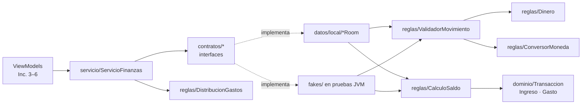
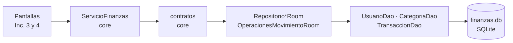

# Mapa del código

Relaciona cada función visible con el archivo que la dibuja, el que recibe la acción, la regla que la decide y el lugar donde se guardan o consultan los datos. **Regla:** solo se escriben como "Existe" las rutas reales; lo demás conserva los nombres planificados en [DISENO_FINANZAS.md](DISENO_FINANZAS.md) y se actualiza al construir su incremento.

Rutas relativas a `finanzas-app/app/src/main/java/gt/edu/umg/finanzas/app/` (app) y `finanzas-core/src/main/kotlin/gt/edu/umg/finanzas/core/` (core). Pruebas: `finanzas-core/src/test/kotlin/...` (JVM) y `finanzas-app/app/src/androidTest/java/.../datos/local/` (Room, en emulador).

> Los IDs pendientes siguen el diseño y la [referencia visual revisada](referencias/INTERFAZ.md). Se comprobarán contra los XML reales al implementar cada pantalla.

## 1. Funciones visibles

Las filas marcadas **Existe** tienen todas sus columnas implementadas. En las demás, la columna Core ya existe (Inc. 1) y la Persistencia sin "(Inc. n)" existe desde el Inc. 2. El detalle de cada acción de pantalla está en la [§4](#4-app-pantallas-incrementos-3-y-4).

| Función visible | Estado | XML / ID | Activity | ViewModel | Core | Persistencia o red |
|---|---|---|---|---|---|---|
| Versión del core en Inicio | **Existe** (Inc. 0, movida al pie de Inicio en el 3) | `res/layout/activity_inicio.xml` · `textoConexionCore` | `ui/inicio/InicioActivity.onCreate` | — | `InfoCore.version` | — (leída de `finanzas-core.properties` dentro del JAR) |
| Ver saldo disponible | **Existe** (Inc. 3) | `activity_inicio.xml` · `textoSaldoDisponible` | `InicioActivity.pintar` | `InicioViewModel.estado` | `servicio/ServicioFinanzas.observarResumen` | `RepositorioUsuarioRoom.observarUsuario` → `UsuarioDao.observarPorId` |
| Ver ingresos, gastos y resultado | **Existe** (Inc. 3) | `textoIngresos`, `textoGastos`, `textoResultado` | `InicioActivity.pintar` | `InicioViewModel.estado` | `ServicioFinanzas.observarResumen`, `ResumenPeriodo.resultadoCentavos` | `RepositorioTransaccionRoom.observarTotales` → `TransaccionDao.observarTotales` |
| Filtrar período en Inicio | **Existe** (Inc. 3; compartido desde el 4) | `chips_periodo.xml` · `grupoPeriodo`, `chipDia` … `chipPersonalizado`, `textoRangoPeriodo` | `ui/comun/ChipsPeriodo` (lo crea `InicioActivity.onCreate`) | `InicioViewModel.seleccionarFiltro`, `seleccionarRango` → `ui/comun/PeriodoGuardado` | `dominio/Periodo.de`, `Periodo.personalizado` | mismas consultas con el nuevo intervalo |
| Dibujar anillo de gastos | **Existe** (Inc. 3) | `graficoGastos` (`GraficoAnilloView`), `textoTotalGastosAnillo`, `contenedorLeyenda`, `textoSinGastos` | `InicioActivity.pintar` → `GraficoAnilloView.mostrar`, `LeyendaGastos.mostrar` | `InicioViewModel.estado` | `reglas/DistribucionGastos.calcular` | `TransaccionDao.observarGastosPorCategoria` |
| Abrir el formulario | **Existe** (Inc. 3) | `barra_navegacion.xml` · `botonAgregarMovimiento` | `NavegacionPrincipal.conectar` → `FormularioActivity.paraRegistrar` | — | — | — |
| Elegir tipo y categoría | **Existe** (Inc. 3) | `activity_formulario.xml` · `grupoTipo`, `listaCategorias` (`item_categoria.xml`) | `FormularioActivity`, `CategoriasAdapter` | `FormularioViewModel.elegirTipo`, `elegirCategoria` | `ServicioFinanzas.observarCategorias` | `CategoriaDao.observarActivasPorTipo` |
| Registrar movimiento | **Existe** (Inc. 3) | `entradaMonto`, `chipSumar5…50`, `entradaFecha`, `entradaDescripcion` · `botonGuardar` | `FormularioActivity` | `FormularioViewModel.guardar` | `reglas/ValidadorMovimiento.validar`, `reglas/CalculoSaldo.deltaCrear` y `aplicar` | `datos/local/OperacionesMovimientoRoom.crear` |
| Ver operaciones | **Existe** (Inc. 4) | `activity_operaciones.xml` · `listaOperaciones` (`item_encabezado_dia.xml`, `item_operacion.xml`), `textoSinOperaciones` | `ui/operaciones/OperacionesActivity.pintar` → `OperacionesAdapter` | `OperacionesViewModel.estado` (`FilaOperacion.agrupar`) | `ServicioFinanzas.observarMovimientos` | `RepositorioTransaccionRoom.observarMovimientos` → `TransaccionDao.observarMovimientos` |
| Filtrar operaciones | **Existe** (Inc. 4) | `grupoTipoFiltro` · `chipTodos`, `chipIngresos`, `chipGastos`; `chips_periodo.xml` | `OperacionesActivity` + `ui/comun/ChipsPeriodo` | `OperacionesViewModel.filtrarTipo`, `seleccionarFiltro`, `seleccionarRango` | `Periodo.de`, `Periodo.personalizado` | misma consulta con tipo e intervalo |
| Ver detalle | **Existe** (Inc. 4) | `dialogo_detalle_movimiento.xml` | `OperacionesActivity.abrirDetalle` → `DetalleMovimientoDialogo` | `OperacionesUiState.movimiento(id)` | — | ya leído en la lista |
| Editar movimiento | **Existe** (Inc. 4) | `dialogo_detalle_movimiento.xml` · `botonEditar` → `activity_formulario.xml` · `botonGuardar` | `DetalleMovimientoDialogo` → `FormularioActivity.paraEditar` | `FormularioViewModel.cargarMovimiento`, `guardar` | `ValidadorMovimiento.validar`, `CalculoSaldo.deltaEditar` | `ServicioFinanzas.obtenerParaEditar` / `editar` → `OperacionesMovimientoRoom.editar` |
| Eliminar movimiento | **Existe** (Inc. 4) | `botonEliminar` → diálogo `ConfirmarEliminacionDialogo` (Cancelar / Eliminar) | `DetalleMovimientoDialogo` → `ConfirmarEliminacionDialogo` | `OperacionesViewModel.eliminar` | `CalculoSaldo.deltaEliminar` | `ServicioFinanzas.eliminar` → `OperacionesMovimientoRoom.eliminar` |
| Navegar con la barra inferior | **Existe** (Inc. 4) | `barra_navegacion.xml` · `botonIrInicio`, `botonAgregarMovimiento`, `botonIrOperaciones` | `ui/comun/NavegacionPrincipal.conectar` (en Inicio y Operaciones) | — | — | — |
| Recalcular saldo | **Existe** (Inc. 5) | `activity_inicio.xml` · `avisoRecalculo`, `textoAvisoRecalculo`, `textoErrorRecalculo`, `botonRecalcularSaldo` | `InicioActivity.onCreate`, `pintar` | `InicioViewModel.recalcularSaldo`, `estado` | `ServicioFinanzas.reconstruirSaldo` → `CalculoSaldo.saldoDesde` | `RepositorioUsuarioRoom` observa la bandera; `ReconstructorSaldoRoom.reconstruirSiPendiente` asigna saldo y apaga bandera en una transacción |
| Cambiar tema | **Existe** (Inc. 5) | `activity_inicio.xml` · `opcionTema`; `strings.xml` · `opciones_tema` (Sistema/Claro/Oscuro) | `InicioActivity` abre `TemaDialogo` (diálogo Material de elección única); este aplica `AppCompatDelegate` | `InicioViewModel.elegirTema`, `estado.tema` | — (preferencia visual) | `datos/preferencias/PreferenciaTema` · SharedPreferences `apariencia`, clave `tema`; `FinanzasApp.onCreate` la aplica al iniciar |
| Consultar tasa | **Existe** (Inc. 6) | `tarjeta_tasa.xml` bajo el anillo · `textoTasa`, `botonReintentarTasa`, `botonConversor` | `InicioActivity.onCreate` observa y pinta `estadoTasa` | `InicioViewModel.actualizarTasa`, `estadoTasa` | `dominio/TasaCambio` | `datos/repositorios/RepositorioTipoCambio` → `datos/remoto/tipocambio/ClienteBanguat` → `ClienteHttp`; `CacheServicios` guarda la última referencia con fecha, fuente e instante de consulta |
| Convertir USD → GTQ o GTQ → USD | **Existe** (Inc. 6) | `dialogo_conversor.xml` · `grupoSentido`, `botonUsdAGtq`, `botonGtqAUsd`, `entradaMontoConversor`, `textoResultadoConversion`, `textoTasaConversor` | `ui/inicio/ConversorDialogo` | `ConversorViewModel.cambiarMonto`, `elegirSentido`, `ConversorUiState.resultado` | `Dinero.desdeTexto` y `ConversorMoneda` mediante `ui/comun/ConversionMonto`; exactamente 2 sentidos | Usa el estado de `RepositorioTipoCambio`; no escribe movimientos |
| Registrar USD y ver el equivalente | **Existe** (Inc. 6) | `activity_formulario.xml` · `grupoMoneda`, `botonMonedaGtq`, `botonMonedaUsd`, `textoTasaFormulario`, `textoConversionPrevia` | `FormularioActivity.conectarAcciones`, `pintar` | `FormularioViewModel.elegirMoneda`, `guardar`; `FormularioUiState.tasa`, `conversionPrevia` | `ValidadorMovimiento` calcula el equivalente y crea `ConversionAplicada` | `OperacionesMovimientoRoom` → `Mapeos.aEntity` → `TransaccionDao`; monto original, tasa decimal, fecha y fuente en Room v2 |
| Ver y editar USD histórico | **Existe** (Inc. 6) | `item_operacion.xml` · `textoOriginalUsd`; `dialogo_detalle_movimiento.xml` · `textoConversionDetalle`; Formulario compartido | `OperacionesAdapter`, `DetalleMovimientoDialogo`, `FormularioActivity` | `FormularioViewModel.cargarMovimiento` conserva moneda y tasa histórica en `SavedStateHandle` | `ConversionAplicada`, `ConversorMoneda`, `ValidadorMovimiento` | `MovimientoFila` trae la fotografía; `Mapeos.aVista` la reconstruye. `OperacionesMovimientoRoom.editar` usa la tasa anterior si sigue en USD |
| Clima de Jutiapa y reintento | **Existe** (Inc. 7) | `tarjeta_clima.xml` · `textoClima`, `textoEstadoClima`, `enlaceOpenMeteo`, `botonReintentarClima`; include `tarjetaClima` bajo tasa | `InicioActivity.pintarClima`; `TextoClima` traduce códigos WMO y formatea fechas/temperatura | `InicioViewModel.estadoClima`, `actualizarClima` | — (temperatura, no dinero) | `RepositorioClima` → `ClienteOpenMeteo` → `ClienteHttp.get` + `LectorRespuestaClima`; `CacheServicios.leerClima/guardarClima` |
| Reflexión del día y actualización | **Existe** (Inc. 7; remoto y respaldo local) | `tarjeta_reflexion.xml` · `textoReflexion`, `textoFuenteReflexion`, `botonReintentarReflexion`; include `tarjetaReflexion` bajo clima | `InicioActivity.pintarReflexion` pinta metadatos/carga/errores y conecta Actualizar/Reintentar | `InicioViewModel.estadoReflexion`, `actualizarReflexion(forzar)` | — | `RepositorioReflexion` → `datos/remoto/reflexion/ClienteDabar` → `ClienteHttp.get` + `LectorRespuestaReflexion`; respaldo `datos/local/CatalogoReflexiones`; `CacheServicios.leerReflexion/guardarReflexion` |
| Ocultar / mostrar reflexión | **Existe** (Inc. 7) | `contenidoReflexion`, `botonVisibilidadReflexion` | `InicioActivity` conecta y pinta visibilidad | `InicioViewModel.cambiarVisibilidadReflexion` | — | `RepositorioReflexion.cambiarVisibilidad` → `CacheServicios.guardarReflexionVisible` |

## 2. Core: qué hace cada clase

Paquetes por responsabilidad: `dominio` guarda datos, `reglas` decide, `contratos` dice qué se necesita del almacenamiento, `servicio` es la puerta de entrada y `resultado` es la forma de responder.

### 2.1 `dominio/` — datos con significado, sin lógica de pantalla

| Archivo | Qué representa | Decisión que conviene defender |
|---|---|---|
| `Transaccion.kt` | Clase sellada con `Ingreso` y `Gasto` | **Herencia**: comparten monto, fecha, categoría y conversión. **Polimorfismo**: `impactoEnSaldo()` da `+monto` o `−monto`. El `init` rechaza montos fuera de 1–999 999 999 centavos y descripciones vacías o de más de 60 caracteres |
| `TipoMovimiento.kt` | `INGRESO`, `GASTO` | Se guarda como texto en la columna `tipo` |
| `Moneda.kt` | `GTQ` (Q) y `USD` (US$) | Solo estas dos; el saldo siempre en GTQ |
| `TasaCambio.kt` | Quetzales por 1 USD, fecha del proveedor y fuente | `BigDecimal` sin recortar; exige tasa > 0 y fuente |
| `ConversionAplicada.kt` | Monto original USD + tasa usada | Fotografía histórica: una tasa nueva no cambia lo guardado |
| `Categoria.kt` | Fila de `Categoria` | `clave` estable sin tildes; `tipo` inmutable; `activa` para archivar |
| `CategoriasIniciales.kt` | `CategoriaInicial` y las 12 categorías sembradas | La usa `InicializadorDatos` en la app |
| `Usuario.kt` | Usuario único, `saldoCentavos`, `reconstruccionPendiente` | El saldo se guarda para no recorrer el historial |
| `DatosMovimiento.kt` | Lo que escribió el usuario, sin validar | El monto llega como texto; la pantalla nunca envía el monto en Q calculado |
| `CampoMovimiento.kt` | Campo con error (`MONTO`, `MONEDA`, `CATEGORIA`, `FECHA`, `DESCRIPCION`) | Permite marcar `campoMonto.error` sin interpretar mensajes |
| `FiltroPeriodo.kt` / `Periodo.kt` | Día, semana, mes, año y rango personalizado | Semana domingo–sábado y zona `America/Guatemala` fijas |
| `TotalesPeriodo.kt`, `TotalCategoria.kt`, `ResumenPeriodo.kt`, `SegmentoGasto.kt`, `MovimientoVista.kt` | Resultados de consultas para Inicio y Operaciones | Campos con nombre, sin `Pair`. Room llena `TotalesPeriodo` y `TotalCategoria` directamente desde el SQL |

### 2.2 `reglas/` — cada regla en un solo lugar

| Archivo · método | Qué decide | Prueba |
|---|---|---|
| `Dinero.desdeTexto` | Texto → centavos. Rechaza coma, signo, espacios internos, más de 2 decimales, cero y montos mayores que 9,999,999.99 | `reglas/DineroTest` (caso f) |
| `Dinero.formatear` | Centavos → `"Q 1,000.00"`, `"-Q 30.00"`, `"US$ 13.05"` | `DineroTest` |
| `ConversorMoneda.usdAGtq` / `gtqAUsd` | Las dos únicas conversiones; `BigDecimal` y un solo redondeo `HALF_UP` al final | `reglas/ConversorMonedaTest` (casos g, i) |
| `ValidadorMovimiento.validar` | Única puerta de datos crudos a `Ingreso`/`Gasto`: tipo de categoría, categoría archivada, monto, tasa USD, fecha no futura y descripción | `reglas/ValidadorMovimientoTest` (parte pura de e) |
| `CalculoSaldo.deltaCrear` / `deltaEditar` / `deltaEliminar` | Cuánto cambia el saldo, usando `impactoEnSaldo()` | `reglas/CalculoSaldoTest` |
| `CalculoSaldo.aplicar` | Saldo final con `Math.addExact`; un desborde da `ErrorNegocio` **antes** de escribir | `CalculoSaldoTest`; en Room, `OperacionesMovimientoRoomTest` (caso j) |
| `CalculoSaldo.saldoDesde` | Saldo desde cero para la reconstrucción | `CalculoSaldoTest` |
| `DistribucionGastos.calcular` | Porcentajes del anillo que suman exactamente 10 000 puntos (mayor residuo) | `reglas/DistribucionGastosTest` (caso h) |
| `dominio/Periodo.de` | Límites de cada filtro | `dominio/PeriodoTest` (caso h) |

### 2.3 `contratos/`, `servicio/` y `resultado/`

| Archivo | Para qué existe | Quién lo implementa o usa |
|---|---|---|
| `contratos/RepositorioUsuario`, `RepositorioCategoria`, `RepositorioTransaccion` | Lecturas con `Flow` (se actualizan solas) y `suspend` puntuales | **Interfaces**: `RepositorioUsuarioRoom`, `RepositorioCategoriaRoom`, `RepositorioTransaccionRoom`; fakes en las pruebas JVM |
| `contratos/OperacionesMovimiento` | Límite atómico de crear, editar y eliminar | `OperacionesMovimientoRoom`; `fakes/OperacionesMovimientoEnMemoria` |
| `contratos/ReconstructorSaldo` | Recalcular solo con la bandera encendida; asigna, no suma | `ReconstructorSaldoRoom` (adelantado al Inc. 3, aviso en el 5); `fakes/ReconstructorSaldoEnMemoria` |
| `servicio/ServicioFinanzas` | Única entrada de los ViewModels: combina saldo y totales, calcula el anillo y delega las escrituras | ViewModels (Inc. 3); `ServicioFinanzasTest` (fakes) y `ServicioSobreRoomTest` (Room) |
| `resultado/Resultado` | `Ok` o `Fallo` (`ErrorNegocio`, `NoEncontrado`, `ErrorAlmacenamiento`) | Todas las reglas y operaciones |

### 2.4 Dobles de prueba (`src/test/.../fakes/`)

`AlmacenEnMemoria` guarda usuario, categorías y movimientos en **un solo valor**; reemplazarlo de una vez imita el COMMIT. Cada fake implementa un contrato y llama a `ValidadorMovimiento` y `CalculoSaldo` sin repetir ningún cálculo. `OperacionesMovimientoEnMemoria` sigue el mismo orden que `OperacionesMovimientoRoom`: leer → validar → comprobar saldo → escribir.

## 3. App: persistencia Room (incremento 2)

### 3.1 Tablas (`datos/local/entidades/`, esquemas en `app/schemas/.../1.json` y `2.json`)

| Archivo | Tabla | Claves e índices | Decisión |
|---|---|---|---|
| `UsuarioEntity.kt` | `Usuario` | PK `idUsuario` (siempre 1) | `saldoCentavos` guardado; `reconstruccionPendiente` con `DEFAULT 0` |
| `CategoriaEntity.kt` | `Categoria` | PK autoincremental; índice **único** en `clave` | El índice único permite sembrar con `INSERT OR IGNORE` sin duplicar |
| `TransaccionEntity.kt` | `Transaccion` | FK `idUsuario` → `Usuario` y `idCategoria` → `Categoria`, ambas `RESTRICT`; índices `fechaEpochDay`, `(tipo, fechaEpochDay)`, `idCategoria`, `idUsuario` | Ingreso y Gasto en una tabla con `tipo`; fecha como `toEpochDay()`. Desde v2 añade `monedaOriginal`, `montoOriginalCentavos`, `tasaGtqPorUsd` (TEXT vía `Convertidores`), `fechaTasaEpochDay`, `fuenteTasa`. Las sumas siguen usando `montoCentavos` en GTQ |

`montoCentavos > 0` no se declara como `CHECK` (Room no lo genera): lo garantiza el `init` de `Transaccion`, que también corre al leer.

### 3.2 DAO (`datos/local/dao/`) — solo SQL

| Método | SQL / uso | Lo llama |
|---|---|---|
| `UsuarioDao.observarPorId` | `Flow` del usuario 1 | `RepositorioUsuarioRoom` |
| `UsuarioDao.obtenerPorId` · `actualizarSaldo` | Lee el saldo y **asigna** el saldo final ya comprobado | `OperacionesMovimientoRoom` |
| `UsuarioDao.insertarSiNoExiste` · `CategoriaDao.insertarSiNoExisten` | `INSERT OR IGNORE` | `InicializadorDatos` |
| `CategoriaDao.observarActivasPorTipo` · `obtenerPorId` | Categorías para elegir; por ID incluye archivadas | `RepositorioCategoriaRoom`, `OperacionesMovimientoRoom` |
| `TransaccionDao.insertar` · `actualizar` · `eliminar` · `obtenerPorId` | Escrituras de un movimiento | Solo `OperacionesMovimientoRoom`, dentro de `withTransaction` |
| `TransaccionDao.observarTotales` | `SUM(CASE tipo …)` del intervalo → `TotalesPeriodo` | `RepositorioTransaccionRoom` |
| `TransaccionDao.observarGastosPorCategoria` | `JOIN` + `GROUP BY` categoría → `TotalCategoria` | `RepositorioTransaccionRoom` |
| `TransaccionDao.observarMovimientos` | `JOIN` con filtro de tipo opcional, fecha descendente → `MovimientoFila` | `RepositorioTransaccionRoom` |

### 3.3 Implementaciones y construcción (`datos/local/` y raíz del paquete)

| Archivo | Responsabilidad |
|---|---|
| `AppDatabase.kt` | `@Database` v2 con las mismas 3 entidades, `Convertidores`, `exportSchema = true` y `addMigrations(Migracion1a2)`. **Sin** `fallbackToDestructiveMigration` |
| `Migracion1a2.kt` | Cinco `ADD COLUMN` y copia `montoOriginalCentavos = montoCentavos` para los registros GTQ de v1. No cambia saldos, importes, categorías, IDs ni la bandera de reconstrucción |
| `Convertidores.kt` | `BigDecimal` ↔ TEXT mediante `toPlainString`; no pasa por `Double` |
| `Mapeos.kt` | Único archivo que convierte entity ↔ dominio. `aDominio()` reconstruye `Ingreso` o `Gasto` según `tipo` |
| `RepositorioUsuarioRoom`, `RepositorioCategoriaRoom`, `RepositorioTransaccionRoom` | Cumplen los contratos de lectura; traducen `Periodo` a días epoch |
| `OperacionesMovimientoRoom.kt` | **Único** `withTransaction` de movimientos. Lee categoría → `ValidadorMovimiento.validar` → `CalculoSaldo.aplicar` → escribe movimiento y saldo, incluida la fotografía USD en v2. Antes de escribir devuelve un `Fallo`; después, cualquier anomalía lanza y Room revierte. Al editar USD toma la tasa del registro anterior; pasar a GTQ elimina la conversión |
| `InicializadorDatos.kt` | Usuario 1 y 12 categorías en un `withTransaction`; idempotente |
| `ReconstructorSaldoRoom.kt` | Adelantado en el Inc. 3 porque `ServicioFinanzas` lo necesita. Solo con `reconstruccionPendiente`: lee el historial una vez (`TransaccionDao.obtenerTodas`), calcula con `CalculoSaldo.saldoDesde`, **asigna** el saldo y apaga la bandera (`UsuarioDao.marcarReconstruccion`) en el mismo `withTransaction` |
| `Dependencias.kt` | Decide qué clase Room cumple cada contrato, arma `servicio` y crea la única `PreferenciaTema` del proceso |
| `FinanzasApp.kt` | `Application` (declarada en el manifiesto): crea `Dependencias`, aplica el tema guardado antes de abrir pantallas y lanza la siembra; deja el resultado en `inicializacion` |

### 3.4 Pruebas instrumentadas (`app/src/androidTest/.../datos/local/`)

| Prueba | Qué comprueba | Caso §14.1 |
|---|---|---|
| `ServicioSobreRoomTest` | Recorrido servicio → contrato → Room → SQLite; totales, anillo 6000/4000, movimientos ordenados y nueva emisión del `Flow` tras guardar | a, b, h |
| `OperacionesMovimientoRoomTest` | `UsuarioDaoQueFalla` lanza al guardar el saldo; FK y `RESTRICT`; datos inválidos sin escribir; `NoEncontrado` | c, j |
| `PersistenciaTest` | Archivo SQLite propio, cerrar y reabrir | d |
| `InicializadorDatosTest` | 1 usuario y 12 categorías tras sembrar dos veces; el saldo no se reinicia | — |
| `ReconstructorSaldoRoomTest` | Saldo erróneo corregido y bandera apagada; segunda llamada sin cambios; sin bandera no toca un saldo en cero; `UsuarioDaoQueFallaAlApagar` revierte saldo y bandera | §9.6 |

`BaseDePrueba.servicioSobre` arma `ServicioFinanzas` con las mismas clases Room que `Dependencias`.

## 4. App: pantallas (incrementos 3 a 7)

Cada capa tiene un solo trabajo: el **XML** declara las vistas y sus IDs; la **Activity** conecta toques y texto con el ViewModel y dibuja su estado; el **ViewModel** guarda el estado (y lo copia a `SavedStateHandle`) y llama al servicio; **ServicioFinanzas** y el core validan y calculan; **Room** guarda y avisa con `Flow`.

### 4.1 Inicio y Formulario: qué archivo responde a cada acción

| Acción visible | XML / ID | Activity (método) | ViewModel (método) | Servicio → Room |
|---|---|---|---|---|
| Ver saldo, ingresos, gastos y resultado | `activity_inicio.xml` · `textoSaldoDisponible`, `textoIngresos`, `textoGastos`, `textoResultado` | `InicioActivity.pintar` | `InicioViewModel.estado` | `observarResumen` → `UsuarioDao.observarPorId` + `TransaccionDao.observarTotales` |
| Tocar Día/Semana/Mes/Año | `chips_periodo.xml` · `chipDia`, `chipSemana`, `chipMes`, `chipAnio` | `ChipsPeriodo` (creado en `InicioActivity.onCreate`) | `seleccionarFiltro` → `PeriodoGuardado.elegirFiltro` | las mismas consultas con el nuevo `Periodo` |
| Tocar Período (rango) | `chipPersonalizado` → `MaterialDatePicker` | `ChipsPeriodo.abrirSelectorRango`, `conectar` | `seleccionarRango` → `PeriodoGuardado.elegirRango` | `Periodo.personalizado` |
| Ver anillo y leyenda | `graficoGastos`, `textoTotalGastosAnillo`, `contenedorLeyenda` (`item_leyenda_gasto.xml`), `textoSinGastos` | `pintar` → `GraficoAnilloView.mostrar`, `LeyendaGastos.mostrar` | `estado.segmentos` | `observarDistribucionGastos` → `TransaccionDao.observarGastosPorCategoria` |
| Añadir | `barra_navegacion.xml` · `botonAgregarMovimiento` | `NavegacionPrincipal.conectar` → `FormularioActivity.paraRegistrar` | — | — |
| Gasto / Ingreso | `activity_formulario.xml` · `grupoTipo` | `FormularioActivity.conectarAcciones` | `elegirTipo` (borra la categoría elegida) | `observarCategorias` → `CategoriaDao.observarActivasPorTipo` |
| Escribir monto | `entradaMonto` en `campoMonto` | `doAfterTextChanged` | `onMontoCambiado` | — (se valida al guardar) |
| +5/+10/+20/+50 | `chipSumar5`, `chipSumar10`, `chipSumar20`, `chipSumar50` | `conectarAcciones` | `sumar` → `Dinero.desdeTexto` y `Dinero.aTexto` | — |
| Elegir categoría | `listaCategorias` · `item_categoria.xml` | `CategoriasAdapter.onBindViewHolder` | `elegirCategoria` | — |
| Elegir fecha | `entradaFecha` / icono de `campoFecha` → `MaterialDatePicker` | `abrirSelectorFecha` | `elegirFecha` | — |
| Escribir descripción | `entradaDescripcion` en `campoDescripcion` (contador = `Transaccion.DESCRIPCION_MAXIMA`) | `doAfterTextChanged` | `onDescripcionCambiada` | — |
| Guardar | `botonGuardar` | `conectarAcciones`; `pintar` lo deshabilita mientras `guardando` o `cargandoMovimiento` | `guardar` (sin `idEnEdicion` registra; con él edita) | `registrar` → `OperacionesMovimientoRoom.crear`, o `editar` → `OperacionesMovimientoRoom.editar` |
| Ver errores | `campoMonto.error`, `campoFecha.error`, `campoDescripcion.error`, `textoErrorCategoria`, `textoErrorGeneral` | `pintar` | `estado.errores` (mensajes del core por `CampoMovimiento`) | `ValidadorMovimiento.validar` |
| Cancelar / Volver | `botonCancelar`, `botonVolver` | `finish()` | — | — |

### 4.2 Operaciones (incremento 4): qué archivo responde a cada acción

| Acción visible | XML / ID | Activity o diálogo (método) | ViewModel (método) | Servicio → Room |
|---|---|---|---|---|
| Ir a Operaciones | `barra_navegacion.xml` · `botonIrOperaciones` | `NavegacionPrincipal.conectar` (desde Inicio abre `OperacionesActivity`; en Operaciones no hace nada) | — | — |
| Ver la lista agrupada por día | `activity_operaciones.xml` · `listaOperaciones` con `item_encabezado_dia.xml` y `item_operacion.xml` | `OperacionesActivity.pintar` → `OperacionesAdapter.submitList` | `estado.filas` (`FilaOperacion.agrupar`) | `observarMovimientos(periodo, tipo)` → `TransaccionDao.observarMovimientos` |
| Ver estado vacío | `textoSinOperaciones` | `pintar` (visible si no carga y no hay filas) | `estado.cargando`, `estado.filas` | — |
| Filtrar por tipo | `grupoTipoFiltro` · `chipTodos`, `chipIngresos`, `chipGastos` | `onCreate` (clics) y `pintar` (marca el chip) | `filtrarTipo` (null = Todos, guardado en `SavedStateHandle`) | la misma consulta con `tipo` |
| Filtrar por período | `chips_periodo.xml` (el mismo de Inicio) | `ChipsPeriodo` | `seleccionarFiltro`, `seleccionarRango` → `PeriodoGuardado` | la misma consulta con el nuevo intervalo |
| Ver detalle | toque en una fila → `dialogo_detalle_movimiento.xml` | `OperacionesActivity.abrirDetalle` → `DetalleMovimientoDialogo.pintar` | `estado.movimiento(id)` | ya leído en la lista |
| Editar | `botonEditar` del detalle | `DetalleMovimientoDialogo` → `FormularioActivity.paraEditar(id)` | `FormularioViewModel.cargarMovimiento`, `guardar` | `obtenerParaEditar`, `editar` → `OperacionesMovimientoRoom.editar` |
| Eliminar | `botonEliminar` del detalle → `ConfirmarEliminacionDialogo` | Cancelar (`setNegativeButton`, sin acción) / Eliminar (`setPositiveButton`) | `eliminar` (solo desde Eliminar) | `eliminar` → `OperacionesMovimientoRoom.eliminar` |
| Aviso tras eliminar | `Snackbar` sobre la barra inferior | `pintar` → `avisoMostrado` | `estado.aviso` (`ELIMINADO`, `NO_SE_PUDO_ELIMINAR`) | — |
| Volver a Inicio | `botonIrInicio` o atrás | `NavegacionPrincipal.conectar` → `finish()` | — | Inicio ya está observando y repinta solo |

### 4.3 Archivos de pantalla

| Archivo | Responsabilidad |
|---|---|
| `ui/inicio/InicioActivity.kt` | Infla `activity_inicio.xml`, conecta período, navegación, recálculo y selector de tema. `pintar` formatea montos y muestra anillo, aviso, progreso y error; no escribe datos |
| `ui/inicio/InicioViewModel.kt`, `InicioUiState.kt` | Conserva período en `SavedStateHandle`; observa resumen, anillo, bandera del usuario y tema. `EstadoRecalculo` guarda operación en curso y error, sobrevive a recreación e impide llamadas simultáneas; `recalcularSaldo` delega en el servicio y `elegirTema` en preferencias |
| `ui/inicio/TemaDialogo.kt` | `DialogFragment` con opciones de `R.array.opciones_tema`; marca `estado.tema`, envía la elección al ViewModel y aplica `AppCompatDelegate`, que recrea las Activities |
| `datos/preferencias/PreferenciaTema.kt` | `Tema` define los tres modos Android. Lee y guarda una sola clave en SharedPreferences; expone `StateFlow<Tema>` al ViewModel. Sistema es el valor inicial si no hay preferencia válida |
| `ui/operaciones/OperacionesActivity.kt` | Recibe los filtros y el toque en una fila; `pintar` entrega las filas al adaptador, marca los chips y muestra el aviso de una sola vez |
| `ui/operaciones/OperacionesViewModel.kt`, `OperacionesUiState.kt` | `combine(período, tipo)` → `flatMapLatest` sobre `observarMovimientos`; `eliminar` traduce el `Resultado` a `AvisoOperaciones`. `FiltrosOperaciones` y `movimiento(id)` viven en el estado |
| `ui/operaciones/FilaOperacion.kt` | `EncabezadoDia` o `Movimiento`; `agrupar` inserta un encabezado cada vez que cambia la fecha (la consulta ya llega ordenada) |
| `ui/operaciones/OperacionesAdapter.kt` | Dos tipos de fila con `DiffUtil`; icono y color de la categoría, monto con signo y descripción accesible con la fecha |
| `ui/operaciones/DetalleMovimientoDialogo.kt`, `ConfirmarEliminacionDialogo.kt` | `DialogFragment` (sobreviven a la rotación) que leen el `OperacionesViewModel` de la Activity; el detalle se cierra solo si el movimiento desaparece |
| `ui/comun/ChipsPeriodo.kt`, `PeriodoGuardado.kt` | Chips de período y selector de rango compartidos por Inicio y Operaciones; la selección (`SeleccionPeriodo`) se guarda en `SavedStateHandle` |
| `ui/comun/NavegacionPrincipal.kt` | Único lugar que conecta `barra_navegacion.xml`: pila Inicio → Operaciones → Formulario, destino actual en amarillo y `isSelected` |
| `ui/comun/MontoConSigno.kt` | "+Q"/"-Q", color y nombre del tipo; lo usan la lista, el detalle y la confirmación |
| `ui/inicio/GraficoAnilloView.kt` | Solo dibuja arcos con los puntos básicos recibidos y los colores de `RecursosCategoria` |
| `ui/inicio/LeyendaGastos.kt` | Filas con icono, nombre, porcentaje e importe; el anillo no depende solo del color |
| `ui/formulario/FormularioActivity.kt` | `paraRegistrar` / `paraEditar` arman el `Intent`. Envía cada cambio al ViewModel; reescribe un campo solo si su texto difiere, para no mover el cursor; se cierra con `guardadoExitoso` |
| `ui/formulario/FormularioViewModel.kt`, `FormularioUiState.kt` | Campos crudos y errores por campo; copia los campos a `SavedStateHandle`; en edición carga el movimiento una sola vez (`movimientoCargado`); `guardar` ignora el segundo toque (`guardando` / `guardadoExitoso`) |
| `ui/formulario/CategoriasAdapter.kt` | Cuadrícula de 4 columnas; marca la elegida con color y descripción accesible "…, seleccionada" |
| `ui/comun/RecursosCategoria.kt` | Clave → icono y color; genérico para una clave desconocida |
| `ui/comun/Fechas.kt`, `BarrasSistema.kt` | Formato dd/MM/yyyy, encabezado "Viernes 23/10/2026" (`textoDia`, en español) y milisegundos UTC del selector; espacio para barras del sistema y teclado (targetSdk 36 dibuja bajo ellas) |
| `res/values/colors.xml`, `res/values-night/colors.xml`, `themes.xml` | Colores por uso (`color_cabecera`, `color_ingreso`, `color_gasto`…) redefinidos para el tema oscuro; tema `Material3.DayNight` |

### 4.4 Rotación, tema y doble toque

- **Rotación o cambio de tema:** la Activity se recrea y el ViewModel sobrevive. La Activity vuelve a pintar desde `estado`, y los selectores abiertos recuperan sus acciones por etiqueta. En Operaciones, el detalle y la confirmación son `DialogFragment`: Android los vuelve a crear y leen el mismo ViewModel. Los filtros de tipo y período se guardan en `SavedStateHandle`.
- **Segundo detalle con interacción propia:** pendiente de la prueba del usuario en el emulador. Los recorridos automatizados de giro y edición no cierran esa observación.
- **Letra grande:** `FormularioActivity.columnasCategorias` usa 4 columnas con letra normal y 3 o 2 cuando la escala no deja unos 80 dp por nombre. Las etiquetas de la barra (`Widget.Finanzas.EtiquetaBarra`) y el centro del anillo se reducen solo lo necesario para no partirse ni salirse.
- **Edición:** el movimiento se carga de Room una sola vez; la bandera `movimientoCargado` evita que una rotación borre lo que ya se cambió.
- **Estado guardado (muerte del proceso):** tipo, monto, categoría, fecha y descripción se copian a `SavedStateHandle` y un ViewModel nuevo los lee de ahí; las categorías se vuelven a consultar a Room. Además de `FormularioViewModelTest` con estado precargado, se ejecutó la muerte real con `am kill` tras enviar la tarea a segundo plano y se recuperó desde Recientes: alta y edición GTQ, campos restaurados, PID nuevo y mismo ID al guardar la edición. Resultados y alcance en README → Revisión final de pendientes.
- **Doble toque:** `FormularioViewModel.guardar` retorna si `guardando` o `guardadoExitoso` ya están activos, y el botón se deshabilita.
- **Tema (Inc. 5):** `opcionTema` abre `TemaDialogo`; `elegirTema` guarda la elección en SharedPreferences. El diálogo aplica `AppCompatDelegate` y `FinanzasApp` repite esa aplicación al iniciar otro proceso. El recálculo en curso y su error viven en el ViewModel; el aviso pendiente viene de Room, por lo que reaparece incluso después de cerrar la app si aún no se completó.

### 4.5 Pruebas de interfaz (`app/src/androidTest/.../ui/`)

| Prueba | Qué comprueba |
|---|---|
| `RecorridoInicioFormularioTest.registrar_ingreso_y_gasto_actualiza_inicio_y_se_conserva_al_reabrir` | Q 0 → ingreso Q 100 → gasto Q 30: saldo Q 70, totales, resultado y centro del anillo; cerrar y abrir Inicio conserva Q 70 |
| `…doble_toque_en_guardar_registra_un_solo_movimiento` | `doubleClick` en Guardar → 1 movimiento en Room |
| `…rotar_y_cambiar_a_tema_oscuro_conservan_lo_escrito` | Horizontal y luego `MODE_NIGHT_YES`: monto, descripción, tipo y categoría siguen iguales |
| `…errores_claros_sin_categoria_y_con_coma_decimal` | "Elige una categoría" y "Usa punto para los decimales"; no se escribe nada |
| `…las_categorias_se_filtran_por_tipo` | Gasto muestra Alimentación y no Salario; Ingreso, al revés |
| `…los_botones_rapidos_suman_al_monto` | 2.50 + 10 + 5 = 17.50 |
| `FormularioViewModelTest.recupera_los_campos_desde_un_estado_guardado` | Un ViewModel creado con un `SavedStateHandle` precargado muestra esos campos (no mata un proceso real) |
| `RotacionDialogosTest.detalle_permanece_al_girar_y_editar_conserva_el_movimiento` | Giro real 0° → 90° → 0° con detalle abierto, mismos datos; Editar carga el gasto correcto y la base sigue en 2 movimientos/Q 70 |
| `RotacionDialogosTest.confirmacion_rotada_permite_cancelar_sin_borrar`, `…confirmacion_rotada_elimina_una_sola_vez` | Confirmación abierta durante giro real; Cancelar no cambia filas/saldo y Eliminar borra una sola vez. `UiAutomation.waitForIdle` espera que termine la transición antes de tocar |
| `FormularioViewModelTest.en_edicion_carga_el_movimiento_y_guarda_con_editar` | Con un ID en edición, el formulario se llena desde Room y Guardar cambia ese movimiento sin crear otro |
| `FormularioViewModelTest.editar_un_id_que_ya_no_existe_avisa_y_no_inserta` | Un ID borrado muestra el aviso y no inserta nada |
| `RecorridoOperacionesTest.lista_vacia_muestra_el_aviso` | Sin movimientos aparece `textoSinOperaciones` |
| `…filtros_por_tipo_y_periodo` | Ingresos, Gastos, Día y Todos se combinan con el período |
| `…editar_importe_y_tipo_actualiza_operaciones_e_inicio` | Gasto Q 30 → ingreso Q 45 desde el detalle; la fila cambia y Inicio muestra Q 145.00 |
| `…caso_a_editar_y_eliminar_el_gasto_desde_operaciones` | Caso a de §14.1 desde la pantalla: Q 70 → Q 80 (gasto editado a Q 20) → Q 100 (gasto eliminado) |
| `…cancelar_la_eliminacion_no_borra_y_confirmar_si` | Cancelar deja 3 movimientos; Eliminar deja 2 e Inicio vuelve a Q 70.00 |
| `…la_barra_inferior_va_y_vuelve_sin_apilar_pantallas` | Tocar Operaciones dentro de Operaciones no hace nada; Inicio la cierra |

### 4.6 Archivos del incremento 6

| Archivo | Responsabilidad y datos |
|---|---|
| `datos/remoto/ClienteHttp.kt` | POST HTTPS en `Dispatchers.IO`, conexión/lectura de 10 s, límite de 256 KiB y rechazo de HTTP fuera de 2xx; cierra conexión y streams |
| `datos/remoto/tipocambio/ClienteBanguat.kt` | URL y sobre SOAP 1.1 comprobados con el servicio oficial; consulta y lectura XML fuera del hilo principal |
| `datos/remoto/tipocambio/LectorRespuestaBanguat.kt` | Sigue Envelope/Body/TipoCambioDiaResponse/TipoCambioDiaResult/CambioDolar/VarDolar en sus espacios XML. Rechaza DTD, campos ausentes/repetidos, fecha inválida y tasa no positiva; crea `BigDecimal` desde texto |
| `datos/preferencias/CacheServicios.kt` | SharedPreferences `servicios`: tasa como texto exacto, fecha del proveedor, fuente y momento de consulta. No contiene movimientos ni saldos |
| `datos/repositorios/RepositorioTipoCambio.kt` | `EstadoTasa` expone dato, carga, origen guardado y error. Reutiliza la consulta del día en Guatemala; un reintento explícito puede forzar otra. `Mutex` serializa consultas. Si falla, conserva la tasa guardada o deja la ausencia explícita |
| `ui/comun/TextoTasa.kt` | Formatea fuente, fecha del proveedor, fecha/hora de consulta y avisos «guardada», «última disponible» y error; no convierte montos |
| `ui/comun/ConversionMonto.kt` | `SentidoConversion` tiene solo USD_A_GTQ y GTQ_A_USD. Adapta texto al core para conversor y vista previa; ninguna fórmula monetaria vive aquí |
| `ui/inicio/ConversorViewModel.kt`, `ConversorDialogo.kt` | Monto y sentido en `SavedStateHandle`; observa tasa y presenta resultado del core en el XML del diálogo |
| `ui/formulario/FormularioViewModel.kt` | Observa la tasa disponible antes de guardar; conserva la histórica al editar. Envía texto, moneda y tasa en `DatosMovimiento`. Guardar nunca espera una consulta de red |

| Prueba | Comportamiento comprobado |
|---|---|
| `datos/local/Migracion1a2Test.kt` | `MigrationTestHelper` crea v1 con saldo Q 70, bandera activa, 12 categorías (una archivada) y 2 movimientos; valida esquema v2, conservación, FK y lectura por DAO después de reabrir |
| `datos/local/MovimientosUsdTest.kt` | Caso e: US$ 10 × 7.66000 → 7660, original 1000 y fotografía exacta. Edición con referencia nueva conserva la histórica; US$ 12 → 9192; eliminar revierte a cero. USD → GTQ borra la fotografía |
| `datos/remoto/BanguatTest.kt` | Fixture real y rechazos de XML, sin petición real ni dependencia del servicio |
| `datos/remoto/BanguatEnVivoTest.kt` | Petición HTTPS al servicio oficial desde Android; solo con `-PpruebasEnVivo` |
| `datos/repositorios/RepositorioTipoCambioTest.kt` | Fallo sin caché, recuperación de tasa guardada con metadatos, una consulta por día y lectura tras crear otro repositorio |
| `ui/RecorridoUsdTest.kt` | Casos e e i desde la pantalla, edición histórica, conservación del conversor al recrear y registro GTQ/USD con wifi y datos del emulador desactivados; restaura la conectividad |

La suite usa `-PdatosPrueba`: instala `gt.edu.umg.finanzas.app.pruebas`. `AyudaInterfaz.baseLimpia` rechaza ejecutarse sobre el paquete normal. El APK normal y la instalación de uso diario conservan `gt.edu.umg.finanzas.app`. Los resultados reales de cada ejecución viven en el README.

### 4.7 Archivos del incremento 7

| Archivo (app) | Responsabilidad |
|---|---|
| `res/layout/tarjeta_clima.xml`, `tarjeta_reflexion.xml`; `res/values/strings_servicios.xml` | Controles, textos y enlace; colores y estilo de tarjeta existentes. `activity_inicio.xml` ordena tasa → clima → reflexión bajo las finanzas |
| `ui/inicio/InicioActivity.kt`, `TextoClima.kt` | La Activity conecta botones y observa los tres estados por separado. El helper traduce WMO y formatea temperatura/fechas; no consulta ni guarda |
| `ui/inicio/InicioViewModel.kt` | Expone estados de tasa/clima/reflexión, inicia corrutinas independientes, recibe reintentos y visibilidad. El resumen financiero conserva su flujo Room |
| `datos/remoto/ClienteHttp.kt` | GET y POST HTTPS con los mismos límites de tiempo/tamaño. El POST SOAP de Banguat conserva su contrato |
| `datos/remoto/clima/ClienteOpenMeteo.kt`, `LectorRespuestaClima.kt`, `ClimaJutiapa.kt` | URL con coordenadas verificadas, petición, validación JSON y dato meteorológico. No hay geolocalización del dispositivo |
| `datos/repositorios/RepositorioClima.kt` | Estado de carga/dato guardado/error; vigencia de 30 minutos, reintento forzado, conservación del dato ante fallo y propagación de cancelación |
| `datos/local/CatalogoReflexiones.kt` | Tres citas RV1909 de dominio público y selección por fecha. Texto, referencia, traducción y fuente nombrados |
| `datos/remoto/reflexion/ClienteDabar.kt`, `LectorRespuestaReflexion.kt` | URL Dabar con la referencia en español y `rv1909`; HTTP/JSON fuera del hilo principal. Exige un versículo, traducción/licencia y referencia correctas, texto no nulo ni HTML. Devuelve el mismo modelo `Reflexion` del catálogo, con fuente Dabar.io |
| `datos/repositorios/RepositorioReflexion.kt` | Una cita por fecha de Guatemala, local o remota; consulta el pasaje elegido por el catálogo, guarda la respuesta o el respaldo local y distingue carga/error de consulta/error de guardado. Si `estado.error` indica un fallo de persistencia, no acepta como caché guardada el valor que SharedPreferences dejó solo en memoria; otra entrada o reintento vuelve a intentar guardar. Reintento explícito con `forzar`; visibilidad persistente. Ninguna regla monetaria |
| `datos/preferencias/CacheServicios.kt` | SharedPreferences `servicios`: `climaTemperatura`, `climaCodigo`, `climaMedidoEn`, `climaConsultadoEn`; `reflexionTexto`, `reflexionReferencia`, `reflexionTraduccion`, `reflexionFuente`, `reflexionFecha`, `reflexionVisible`. Guardado atómico de cada dato con `commit` fuera del hilo principal; visibilidad con `apply`. No movimientos ni saldos |
| `Dependencias.kt` | Construye repositorios con la misma caché; sin nuevas capas ni librerías |
| `app/build.gradle.kts`, `androidTest/.../PruebaEnVivo.kt` | Sin `pruebasEnVivo`, excluye peticiones reales; con la propiedad ejecuta solo las anotadas. `datosPrueba` mantiene el paquete separado |

Pruebas relativas a `app/src/androidTest/java/gt/edu/umg/finanzas/app/`:

| Archivo | Comportamiento comprobado |
|---|---|
| `datos/remoto/BanguatTest.kt`, `ClimaTest.kt` | Lectores con respuestas reales guardadas y rechazos de respuestas incompletas/incompatibles, sin internet |
| `datos/repositorios/RepositorioClimaTest.kt` | Sin caché, conservación del dato al fallar, reintento que recupera, reapertura, límite de 30 min y cancelación durante carga |
| `datos/remoto/ReflexionTest.kt`, `RespuestaDabarGuardada.kt` | Tres respuestas reales RV1909; rechazo de otra traducción/licencia/referencia, varios versículos, nulos, HTML y contenido incoherente. El helper solo carga fixtures reales, sin acceso HTTP |
| `datos/repositorios/RepositorioReflexionTest.kt` | Misma cita y una consulta automática por día, reapertura, siguiente día, respaldo local, recuperación al reintentar, conservación de una remota válida ante fallo, cancelación y ocultar/mostrar persistente |
| `datos/repositorios/FalloGuardadoReflexionTest.kt` | Fallo físico de `commit`: permisos de carpeta quitados temporalmente en almacenamiento Android de prueba separado. Comprueba error de guardado (no de consulta), XML anterior intacto, reentrada sin ocultar el error y persistencia real al restaurar permisos y reintentar. `finally` restaura los permisos; no cambia preferencias de tema/tasa/clima |
| `ui/RecorridoReflexionTest.kt` | Sin red: cita remota guardada conserva texto/referencia/traducción/fuente al reintentar y recrear Inicio en claro/oscuro; sin caché usa y guarda la fuente local correcta |
| `ui/RecorridoTarjetasTest.kt` | Sin red: clima vacío o guardado con error/reintento; reflexión disponible y ocultable; conversor y registro GTQ siguen funcionando |
| `datos/remoto/BanguatEnVivoTest.kt`, `OpenMeteoEnVivoTest.kt` | Contratos reales desde Android, ejecutados separadamente de la suite habitual |
| `datos/remoto/DabarEnVivoTest.kt` | Petición real de Filipenses 4:13 RV1909 desde Android; selección independiente con `PruebaEnVivo` y el filtro de clase |

Fixtures en `app/src/androidTest/assets/openmeteo/`, `banguat/`, `dabar/` (catálogo y tres versículos) y catálogo real de traducciones en `bolls/` como evidencia del descarte anterior. [Procedencia, licencias y comandos](referencias/SERVICIOS_INCREMENTO_7.md). Core 0.3.0, DAO, migración y esquema Room v2 no cambian.

## 5. Recorridos reales

Las pruebas del Inc. 5 están en `app/src/androidTest/.../ui/RecorridoSaldoTemaTest.kt`: aviso conservado al recrear Inicio, Q 1.23 erróneo → Q 70.00 desde dos movimientos, bandera apagada y repetición sin cambios; fallo SQLite real al apagar la bandera con rollback y reintento desde el mismo botón; saldo cero sin bandera no muestra el aviso; selector de las tres opciones persistidas, opción marcada al reabrir y recursos claros/oscuros en Inicio y Formulario. Los resultados ejecutados y las limitaciones del recorrido visual están en [README](../README.md#estado-real).

### 5.1 Incremento 0: conexión core → JAR → Android (ejecutado)
1. `finanzas-core/pom.xml` copia `<version>` en `finanzas-core.properties` y compila con destino JVM 11.
2. `mvn clean install` deja el JAR en `~/.m2/repository/gt/edu/umg/finanzas/finanzas-core/<versión>/`.
3. `settings.gradle.kts` solo busca el grupo `gt.edu.umg.finanzas` en `mavenLocal()`. `libs.versions.toml` fija `finanzasCore = "0.3.0"`.
4. `InicioActivity` escribe `InfoCore.version` en `textoConexionCore`, al pie de Inicio.

### 5.2 Incremento 2: registrar un gasto en Room (ejecutado en pruebas instrumentadas)
1. `ServicioFinanzas.registrar(datos, hoy)` delega en el contrato `OperacionesMovimiento.crear`; `Dependencias` lo cumple con `OperacionesMovimientoRoom`.
2. `withTransaction` empieza. `CategoriaDao.obtenerPorId` lee la categoría.
3. `ValidadorMovimiento.validar` convierte `"30"` en 3000 centavos y construye un `Gasto`. Un error devuelve `ErrorNegocio` sin escribir.
4. `UsuarioDao.obtenerPorId` lee el saldo y `CalculoSaldo.aplicar` calcula el final con `Math.addExact`. Un desborde devuelve `ErrorNegocio` sin escribir.
5. `TransaccionDao.insertar` y luego `UsuarioDao.actualizarSaldo`. Si el segundo falla, la excepción revierte también el INSERT (caso c).
6. COMMIT. Room invalida las tablas y `observarResumen` vuelve a emitir con el saldo nuevo.

### 5.3 Incremento 3: registrar desde la pantalla (ejecutado en el emulador)
1. Inicio → toque en `botonAgregarMovimiento`: `InicioActivity` abre `FormularioActivity`.
2. Cada toque o texto llega a `FormularioViewModel` (`elegirTipo`, `onMontoCambiado`, `elegirCategoria`, `onDescripcionCambiada`), que lo copia a `SavedStateHandle`.
3. `botonGuardar` → `FormularioViewModel.guardar`: arma `DatosMovimiento` con el texto crudo y llama a `ServicioFinanzas.registrar`; desde ahí sigue el recorrido 5.2.
4. Con `Resultado.Ok`, el estado pasa a `guardadoExitoso` y la Activity hace `finish()`. Con `ErrorNegocio`, el mensaje del core aparece en el campo indicado por `CampoMovimiento`.
5. Room invalida las tablas; `InicioViewModel.estado` vuelve a emitir y `InicioActivity.pintar` muestra el saldo, los totales y el anillo nuevos sin recargar.

Capturas del emulador: [Inicio](referencias/capturas/inc3-inicio-con-datos.png), [Formulario](referencias/capturas/inc3-formulario-vacio.png), [Inicio oscuro](referencias/capturas/inc3-inicio-oscuro.png), [Formulario oscuro](referencias/capturas/inc3-formulario-oscuro.png).

### 5.4 Incremento 4: editar y eliminar desde Operaciones
1. Inicio → `botonIrOperaciones`: `NavegacionPrincipal` abre `OperacionesActivity`. `OperacionesViewModel` combina período y tipo y observa `ServicioFinanzas.observarMovimientos`; `FilaOperacion.agrupar` intercala un encabezado por día.
2. Toque en una fila → `DetalleMovimientoDialogo` con categoría, monto con signo, tipo, fecha y descripción.
3. **Editar** → `FormularioActivity.paraEditar(id)`. `FormularioViewModel.cargarMovimiento` llama a `ServicioFinanzas.obtenerParaEditar` y llena los campos. Guardar llama a `ServicioFinanzas.editar`; `OperacionesMovimientoRoom.editar` lee el anterior, valida el nuevo, calcula `CalculoSaldo.deltaEditar` y escribe movimiento y saldo en un solo `withTransaction`.
4. **Eliminar** → `ConfirmarEliminacionDialogo`. Cancelar solo cierra el diálogo. Eliminar llama a `OperacionesViewModel.eliminar` → `ServicioFinanzas.eliminar` → `OperacionesMovimientoRoom.eliminar` (borra y aplica `deltaEliminar` en la misma transacción).
5. Tras cada COMMIT, Room vuelve a emitir: la lista de Operaciones y el Inicio que quedó debajo se repintan sin recargar. Atrás o `botonIrInicio` cierran Operaciones.

### 5.5 Incremento 7: clima y reflexión independientes

1. Al abrir Inicio, el ViewModel carga clima y reflexión en corrutinas propias. Las tarjetas se dibujan después de tasa; las consultas del saldo no esperan HTTP.
2. `RepositorioClima` lee la caché: si tiene menos de 30 min la presenta con fechas; si no, consulta Open-Meteo. Un error conserva el dato anterior o deja el estado vacío. `botonReintentarClima` fuerza otra consulta.
3. `RepositorioReflexion` conserva la cita de hoy guardada o consulta Dabar para el pasaje del día. Si falla, usa el respaldo local de hoy; cada texto conserva su propia fuente y traducción. El botón Actualizar/Reintentar puede forzar la consulta. Ocultar cambia solo `reflexionVisible`; al mostrar vuelve la misma cita. Bolls sigue descartado y Dabar es el único proveedor remoto.
4. Ejecutado en API 37: suite habitual **56/56 con wifi/datos desactivados** y suite en vivo **2/2** (Banguat/Open-Meteo), sin fallos ni omitidas. Los recorridos de UI mantienen conversor y registro GTQ ante fallo del clima. Revisión visual y capturas: [INTERFAZ](referencias/INTERFAZ.md).
5. Continuación de reflexión: suite habitual **65/65 sin red**, incluidos lector Dabar con tres respuestas reales, caché/fallback/reintento/cancelación y UI clara/oscura. **DabarEnVivoTest 1/1** por separado; Banguat/Open-Meteo no se repitieron en esa continuación. Recorrido visual real: cita remota, persistencia sin red, respaldo local desde instalación de prueba sin caché y recuperación al reconectar. Core, clima y Room sin cambios.

### 5.6 Revisión final de ciclo de vida y fallo de persistencia

- `RotacionDialogosTest` gira realmente el dispositivo con detalle o confirmación abiertos, espera a que termine la transición y comprueba datos, acciones y base. Cancelar deja Q 70.00/2 filas; confirmar deja Q 100.00/1 fila. No se modificaron los diálogos.
- Recorrido ADB de muerte real: Formulario → HOME y segundo plano → `am kill gt.edu.umg.finanzas.app.pruebas` → PID ausente → tarjeta en Recientes. Alta GTQ: PID 7677 → 7925, borrador completo y posterior guardado Q 123.45. Edición: 7925 → 8626; los cambios siguen sin escribir hasta Guardar, que conserva ID 1 y deja Q 234.56 en una sola fila. `FormularioViewModel` recupera `SavedStateHandle` y la Activity pinta; Room guarda solamente al confirmar. No se modificó el Formulario.
- `FalloGuardadoReflexionTest` reproduce un `commit` fallido negando escritura a un almacén Android aislado. `CacheServicios` lanza el fallo y `RepositorioReflexion` lo expone; la corrección impide aceptar como persistido el valor que permanece solo en memoria. Otra carga mantiene el error hasta que una escritura termine correctamente. El test contrasta el XML físico y restaura permisos con `finally`.
- Suite final **69/69 sin red en API 37**. API 24–25 sin imagen/AVD instalado: pendiente. **La prueba del segundo detalle con la propia interacción del usuario queda expresamente pendiente**, a cargo del usuario en el emulador.

## 6. Dónde están los pilares de POO

| Pilar | Dónde | Por qué tiene función real |
|---|---|---|
| Encapsulamiento | `Transaccion` (validación en `init`), `TasaCambio`, `ConversionAplicada` | No puede existir un movimiento con monto 0 ni una tasa negativa, tampoco al leer de la base |
| Herencia | `Ingreso` y `Gasto` heredan de `Transaccion`; los fallos heredan de `Resultado.Fallo` | Sin campos duplicados; un solo `is Fallo -> return` propaga cualquier error |
| Polimorfismo | `impactoEnSaldo()` en `CalculoSaldo` | El cálculo no pregunta "¿es gasto?" |
| Abstracción | `contratos/*` | El core no conoce Room; la misma prueba de recorrido corre con fakes (JVM) y con Room (emulador) |

## 7. Preguntas de defensa

| Pregunta | Respuesta breve | Dónde mirar | Estado |
|---|---|---|---|
| ¿Cómo llega código del core a la app? | Maven instala el JAR en `.m2`; Gradle lo resuelve por sus coordenadas | `pom.xml`, `settings.gradle.kts`, `libs.versions.toml` | Existe, ejecutado |
| ¿Quién valida el monto? | El core: `Dinero.desdeTexto` dentro de `ValidadorMovimiento.validar` | `reglas/` | Existe, probado |
| ¿Por qué centavos en `Long`? | `Double` no representa 0.10 exacto; `Long` suma sin error y `BigDecimal` solo se usa para texto y conversión | `Dinero`, `ConversorMoneda` | Existe, probado |
| ¿Quién guarda? | `OperacionesMovimientoRoom`, dentro de un `withTransaction` | `datos/local/OperacionesMovimientoRoom.kt` | Existe, probado |
| ¿Cómo cambia el saldo? | Se calcula el delta con `impactoEnSaldo()`; `CalculoSaldo.aplicar` comprueba el final con `Math.addExact` y el DAO **asigna** ese valor | `CalculoSaldo`, `UsuarioDao.actualizarSaldo` | Existe, probado |
| ¿Qué pasa si falla a mitad? | La excepción revierte el movimiento y el saldo; se devuelve `ErrorAlmacenamiento` | `OperacionesMovimientoRoomTest` (caso c) | Existe, probado |
| ¿Qué pasa si el saldo desborda? | `ErrorNegocio` antes de la primera escritura | `OperacionesMovimientoRoomTest` (caso j) | Existe, probado |
| ¿Por qué no se duplican las categorías? | Índice único en `clave` + `INSERT OR IGNORE` | `CategoriaEntity`, `InicializadorDatos` | Existe, probado |
| ¿Qué impide un movimiento con una categoría inexistente? | La validación lee la categoría y, además, la FK de SQLite lo rechaza | `TransaccionEntity`, `OperacionesMovimientoRoomTest` | Existe, probado |
| ¿Cómo se actualiza Inicio sin "refrescar"? | Los DAO devuelven `Flow`; Room vuelve a emitir tras cada COMMIT y `InicioViewModel` lo observa con `flatMapLatest` | `TransaccionDao`, `InicioViewModel.estado` | Existe, probado y comprobado en el emulador |
| ¿Por qué funciona `LocalDate` en Android 7? | `coreLibraryDesugaring` reescribe `java.time` como `j$.time` dentro del APK | `app/build.gradle.kts` | Comprobado en el dex; ejecución en API 24 pendiente |
| ¿Qué pasa al cambiar el esquema? | `Migracion1a2` añade las columnas USD y copia el monto original de GTQ; no recalcula saldos ni borra datos | `AppDatabase`, `Migracion1a2`; esquemas `1.json` y `2.json` en `app/schemas/gt.edu.umg.finanzas.app.datos.local.AppDatabase/` | v1 → v2 probada con datos |
| ¿Dónde se dibuja el botón Guardar? | En el XML del formulario, con ID `botonGuardar` | `activity_formulario.xml` | Existe |
| ¿Qué pasa al presionarlo? | La Activity llama a `guardar()`; el ViewModel ignora toques repetidos y llama al servicio | `FormularioActivity.conectarAcciones`, `FormularioViewModel.guardar` | Existe, probado (doble toque = 1 movimiento) |
| ¿Por qué no se pierde lo escrito al rotar o cambiar de tema? | El ViewModel sobrevive a la recreación y además copia los campos a `SavedStateHandle` por si Android cierra el proceso | `FormularioViewModel.cambiarCampos` | Rotación/tema y muerte real del proceso en alta/edición GTQ probados en API 37; la tarea debe haber pasado a segundo plano para guardar su estado |
| ¿Quién decide los colores del tema oscuro? | Los mismos nombres de color en `values/` y `values-night/`; los layouts no cambian | `res/values-night/colors.xml` | Existe, revisado en capturas |
| ¿Por qué la pantalla no calcula el anillo? | `DistribucionGastos` (core) calcula los puntos básicos y `GraficoAnilloView` solo dibuja | `GraficoAnilloView.mostrar` | Existe |
| ¿Quién recalcula un saldo dañado? | El botón en `activity_inicio.xml` llama al ViewModel y este al servicio; `ReconstructorSaldoRoom` calcula solo con la bandera activa y asigna saldo y bandera en una transacción | `InicioViewModel.recalcularSaldo`, `datos/local/ReconstructorSaldoRoom.kt` | Existe, probado |
| ¿Es una migración recalcular el saldo? | No cambia tablas ni columnas: reconstruye un dato derivado desde los movimientos; el esquema sigue en v1 | `ReconstructorSaldoRoom`, `AppDatabase` | Existe, probado |
| ¿Quién recuerda el tema tras cerrar la app? | `PreferenciaTema` guarda Sistema/Claro/Oscuro; `FinanzasApp` lee esa clave y aplica el modo antes de abrir pantallas | `datos/preferencias/PreferenciaTema.kt`, `FinanzasApp.onCreate` | Existe |
| ¿Cómo se edita sin otra pantalla? | El mismo `FormularioActivity` recibe el ID en el `Intent`; el ViewModel carga el movimiento y `guardar` llama a `editar` en vez de `registrar` | `FormularioActivity.paraEditar`, `FormularioViewModel.guardar` | Existe, probado |
| ¿Cómo cambia el saldo al editar o eliminar? | `CalculoSaldo.deltaEditar` (nuevo impacto − anterior) y `deltaEliminar`; se escriben con el movimiento en un solo `withTransaction` | `OperacionesMovimientoRoom.editar`, `eliminar` | Existe, probado |
| ¿Qué evita borrar por accidente? | Solo el botón Eliminar del diálogo llama a `eliminar`; Cancelar, atrás o tocar fuera no tocan la base | `ConfirmarEliminacionDialogo` | Existe, probado |
| ¿Por qué el detalle no se pierde al rotar? | Es un `DialogFragment`: Android lo vuelve a crear y lee el mismo ViewModel | `DetalleMovimientoDialogo` | Existe |
| ¿Por qué "Inicio" no abre otra pantalla de Inicio? | Inicio siempre está debajo de Operaciones; `NavegacionPrincipal` hace `finish()` | `ui/comun/NavegacionPrincipal.kt` | Existe, probado |
| ¿Qué pasa sin internet? | GTQ funciona; USD usa la tasa guardada con fuente/fecha o queda deshabilitado. Guardar no espera a la red | `RepositorioTipoCambio`, `FormularioViewModel.guardar` | Existe, probado sin wifi ni datos en emulador |
| ¿Por qué una tasa nueva no altera lo anterior? | Cada fila USD guarda original, equivalente y tasa histórica. Consultar solo actualiza SharedPreferences; editar USD vuelve a usar la tasa de la fila | `TransaccionEntity`, `OperacionesMovimientoRoom.editar` | Existe, caso e probado en Room y UI |
| ¿Dónde están las fórmulas del conversor? | En el core (`ConversorMoneda`); la UI solo elige uno de dos sentidos y presenta el resultado | `ui/comun/ConversionMonto`, `reglas/ConversorMoneda` | Existe, caso i probado |

Al terminar cada incremento: cambia "Pendiente" por la ruta y la función reales, y añade el recorrido del incremento en la §5.
