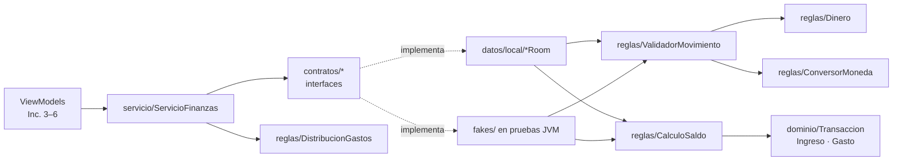
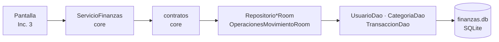

# Mapa del código

Relaciona cada función visible con el archivo que la dibuja, el que recibe la acción, la regla que la decide y el lugar donde se guardan o consultan los datos. **Regla:** solo se escriben como "Existe" las rutas reales; lo demás conserva los nombres planificados en [DISENO_FINANZAS.md](DISENO_FINANZAS.md) y se actualiza al construir su incremento.

Rutas relativas a `finanzas-app/app/src/main/java/gt/edu/umg/finanzas/app/` (app) y `finanzas-core/src/main/kotlin/gt/edu/umg/finanzas/core/` (core). Pruebas: `finanzas-core/src/test/kotlin/...` (JVM) y `finanzas-app/app/src/androidTest/java/.../datos/local/` (Room, en emulador).

> Los IDs pendientes siguen el diseño y la [referencia visual revisada](referencias/INTERFAZ.md). Se comprobarán contra los XML reales al implementar cada pantalla.

## 1. Funciones visibles

Columna Core: existe y tiene pruebas desde el Inc. 1. Columna Persistencia: las entradas sin "(Inc. n)" existen desde el Inc. 2 y tienen pruebas instrumentadas. XML, Activity y ViewModel siguen pendientes salvo en la primera fila.

| Función visible | Estado | XML / ID | Activity | ViewModel | Core | Persistencia o red |
|---|---|---|---|---|---|---|
| Texto de conexión con el core | **Existe, ejecutado** (Inc. 0) | `res/layout/activity_inicio.xml` · `textoConexionCore` | `ui/inicio/InicioActivity.onCreate` | — | `InfoCore.mensajeConexion()` | — (versión leída de `finanzas-core.properties` dentro del JAR) |
| Ver saldo disponible | Core y Room existen; pantalla Inc. 3 | `activity_inicio.xml` · `textoSaldoDisponible` | `InicioActivity` | `InicioViewModel.estado` | `servicio/ServicioFinanzas.observarResumen` | `RepositorioUsuarioRoom.observarUsuario` → `UsuarioDao.observarPorId` |
| Filtrar período en Inicio | Core y Room existen; pantalla Inc. 3 | `chipDia` … `chipPersonalizado` | `InicioActivity` | `InicioViewModel.seleccionarFiltro` | `dominio/Periodo.de`, `Periodo.personalizado` | `RepositorioTransaccionRoom.observarTotales` → `TransaccionDao.observarTotales` |
| Dibujar anillo de gastos | Core y Room existen; pantalla Inc. 3 | `graficoGastos` (`GraficoAnilloView`) | `InicioActivity` | `InicioViewModel.estado` | `reglas/DistribucionGastos.calcular` | `TransaccionDao.observarGastosPorCategoria` |
| Elegir categoría | Core y Room existen; pantalla Inc. 3 | cuadrícula de categorías | `FormularioActivity` | `FormularioViewModel` | `ServicioFinanzas.observarCategorias` | `CategoriaDao.observarActivasPorTipo` |
| Registrar movimiento | Core y Room existen; pantalla Inc. 3 | `botonAgregarMovimiento` → `activity_formulario.xml` · `botonGuardar` | `FormularioActivity` | `FormularioViewModel.guardar` | `reglas/ValidadorMovimiento.validar`, `reglas/CalculoSaldo.deltaCrear` y `aplicar` | `datos/local/OperacionesMovimientoRoom.crear` |
| Editar movimiento | Core y Room existen; pantalla Inc. 4 | `dialogo_detalle_movimiento.xml` · `botonEditar` → `botonGuardar` | `OperacionesActivity` → `FormularioActivity` | `FormularioViewModel.guardar` | `CalculoSaldo.deltaEditar` | `OperacionesMovimientoRoom.editar` |
| Eliminar movimiento | Core y Room existen; pantalla Inc. 4 | `botonEliminar` + diálogo de confirmación | `OperacionesActivity` | `OperacionesViewModel.eliminar` | `CalculoSaldo.deltaEliminar` | `OperacionesMovimientoRoom.eliminar` |
| Filtrar operaciones | Core y Room existen; pantalla Inc. 4 | `chipTodos/chipIngresos/chipGastos`, rango | `OperacionesActivity` | `OperacionesViewModel.seleccionarFiltro` | `Periodo.de` | `TransaccionDao.observarMovimientos` |
| Recalcular saldo | Core existe; Room y pantalla Inc. 5 | aviso `botonRecalcularSaldo` | `InicioActivity` | `InicioViewModel.recalcularSaldo` | `CalculoSaldo.saldoDesde` | `ReconstructorSaldoRoom` (Inc. 5) |
| Cambiar tema | Pendiente (Inc. 5) | menú `opcionTema` | `InicioActivity` | — | — | `PreferenciaTema` |
| Consultar tasa | Core existe; pantalla Inc. 6 | `tarjeta_tasa.xml` · `botonReintentarTasa` | `InicioActivity` | `InicioViewModel.estadoTasa` | `dominio/TasaCambio` | `RepositorioTipoCambio` → `ClienteBanguat` (Inc. 6) |
| Convertir USD → GTQ o GTQ → USD | Core existe; pantalla Inc. 6 | `dialogo_conversor.xml` · selector de sentido; `textoConversionPrevia` en el formulario | `ConversorDialogo`, `FormularioActivity` | `FormularioViewModel.onMontoCambiado` | `reglas/ConversorMoneda.usdAGtq` / `gtqAUsd` | — (usa la tasa ya cargada; solo dos direcciones). Guardar en USD requiere la base v2 (Inc. 6) |
| Clima / Reflexión | Pendiente (Inc. 7) | `tarjeta_clima.xml`, `tarjeta_reflexion.xml` | `InicioActivity` | `estadoClima`, `estadoReflexion` | — | `RepositorioClima`, `RepositorioReflexion` |

## 2. Core: qué hace cada clase

Paquetes por responsabilidad: `dominio` guarda datos, `reglas` decide, `contratos` dice qué se necesita del almacenamiento, `servicio` es la puerta de entrada y `resultado` es la forma de responder.

### 2.1 `dominio/` — datos con significado, sin lógica de pantalla

| Archivo | Qué representa | Decisión que conviene defender |
|---|---|---|
| `Transaccion.kt` | Clase sellada con `Ingreso` y `Gasto` | **Herencia**: comparten monto, fecha, categoría y conversión. **Polimorfismo**: `impactoEnSaldo()` da `+monto` o `−monto`. El `init` rechaza montos fuera de 1–999 999 999 centavos y descripciones vacías o de más de 60 caracteres |
| `TipoMovimiento.kt` | `INGRESO`, `GASTO` | Se guarda como texto en la columna `tipo` |
| `Moneda.kt` | `GTQ` (Q) y `USD` (US$) | Solo estas dos; el saldo siempre en GTQ |
| `TasaCambio.kt` | Quetzales por 1 USD, fecha del proveedor y fuente | `BigDecimal` sin recortar; exige tasa > 0 y fuente |
| `ConversionAplicada.kt` | Monto original USD + tasa usada | Fotografía histórica: una tasa nueva no cambia lo guardado |
| `Categoria.kt` | Fila de `Categoria` | `clave` estable sin tildes; `tipo` inmutable; `activa` para archivar |
| `CategoriasIniciales.kt` | `CategoriaInicial` y las 12 categorías sembradas | La usa `InicializadorDatos` en la app |
| `Usuario.kt` | Usuario único, `saldoCentavos`, `reconstruccionPendiente` | El saldo se guarda para no recorrer el historial |
| `DatosMovimiento.kt` | Lo que escribió el usuario, sin validar | El monto llega como texto; la pantalla nunca envía el monto en Q calculado |
| `CampoMovimiento.kt` | Campo con error (`MONTO`, `MONEDA`, `CATEGORIA`, `FECHA`, `DESCRIPCION`) | Permite marcar `campoMonto.error` sin interpretar mensajes |
| `FiltroPeriodo.kt` / `Periodo.kt` | Día, semana, mes, año y rango personalizado | Semana domingo–sábado y zona `America/Guatemala` fijas |
| `TotalesPeriodo.kt`, `TotalCategoria.kt`, `ResumenPeriodo.kt`, `SegmentoGasto.kt`, `MovimientoVista.kt` | Resultados de consultas para Inicio y Operaciones | Campos con nombre, sin `Pair`. Room llena `TotalesPeriodo` y `TotalCategoria` directamente desde el SQL |

### 2.2 `reglas/` — cada regla en un solo lugar

| Archivo · método | Qué decide | Prueba |
|---|---|---|
| `Dinero.desdeTexto` | Texto → centavos. Rechaza coma, signo, espacios internos, más de 2 decimales, cero y montos mayores que 9,999,999.99 | `reglas/DineroTest` (caso f) |
| `Dinero.formatear` | Centavos → `"Q 1,000.00"`, `"-Q 30.00"`, `"US$ 13.05"` | `DineroTest` |
| `ConversorMoneda.usdAGtq` / `gtqAUsd` | Las dos únicas conversiones; `BigDecimal` y un solo redondeo `HALF_UP` al final | `reglas/ConversorMonedaTest` (casos g, i) |
| `ValidadorMovimiento.validar` | Única puerta de datos crudos a `Ingreso`/`Gasto`: tipo de categoría, categoría archivada, monto, tasa USD, fecha no futura y descripción | `reglas/ValidadorMovimientoTest` (parte pura de e) |
| `CalculoSaldo.deltaCrear` / `deltaEditar` / `deltaEliminar` | Cuánto cambia el saldo, usando `impactoEnSaldo()` | `reglas/CalculoSaldoTest` |
| `CalculoSaldo.aplicar` | Saldo final con `Math.addExact`; un desborde da `ErrorNegocio` **antes** de escribir | `CalculoSaldoTest`; en Room, `OperacionesMovimientoRoomTest` (caso j) |
| `CalculoSaldo.saldoDesde` | Saldo desde cero para la reconstrucción | `CalculoSaldoTest` |
| `DistribucionGastos.calcular` | Porcentajes del anillo que suman exactamente 10 000 puntos (mayor residuo) | `reglas/DistribucionGastosTest` (caso h) |
| `dominio/Periodo.de` | Límites de cada filtro | `dominio/PeriodoTest` (caso h) |

### 2.3 `contratos/`, `servicio/` y `resultado/`

| Archivo | Para qué existe | Quién lo implementa o usa |
|---|---|---|
| `contratos/RepositorioUsuario`, `RepositorioCategoria`, `RepositorioTransaccion` | Lecturas con `Flow` (se actualizan solas) y `suspend` puntuales | **Interfaces**: `RepositorioUsuarioRoom`, `RepositorioCategoriaRoom`, `RepositorioTransaccionRoom`; fakes en las pruebas JVM |
| `contratos/OperacionesMovimiento` | Límite atómico de crear, editar y eliminar | `OperacionesMovimientoRoom`; `fakes/OperacionesMovimientoEnMemoria` |
| `contratos/ReconstructorSaldo` | Recalcular solo con la bandera encendida; asigna, no suma | `ReconstructorSaldoRoom` (Inc. 5); `fakes/ReconstructorSaldoEnMemoria` |
| `servicio/ServicioFinanzas` | Única entrada de los ViewModels: combina saldo y totales, calcula el anillo y delega las escrituras | ViewModels (Inc. 3); `ServicioFinanzasTest` (fakes) y `ServicioSobreRoomTest` (Room) |
| `resultado/Resultado` | `Ok` o `Fallo` (`ErrorNegocio`, `NoEncontrado`, `ErrorAlmacenamiento`) | Todas las reglas y operaciones |

### 2.4 Dobles de prueba (`src/test/.../fakes/`)

`AlmacenEnMemoria` guarda usuario, categorías y movimientos en **un solo valor**; reemplazarlo de una vez imita el COMMIT. Cada fake implementa un contrato y llama a `ValidadorMovimiento` y `CalculoSaldo` sin repetir ningún cálculo. `OperacionesMovimientoEnMemoria` sigue el mismo orden que `OperacionesMovimientoRoom`: leer → validar → comprobar saldo → escribir.

## 3. App: persistencia Room (incremento 2)

### 3.1 Tablas (`datos/local/entidades/`, esquema en `app/schemas/.../1.json`)

| Archivo | Tabla | Claves e índices | Decisión |
|---|---|---|---|
| `UsuarioEntity.kt` | `Usuario` | PK `idUsuario` (siempre 1) | `saldoCentavos` guardado; `reconstruccionPendiente` con `DEFAULT 0` |
| `CategoriaEntity.kt` | `Categoria` | PK autoincremental; índice **único** en `clave` | El índice único permite sembrar con `INSERT OR IGNORE` sin duplicar |
| `TransaccionEntity.kt` | `Transaccion` | FK `idUsuario` → `Usuario` y `idCategoria` → `Categoria`, ambas `RESTRICT`; índices `fechaEpochDay`, `(tipo, fechaEpochDay)`, `idCategoria`, `idUsuario` | Ingreso y Gasto en una tabla con `tipo`; fecha como `toEpochDay()`; sin columnas USD hasta la v2 (Inc. 6) |

`montoCentavos > 0` no se declara como `CHECK` (Room no lo genera): lo garantiza el `init` de `Transaccion`, que también corre al leer.

### 3.2 DAO (`datos/local/dao/`) — solo SQL

| Método | SQL / uso | Lo llama |
|---|---|---|
| `UsuarioDao.observarPorId` | `Flow` del usuario 1 | `RepositorioUsuarioRoom` |
| `UsuarioDao.obtenerPorId` · `actualizarSaldo` | Lee el saldo y **asigna** el saldo final ya comprobado | `OperacionesMovimientoRoom` |
| `UsuarioDao.insertarSiNoExiste` · `CategoriaDao.insertarSiNoExisten` | `INSERT OR IGNORE` | `InicializadorDatos` |
| `CategoriaDao.observarActivasPorTipo` · `obtenerPorId` | Categorías para elegir; por ID incluye archivadas | `RepositorioCategoriaRoom`, `OperacionesMovimientoRoom` |
| `TransaccionDao.insertar` · `actualizar` · `eliminar` · `obtenerPorId` | Escrituras de un movimiento | Solo `OperacionesMovimientoRoom`, dentro de `withTransaction` |
| `TransaccionDao.observarTotales` | `SUM(CASE tipo …)` del intervalo → `TotalesPeriodo` | `RepositorioTransaccionRoom` |
| `TransaccionDao.observarGastosPorCategoria` | `JOIN` + `GROUP BY` categoría → `TotalCategoria` | `RepositorioTransaccionRoom` |
| `TransaccionDao.observarMovimientos` | `JOIN` con filtro de tipo opcional, fecha descendente → `MovimientoFila` | `RepositorioTransaccionRoom` |

### 3.3 Implementaciones y construcción (`datos/local/` y raíz del paquete)

| Archivo | Responsabilidad |
|---|---|
| `AppDatabase.kt` | `@Database` v1 con las 3 entidades y `exportSchema = true`. **Sin** `fallbackToDestructiveMigration` |
| `Mapeos.kt` | Único archivo que convierte entity ↔ dominio. `aDominio()` reconstruye `Ingreso` o `Gasto` según `tipo` |
| `RepositorioUsuarioRoom`, `RepositorioCategoriaRoom`, `RepositorioTransaccionRoom` | Cumplen los contratos de lectura; traducen `Periodo` a días epoch |
| `OperacionesMovimientoRoom.kt` | **Único** `withTransaction` de movimientos. Lee la categoría → `ValidadorMovimiento.validar` → `CalculoSaldo.aplicar` → escribe el movimiento y el saldo. Antes de escribir devuelve un `Fallo`; después, cualquier anomalía lanza y Room revierte. Rechaza USD en la v1 |
| `InicializadorDatos.kt` | Usuario 1 y 12 categorías en un `withTransaction`; idempotente |
| `Dependencias.kt` | Decide qué clase Room cumple cada contrato. `ServicioFinanzas` se arma en el Inc. 3 |
| `FinanzasApp.kt` | `Application` (declarada en el manifiesto): crea `Dependencias` y lanza la siembra al arrancar; deja el resultado en `inicializacion` |

### 3.4 Pruebas instrumentadas (`app/src/androidTest/.../datos/local/`)

| Prueba | Qué comprueba | Caso §14.1 |
|---|---|---|
| `ServicioSobreRoomTest` | Recorrido servicio → contrato → Room → SQLite; totales, anillo 6000/4000, movimientos ordenados y nueva emisión del `Flow` tras guardar | a, b, h |
| `OperacionesMovimientoRoomTest` | `UsuarioDaoQueFalla` lanza al guardar el saldo; FK y `RESTRICT`; datos inválidos sin escribir; `NoEncontrado` | c, j |
| `PersistenciaTest` | Archivo SQLite propio, cerrar y reabrir | d |
| `InicializadorDatosTest` | 1 usuario y 12 categorías tras sembrar dos veces; el saldo no se reinicia | — |

`BaseDePrueba.servicioSobre` arma `ServicioFinanzas` con las clases Room y un `ReconstructorSaldo` que falla si se usa, porque `ReconstructorSaldoRoom` es del Inc. 5.

## 4. Recorridos reales

### 4.1 Incremento 0: conexión core → JAR → Android (ejecutado)
1. `finanzas-core/pom.xml` copia `<version>` en `finanzas-core.properties` y compila con destino JVM 11.
2. `mvn clean install` deja el JAR en `~/.m2/repository/gt/edu/umg/finanzas/finanzas-core/<versión>/`.
3. `settings.gradle.kts` solo busca el grupo `gt.edu.umg.finanzas` en `mavenLocal()`. `libs.versions.toml` fija `finanzasCore = "0.2.0"`.
4. `InicioActivity` escribe `InfoCore.mensajeConexion()` en `textoConexionCore`.

### 4.2 Incremento 2: registrar un gasto en Room (ejecutado en pruebas instrumentadas)
1. `ServicioFinanzas.registrar(datos, hoy)` delega en el contrato `OperacionesMovimiento.crear`; `Dependencias` lo cumple con `OperacionesMovimientoRoom`.
2. `withTransaction` empieza. `CategoriaDao.obtenerPorId` lee la categoría.
3. `ValidadorMovimiento.validar` convierte `"30"` en 3000 centavos y construye un `Gasto`. Un error devuelve `ErrorNegocio` sin escribir.
4. `UsuarioDao.obtenerPorId` lee el saldo y `CalculoSaldo.aplicar` calcula el final con `Math.addExact`. Un desborde devuelve `ErrorNegocio` sin escribir.
5. `TransaccionDao.insertar` y luego `UsuarioDao.actualizarSaldo`. Si el segundo falla, la excepción revierte también el INSERT (caso c).
6. COMMIT. Room invalida las tablas y `observarResumen` vuelve a emitir con el saldo nuevo.

En el Inc. 3 el paso 1 lo iniciará `FormularioViewModel.guardar`.

## 5. Dónde están los pilares de POO

| Pilar | Dónde | Por qué tiene función real |
|---|---|---|
| Encapsulamiento | `Transaccion` (validación en `init`), `TasaCambio`, `ConversionAplicada` | No puede existir un movimiento con monto 0 ni una tasa negativa, tampoco al leer de la base |
| Herencia | `Ingreso` y `Gasto` heredan de `Transaccion`; los fallos heredan de `Resultado.Fallo` | Sin campos duplicados; un solo `is Fallo -> return` propaga cualquier error |
| Polimorfismo | `impactoEnSaldo()` en `CalculoSaldo` | El cálculo no pregunta "¿es gasto?" |
| Abstracción | `contratos/*` | El core no conoce Room; la misma prueba de recorrido corre con fakes (JVM) y con Room (emulador) |

## 6. Preguntas de defensa

| Pregunta | Respuesta breve | Dónde mirar | Estado |
|---|---|---|---|
| ¿Cómo llega código del core a la app? | Maven instala el JAR en `.m2`; Gradle lo resuelve por sus coordenadas | `pom.xml`, `settings.gradle.kts`, `libs.versions.toml` | Existe, ejecutado |
| ¿Quién valida el monto? | El core: `Dinero.desdeTexto` dentro de `ValidadorMovimiento.validar` | `reglas/` | Existe, probado |
| ¿Por qué centavos en `Long`? | `Double` no representa 0.10 exacto; `Long` suma sin error y `BigDecimal` solo se usa para texto y conversión | `Dinero`, `ConversorMoneda` | Existe, probado |
| ¿Quién guarda? | `OperacionesMovimientoRoom`, dentro de un `withTransaction` | `datos/local/OperacionesMovimientoRoom.kt` | Existe, probado |
| ¿Cómo cambia el saldo? | Se calcula el delta con `impactoEnSaldo()`; `CalculoSaldo.aplicar` comprueba el final con `Math.addExact` y el DAO **asigna** ese valor | `CalculoSaldo`, `UsuarioDao.actualizarSaldo` | Existe, probado |
| ¿Qué pasa si falla a mitad? | La excepción revierte el movimiento y el saldo; se devuelve `ErrorAlmacenamiento` | `OperacionesMovimientoRoomTest` (caso c) | Existe, probado |
| ¿Qué pasa si el saldo desborda? | `ErrorNegocio` antes de la primera escritura | `OperacionesMovimientoRoomTest` (caso j) | Existe, probado |
| ¿Por qué no se duplican las categorías? | Índice único en `clave` + `INSERT OR IGNORE` | `CategoriaEntity`, `InicializadorDatos` | Existe, probado |
| ¿Qué impide un movimiento con una categoría inexistente? | La validación lee la categoría y, además, la FK de SQLite lo rechaza | `TransaccionEntity`, `OperacionesMovimientoRoomTest` | Existe, probado |
| ¿Cómo se actualiza Inicio sin "refrescar"? | Los DAO devuelven `Flow`; Room vuelve a emitir tras cada COMMIT | `TransaccionDao`, `ServicioSobreRoomTest` | Existe, probado (pantalla Inc. 3) |
| ¿Por qué funciona `LocalDate` en Android 7? | `coreLibraryDesugaring` reescribe `java.time` como `j$.time` dentro del APK | `app/build.gradle.kts` | Comprobado en el dex; ejecución en API 24 pendiente |
| ¿Qué pasa al cambiar el esquema? | Se sube la versión y se escribe una `Migration`; sin ella la app falla en vez de borrar datos | `AppDatabase`, `app/schemas/` | v1 existe; migración en Inc. 6 |
| ¿Dónde se dibuja el botón Guardar? | En el XML del formulario, con ID `botonGuardar` | `activity_formulario.xml` | Inc. 3 |
| ¿Qué pasa al presionarlo? | La Activity llama a `guardar()`; el ViewModel ignora toques repetidos y llama al servicio | `FormularioActivity`, `FormularioViewModel.guardar` | Inc. 3 |
| ¿Qué pasa sin internet? | Las finanzas funcionan; USD usa la última tasa guardada o queda deshabilitado | `RepositorioTipoCambio` | Inc. 6 |

Al terminar cada incremento: cambia "Pendiente" por la ruta y la función reales, y añade el recorrido del incremento en la §4.
