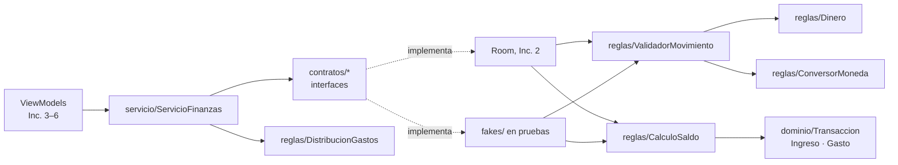

# Mapa del código

Relaciona cada función visible con el archivo que la dibuja, el que recibe la acción, la regla que la decide y el lugar donde se guardan o consultan los datos. **Regla:** solo se escriben como "Existe" las rutas reales; lo demás conserva los nombres planificados en [DISENO_FINANZAS.md](DISENO_FINANZAS.md) y se actualiza al construir su incremento.

Rutas relativas a `finanzas-app/app/src/main/` (app) y `finanzas-core/src/main/kotlin/gt/edu/umg/finanzas/core/` (core). Las pruebas están en `finanzas-core/src/test/kotlin/gt/edu/umg/finanzas/core/`.

> Los IDs pendientes siguen el diseño y la [referencia visual revisada](referencias/INTERFAZ.md). Se comprobarán contra los XML reales al implementar cada pantalla.

## 1. Funciones visibles

Desde el Inc. 1, **todas las funciones de la columna Core existen y tienen pruebas**. Las columnas XML, Activity, ViewModel y Persistencia siguen pendientes en las filas que no dicen "Existe".

| Función visible | Estado | XML / ID | Activity | ViewModel | Core | Persistencia o red |
|---|---|---|---|---|---|---|
| Texto de conexión con el core | **Existe, ejecutado** (Inc. 0) | `res/layout/activity_inicio.xml` · `textoConexionCore` | `ui/inicio/InicioActivity.onCreate` | — | `InfoCore.mensajeConexion()` | — (versión leída de `finanzas-core.properties` dentro del JAR) |
| Ver saldo disponible | Core existe; pantalla Inc. 3 | `activity_inicio.xml` · `textoSaldoDisponible` | `InicioActivity` | `InicioViewModel.estado` | `servicio/ServicioFinanzas.observarResumen` | `UsuarioDao.observarUsuario` (Inc. 2) |
| Filtrar período en Inicio | Core existe; pantalla Inc. 3 | `chipDia` … `chipPersonalizado` | `InicioActivity` | `InicioViewModel.seleccionarFiltro` | `dominio/Periodo.de`, `Periodo.personalizado` | `TransaccionDao.observarTotales` (Inc. 2) |
| Dibujar anillo de gastos | Core existe; pantalla Inc. 3 | `graficoGastos` (`GraficoAnilloView`) | `InicioActivity` | `InicioViewModel.estado` | `reglas/DistribucionGastos.calcular` | `TransaccionDao.observarGastosPorCategoria` (Inc. 2) |
| Registrar movimiento | Core existe; pantalla Inc. 3 | `botonAgregarMovimiento` → `activity_formulario.xml` · `botonGuardar` | `FormularioActivity` | `FormularioViewModel.guardar` | `reglas/ValidadorMovimiento.validar`, `reglas/CalculoSaldo.deltaCrear` y `aplicar` | `OperacionesMovimientoRoom.crear` (Inc. 2) |
| Editar movimiento | Core existe; pantalla Inc. 4 | `dialogo_detalle_movimiento.xml` · `botonEditar` → `botonGuardar` | `OperacionesActivity` → `FormularioActivity` | `FormularioViewModel.guardar` | `CalculoSaldo.deltaEditar` | `OperacionesMovimientoRoom.editar` (Inc. 2) |
| Eliminar movimiento | Core existe; pantalla Inc. 4 | `botonEliminar` + diálogo de confirmación | `OperacionesActivity` | `OperacionesViewModel.eliminar` | `CalculoSaldo.deltaEliminar` | `OperacionesMovimientoRoom.eliminar` (Inc. 2) |
| Filtrar operaciones | Core existe; pantalla Inc. 4 | `chipTodos/chipIngresos/chipGastos`, rango | `OperacionesActivity` | `OperacionesViewModel.seleccionarFiltro` | `Periodo.de` | `TransaccionDao.observarMovimientos` (Inc. 2) |
| Recalcular saldo | Core existe; pantalla Inc. 5 | aviso `botonRecalcularSaldo` | `InicioActivity` | `InicioViewModel.recalcularSaldo` | `CalculoSaldo.saldoDesde` | `ReconstructorSaldoRoom` (Inc. 5) |
| Cambiar tema | Pendiente (Inc. 5) | menú `opcionTema` | `InicioActivity` | — | — | `PreferenciaTema` |
| Consultar tasa | Core existe; pantalla Inc. 6 | `tarjeta_tasa.xml` · `botonReintentarTasa` | `InicioActivity` | `InicioViewModel.estadoTasa` | `dominio/TasaCambio` | `RepositorioTipoCambio` → `ClienteBanguat` |
| Convertir USD → GTQ o GTQ → USD | Core existe; pantalla Inc. 6 | `dialogo_conversor.xml` · selector de sentido; `textoConversionPrevia` en el formulario | `ConversorDialogo`, `FormularioActivity` | `FormularioViewModel.onMontoCambiado` | `reglas/ConversorMoneda.usdAGtq` / `gtqAUsd` | — (usa la tasa ya cargada; solo dos direcciones) |
| Clima / Reflexión | Pendiente (Inc. 7) | `tarjeta_clima.xml`, `tarjeta_reflexion.xml` | `InicioActivity` | `estadoClima`, `estadoReflexion` | — | `RepositorioClima`, `RepositorioReflexion` |

## 2. Core: qué hace cada clase

Paquetes por responsabilidad: `dominio` guarda datos, `reglas` decide, `contratos` dice qué se necesita del almacenamiento, `servicio` es la puerta de entrada y `resultado` es la forma de responder.

### 2.1 `dominio/` — datos con significado, sin lógica de pantalla

| Archivo | Qué representa | Decisión que conviene defender |
|---|---|---|
| `Transaccion.kt` | Clase sellada con `Ingreso` y `Gasto` | **Herencia**: comparten monto, fecha, categoría y conversión. **Polimorfismo**: `impactoEnSaldo()` da `+monto` o `−monto`. El `init` rechaza montos fuera de 1–999 999 999 centavos y descripciones vacías o de más de 60 caracteres |
| `TipoMovimiento.kt` | `INGRESO`, `GASTO` | Se guarda como texto en la columna `tipo` |
| `Moneda.kt` | `GTQ` (Q) y `USD` (US$) | Solo estas dos; el saldo siempre en GTQ |
| `TasaCambio.kt` | Quetzales por 1 USD, fecha del proveedor y fuente | `BigDecimal` sin recortar; exige tasa > 0 y fuente |
| `ConversionAplicada.kt` | Monto original USD + tasa usada | Fotografía histórica: una tasa nueva no cambia lo guardado |
| `Categoria.kt` | Fila de `Categoria` | `clave` estable sin tildes; `tipo` inmutable; `activa` para archivar |
| `CategoriasIniciales.kt` | `CategoriaInicial` y las 12 categorías sembradas | Lista probada sin Android; el inicializador de Room la usará en el Inc. 2 |
| `Usuario.kt` | Usuario único, `saldoCentavos`, `reconstruccionPendiente` | El saldo se guarda para no recorrer el historial |
| `DatosMovimiento.kt` | Lo que escribió el usuario, sin validar | El monto llega como texto; la pantalla nunca envía el monto en Q calculado |
| `CampoMovimiento.kt` | Campo con error (`MONTO`, `MONEDA`, `CATEGORIA`, `FECHA`, `DESCRIPCION`) | Permite marcar `campoMonto.error` sin interpretar mensajes |
| `FiltroPeriodo.kt` / `Periodo.kt` | Día, semana, mes, año y rango personalizado | Semana domingo–sábado y zona `America/Guatemala` fijas |
| `TotalesPeriodo.kt`, `TotalCategoria.kt`, `ResumenPeriodo.kt`, `SegmentoGasto.kt`, `MovimientoVista.kt` | Resultados de consultas para Inicio y Operaciones | Campos con nombre, sin `Pair`; el porcentaje va en puntos básicos enteros |

### 2.2 `reglas/` — cada regla en un solo lugar

| Archivo · método | Qué decide | Prueba |
|---|---|---|
| `Dinero.desdeTexto` | Texto → centavos. Rechaza coma, signo, espacios internos, más de 2 decimales, cero y montos mayores que 9,999,999.99 | `reglas/DineroTest` (caso f) |
| `Dinero.formatear` | Centavos → `"Q 1,000.00"`, `"-Q 30.00"`, `"US$ 13.05"` | `DineroTest` |
| `ConversorMoneda.usdAGtq` / `gtqAUsd` | Las dos únicas conversiones; `BigDecimal` y un solo redondeo `HALF_UP` al final | `reglas/ConversorMonedaTest` (casos g, i) |
| `ValidadorMovimiento.validar` | Única puerta de datos crudos a `Ingreso`/`Gasto`: tipo de categoría, categoría archivada, monto, tasa USD, fecha no futura y descripción | `reglas/ValidadorMovimientoTest` (parte pura de e) |
| `CalculoSaldo.deltaCrear` / `deltaEditar` / `deltaEliminar` | Cuánto cambia el saldo, usando `impactoEnSaldo()` | `reglas/CalculoSaldoTest` |
| `CalculoSaldo.aplicar` | Saldo final con `Math.addExact`; un desborde da `ErrorNegocio` **antes** de escribir | `CalculoSaldoTest` (parte pura de j) |
| `CalculoSaldo.saldoDesde` | Saldo desde cero para la reconstrucción | `CalculoSaldoTest` |
| `DistribucionGastos.calcular` | Porcentajes del anillo que suman exactamente 10 000 puntos (mayor residuo) | `reglas/DistribucionGastosTest` (caso h) |
| `dominio/Periodo.de` | Límites de cada filtro | `dominio/PeriodoTest` (caso h) |

### 2.3 `contratos/`, `servicio/` y `resultado/`

| Archivo | Para qué existe | Quién lo implementa o usa |
|---|---|---|
| `contratos/RepositorioUsuario`, `RepositorioCategoria`, `RepositorioTransaccion` | Lecturas con `Flow` (se actualizan solas) y `suspend` puntuales | **Interfaces**: Room en el Inc. 2; los fakes en las pruebas |
| `contratos/OperacionesMovimiento` | Límite atómico de crear, editar y eliminar: valida, comprueba el saldo final y escribe todo o nada | `OperacionesMovimientoRoom` (Inc. 2); `fakes/OperacionesMovimientoEnMemoria` |
| `contratos/ReconstructorSaldo` | Recalcular solo con la bandera encendida; asigna, no suma | `ReconstructorSaldoRoom` (Inc. 5); `fakes/ReconstructorSaldoEnMemoria` |
| `servicio/ServicioFinanzas` | Única entrada de los ViewModels: combina saldo y totales, calcula el anillo y delega las escrituras | ViewModels (Inc. 3); `servicio/ServicioFinanzasTest` |
| `resultado/Resultado` | `Ok` o `Fallo` (`ErrorNegocio`, `NoEncontrado`, `ErrorAlmacenamiento`) | Todas las reglas y operaciones |

### 2.4 Dobles de prueba (`src/test/.../fakes/`)

`AlmacenEnMemoria` guarda usuario, categorías y movimientos en **un solo valor**; reemplazarlo de una vez imita el COMMIT. Cada fake implementa un contrato y llama a `ValidadorMovimiento` y `CalculoSaldo`: no repite ningún cálculo. `OperacionesMovimientoEnMemoria` sigue el mismo orden que tendrá Room: leer → validar → comprobar saldo → escribir.

## 3. Recorridos reales

### 3.1 Incremento 0 — conexión core → JAR → Android (ejecutado)
1. `finanzas-core/pom.xml` copia `<version>` en `finanzas-core.properties` (filtrado de recursos) y compila con destino JVM 11.
2. `mvn clean install` deja el JAR en `~/.m2/repository/gt/edu/umg/finanzas/finanzas-core/<versión>/`.
3. `finanzas-app/settings.gradle.kts` solo busca el grupo `gt.edu.umg.finanzas` en `mavenLocal()` (`exclusiveContent`). `gradle/libs.versions.toml` fija `finanzasCore = "0.2.0"` y `app/build.gradle.kts` lo declara con `implementation(libs.finanzas.core)`.
4. `AndroidManifest.xml` abre `ui.inicio.InicioActivity`, que infla `activity_inicio.xml` con View Binding y escribe `InfoCore.mensajeConexion()` en `textoConexionCore`.

### 3.2 Incremento 1 — registrar un gasto (en pruebas, sin Android)
1. `ServicioFinanzasTest` llama a `ServicioFinanzas.registrar(datos, hoy)` con `"30"` en GTQ y la categoría `ALIMENTACION`.
2. El servicio delega en `OperacionesMovimiento.crear` (en pruebas, `OperacionesMovimientoEnMemoria`).
3. La operación lee la categoría y llama a `ValidadorMovimiento.validar`, que usa `Dinero.desdeTexto` (`"30"` → 3000) y construye un `Gasto`.
4. `CalculoSaldo.aplicar(saldoActual, deltaCrear(gasto))` devuelve el saldo final o `ErrorNegocio` si desborda.
5. Solo entonces se escribe el movimiento y el saldo en un único reemplazo del estado.
6. `observarResumen` vuelve a emitir: el saldo, los ingresos y los gastos cambian sin "refrescar".

En el Inc. 2, el paso 5 será `OperacionesMovimientoRoom` dentro de `withTransaction`; los pasos 1–4 no cambian.

## 4. Dónde están los pilares de POO

| Pilar | Dónde | Por qué tiene función real |
|---|---|---|
| Encapsulamiento | `Transaccion` (validación en `init`), `TasaCambio`, `ConversionAplicada` | No puede existir un movimiento con monto 0 ni una tasa negativa |
| Herencia | `Ingreso` y `Gasto` heredan de `Transaccion`; los fallos heredan de `Resultado.Fallo` | Sin campos duplicados; un solo `is Fallo -> return` propaga cualquier error |
| Polimorfismo | `impactoEnSaldo()` en `CalculoSaldo` | El cálculo no pregunta "¿es gasto?" |
| Abstracción | `contratos/*` | El core no conoce Room; las pruebas usan fakes con el mismo contrato |

## 5. Preguntas de defensa

| Pregunta | Respuesta breve | Dónde mirar | Estado |
|---|---|---|---|
| ¿Cómo llega código del core a la app? | Maven instala el JAR en `.m2`; Gradle lo resuelve por sus coordenadas | `pom.xml`, `settings.gradle.kts`, `libs.versions.toml` | Existe, ejecutado |
| ¿Cómo sé que la app usa el JAR correcto? | La pantalla muestra la versión que Maven copió del `pom.xml` (hoy 0.2.0) | `InfoCore.version` | Existe, ejecutado |
| ¿Quién valida el monto? | El core: `Dinero.desdeTexto` dentro de `ValidadorMovimiento.validar` | `reglas/` | Existe, probado |
| ¿Por qué centavos en `Long`? | `Double` no representa 0.10 exacto; `Long` suma sin error y `BigDecimal` solo se usa para texto y conversión | `Dinero`, `ConversorMoneda` | Existe, probado |
| ¿Cuándo se redondea una conversión? | Una sola vez, al final, con `HALF_UP` | `ConversorMoneda` | Existe, probado |
| ¿Cómo cambia el saldo? | Se calcula el delta con `impactoEnSaldo()` y `CalculoSaldo.aplicar` comprueba el saldo final con `Math.addExact` | `Transaccion`, `CalculoSaldo` | Existe, probado |
| ¿Qué pasa si el saldo desborda? | `aplicar` devuelve `ErrorNegocio` y no se escribe nada | `CalculoSaldoTest`, `ServicioFinanzasTest` | Existe, probado (Room en Inc. 2) |
| ¿Por qué el porcentaje del anillo suma 100 %? | Puntos básicos enteros y método del mayor residuo | `DistribucionGastos` | Existe, probado |
| ¿Dónde se dibuja el botón Guardar? | En el XML del formulario, con ID `botonGuardar` | `activity_formulario.xml` | Inc. 3 |
| ¿Qué pasa al presionarlo? | La Activity llama a `guardar()`; el ViewModel ignora toques repetidos y llama al servicio | `FormularioActivity`, `FormularioViewModel.guardar` | Inc. 3 |
| ¿Quién guarda? | `OperacionesMovimientoRoom` dentro de un `withTransaction` | `datos/local/` | Inc. 2 |
| ¿Qué pasa si falla a mitad? | La excepción revierte la inserción y el saldo | `OperacionesMovimientoRoom` | Inc. 2 |
| ¿Qué pasa sin internet? | Las finanzas funcionan; USD usa la última tasa guardada o queda deshabilitado | `RepositorioTipoCambio` | Inc. 6 |

Al terminar cada incremento: cambia "Pendiente" por la ruta y la función reales, y añade el recorrido del incremento en la §3.
