# Referencia de la interfaz

Referencia principal: la maqueta de Canva compartida por el usuario. Se revisaron la captura de Inicio y el HTML con las vistas Inicio, Añadir y Operaciones. Las capturas de Gestor de gastos se usan como apoyo visual.

## Apariencia

- Cabecera y barra inferior verde oscuro: #1E463E.
- Acento amarillo: #FFC229, especialmente en el botón central Añadir.
- Fondo claro: #F2F5F3, tarjetas redondeadas y espacios amplios.
- Iconos acompañados de texto; ingresos y gastos con signo y etiqueta.
- Colores definidos en recursos de tema. En oscuro cambian fondo, superficies y texto; se conservan el orden y los mismos layouts.

La imagen contiene montos y símbolos de demostración. En Android, el saldo se muestra en Q.

## Comparación del incremento 3 (emulador API 37)

| Inicio | Formulario | Inicio oscuro | Formulario oscuro |
|---|---|---|---|
|  |  |  |  |

- **Igual que la maqueta:** cabecera verde con saldo grande y fila de períodos, pestaña activa en amarillo, tarjetas Ingresos y Gastos juntas con flechas, anillo con leyenda por categoría, barra inferior verde con el botón Añadir amarillo al centro.
- **Adaptado:** el saldo es histórico y los chips solo cambian ingresos, gastos y anillo; se añadió la tarjeta Resultado del período; el centro del anillo dice Gastos del período; Operaciones aparece deshabilitada hasta el Inc. 4.
- **Formulario:** tipo Gasto/Ingreso, monto con prefijo Q, accesos +5/+10/+20/+50, cuadrícula de categorías de 4 columnas filtrada por tipo, fecha y descripción obligatoria con contador.
- **Corregido al comparar:** los chips de período se veían como rectángulos blancos sin texto (superficie de Material 3) y "Entretenimiento" se partía en dos líneas.
- **Letra grande:** revisada y corregida en el Inc. 4 (ver abajo).

## Comparación del incremento 4 (emulador API 37)

| Operaciones | Detalle | Editar | Confirmar eliminación |
|---|---|---|---|
|  |  |  |  |

- **Igual que la maqueta:** cabecera verde con título y filtros en pastillas, pestaña activa en amarillo, filas en tarjetas con icono de categoría a color, descripción y monto con signo y color, barra inferior con el destino actual en amarillo.
- **Adaptado:** la fecha va en un encabezado por día ("SÁBADO 24/10/2026") en lugar de repetirse en cada fila; la fila muestra "categoría · tipo" para no depender solo del color. El detalle y la confirmación son diálogos sobre la lista; Editar abre el mismo Formulario con el título "Editar movimiento".
- **Estado vacío y tema oscuro:** [lista vacía](capturas/inc4-operaciones-vacia.png) y [Operaciones en oscuro](capturas/inc4-operaciones-oscuro.png).
- **Calendarios:** [rango](capturas/inc4-calendario-rango.png) y [fecha](capturas/inc4-calendario-fecha.png). Son los de Material; sus botones y meses siguen el idioma del sistema.

### Letra grande del sistema (escala 1.3 y 2.0)

| Formulario 1.3 | Formulario 2.0 | Inicio 2.0 | Detalle 2.0 |
|---|---|---|---|
|  |  |  |  |

- **Corregido:** la cuadrícula partía nombres a mitad de palabra ("Entretenimien-to" con 1.3; "Alimenta-ción", "Educació-n" con 2.0). Ahora usa 4 columnas con letra normal, 3 con 1.3 y 2 con 2.0. La etiqueta "Operaciones" de la barra se partía en "Operacione-s" con 2.0; ahora queda en una línea y se reduce solo lo necesario. En el centro del anillo, "Gastos del período" se salía del hueco con 2.0; ahora el centro tiene medidas fijas y el texto se reduce dentro de él, con un mínimo en dp para que la escala no lo vuelva a agrandar (el mismo total se lee completo en la tarjeta Gastos).
- **Se deja así:** con 1.3 y 2.0 la fila de períodos no cabe entera y se desplaza de lado (Período queda a la derecha); con 2.0 "Q 1,250.00" pasa a dos líneas en la tarjeta Ingresos y "categoría · tipo" ocupa dos líneas en [Operaciones](capturas/inc4-letra-2.0-operaciones.png). Todo sigue legible y sin cortes; el formulario y la lista se desplazan para llegar a Guardar y a las últimas filas.
- El detalle de un movimiento cabe completo con 2.0.

## Incremento 5: aviso y selector de tema (emulador API 37)

| Aviso claro | Selector | Aviso oscuro | Saldo corregido |
|---|---|---|---|
|  |  |  |  |

- `opcionTema` ocupa el extremo derecho de la cabecera verde. Abre un diálogo Material con Sistema, Claro y Oscuro; los colores y layouts existentes se conservan.
- El aviso aparece antes de las tarjetas solo con bandera pendiente. Explica que el saldo puede estar desactualizado y ofrece Recalcular saldo. Durante la operación el botón indica Recalculando y queda deshabilitado; un error mantiene la tarjeta con opción de reintentar.
- En una base de prueba con Q 100 de ingreso y Q 30 de gasto, el botón cambió Q 1.23 erróneo a Q 70.00 y ocultó la tarjeta. Tema y aviso se revisaron en claro y oscuro; las tres opciones persistieron tras forzar el cierre y abrir otro proceso. Sistema siguió el modo claro/oscuro de Android.
- Revisión mediante capturas, jerarquías Android y acciones individuales de ADB. El [segundo detalle](capturas/inc5-segundo-detalle.png) seguía abierto 372 s después de cancelar una eliminación y reabrirlo; no se declara corregida la observación anterior. Los otros pendientes conservan su estado en el README.

## Incremento 6: tasa y movimientos USD (emulador API 37)

| Tasa clara | Tasa oscura | Conversor claro | Conversor oscuro |
|---|---|---|---|
|  |  |  |  |

| Formulario claro | Formulario oscuro | Detalle claro | Detalle oscuro |
|---|---|---|---|
|  |  |  |  |

- Se conserva la jerarquía de Canva: cabecera verde, saldo en Q, resumen/anillo y navegación verde con Añadir amarillo. `tarjeta_tasa.xml` aparece bajo el contenido financiero, con fuente, fecha del proveedor, momento de consulta, Convertir y Reintentar.
- El conversor ofrece solo USD → GTQ y GTQ → USD en un grupo de dos botones. El monto, el sentido y el resultado se conservaron al cambiar de tema. No hay pares de selectores libres ni otras monedas.
- El Formulario conserva tipo, accesos rápidos y cuadrícula. Añade el selector GTQ/USD antes del monto y, debajo, los metadatos de la tasa y el equivalente. USD se deshabilita sin tasa disponible. Al editar se muestra la tasa histórica y se conserva el monto original.
- [Operaciones](capturas/inc6-operaciones-usd-claro.png) mantiene el equivalente con signo en Q y añade «Original: US$ …». El detalle muestra original, tasa, fecha y fuente. El detalle USD de prueba también se revisó con letra 2.0 y sus acciones quedaron visibles; no se declara revisada toda la app con esa escala en este incremento.
- Datos reales del servicio en una instalación separada de prueba: referencia 7.64187 del 30/10/2026; US$ 10 → Q 76.42. [Sin red](capturas/inc6-tasa-sin-red.png), el saldo y la tasa real guardada se conservaron al reiniciar; Reintentar mostró que no se pudo actualizar sin borrar el dato. La conectividad y el tema del sistema se restauraron al terminar.
- Comparación por capturas y acciones de ADB. Las pruebas instrumentadas adicionales usan tasas explícitamente ficticias y la instalación `.pruebas`; no se reemplazan datos de la instalación normal.

## Incremento 7: clima y reflexión local (emulador API 37)

| Tarjetas claras | Tarjetas oscuras |
|---|---|
|  |  |

- Se compararon con Canva y las capturas anteriores: misma cabecera verde, saldo en Q, filtros, resumen financiero y navegación con Añadir amarillo. [Inicio claro](capturas/inc7-inicio-claro.png) e [Inicio oscuro](capturas/inc7-inicio-oscuro.png) conservan esa jerarquía. Las nuevas tarjetas están en el contenido desplazable, en orden **tasa → clima → reflexión**, con el estilo de tarjeta y los colores del tema existentes.
- `tarjeta_clima.xml` muestra temperatura, condición WMO en español, fecha de medición, fecha de consulta en Guatemala y origen guardado/actualizado. Incluye atribución enlazada Open-Meteo.com, CC BY 4.0 y **Reintentar clima**. El icono del título identifica el clima; la condición actual siempre se expresa en texto. No se añade GPS ni otra pantalla.
- Dato real observado: **18.1 °C · Despejado**, medición 30/10/2026 01:00, consulta 01:12. Al cambiar de tema se mostró «Dato guardado» conservando valores y fechas. Las dos tarjetas y sus botones quedaron legibles, sin solaparse con la navegación, en la escala normal del emulador.
- `tarjeta_reflexion.xml` muestra la cita, referencia, RV1909, **Catálogo local · eBible · Dominio público** y fecha. **Ocultar reflexión** contrae el contenido y deja **Mostrar reflexión** disponible; la preferencia y la cita sobreviven a recrear la Activity (prueba instrumentada). No presenta el contenido como descargado de Bolls.
- Con wifi/datos desactivados, [el reintento conservó el clima guardado](capturas/inc7-clima-guardado-sin-red.png) y añadió el error, mientras reflexión y navegación seguían disponibles. `am force-stop` y abrir otra vez conservó los datos y la misma cita. Tras restaurar internet, [Reintentar actualizó la consulta a 01:14](capturas/inc7-clima-recuperado.png) y quitó el error; durante la petición se observó «Consultando el clima…».
- En una instalación `.pruebas` vaciada expresamente para este recorrido, [sin red y sin caché](capturas/inc7-clima-sin-datos.png) se mostró «Sin datos del clima», error y reintento; la reflexión local siguió disponible desde el primer arranque. La base de la app normal nunca se vació ni se reinstaló. Se restauró wifi/datos al terminar.
- Revisión por capturas, jerarquía Android y acciones de ADB. No se repite aquí la revisión de toda la app con letra 2.0 ni API 24–25. En `4df6fa8` la integración remota quedó pendiente; esas capturas muestran el catálogo local. La continuación siguiente resuelve la fuente con Dabar.

## Continuación del incremento 7: reflexión remota RV1909

| Remota clara | Remota oscura |
|---|---|
| 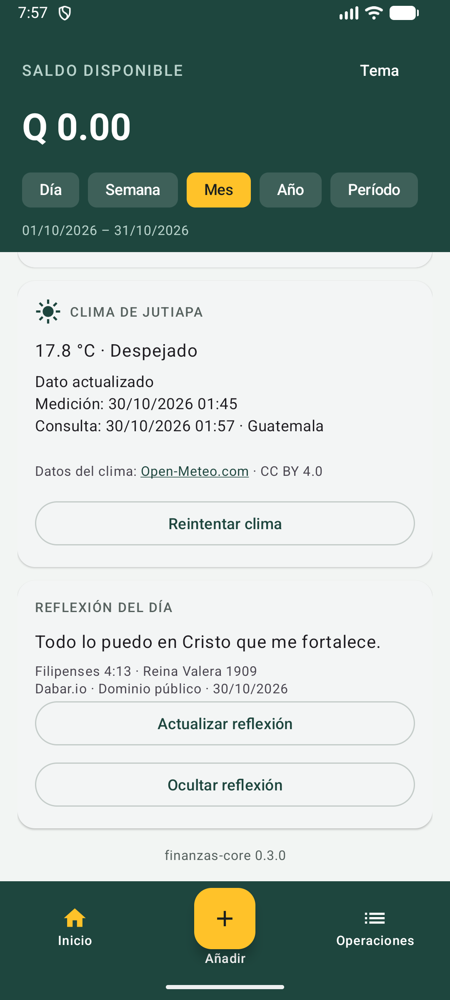 | 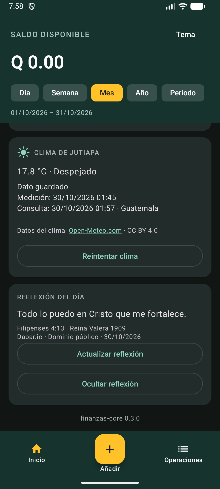 |

| Remota guardada sin red | Respaldo local sin caché |
|---|---|
| 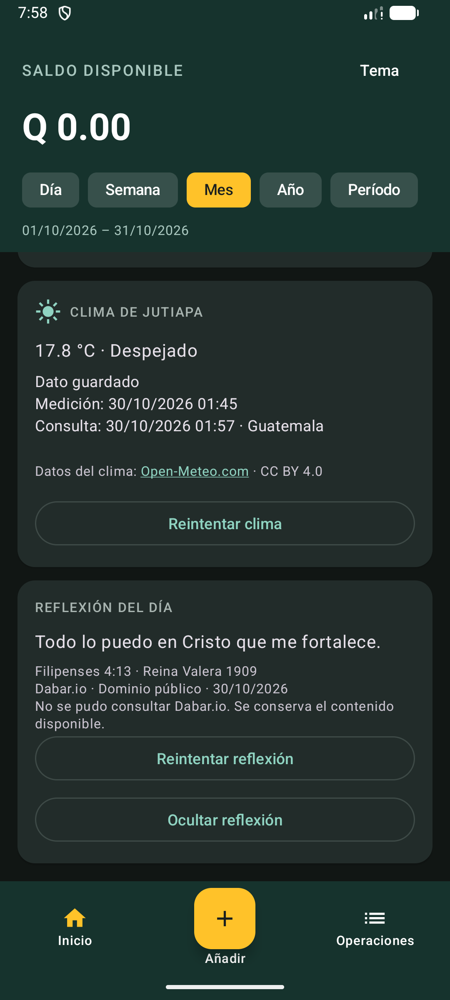 | 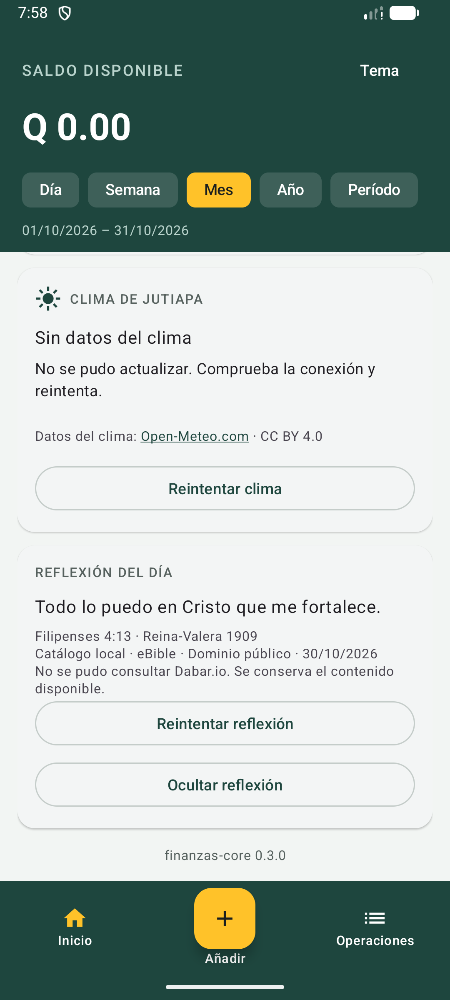 |

- Se conserva `tarjeta_reflexion.xml` bajo el clima, sin cambiar navegación, colores, tipografía ni el orden financiero. El botón `botonReintentarReflexion`, antes reservado al fallo de guardado, ahora ofrece **Actualizar reflexión** o **Reintentar reflexión** y queda deshabilitado durante la petición. Ocultar/Mostrar sigue en el mismo lugar.
- Cita real revisada en API 37: Filipenses 4:13, «Todo lo puedo en Cristo que me fortalece.», **Reina Valera 1909 · Dabar.io · Dominio público · 30/10/2026**. En claro y oscuro se ven cita, referencia, fuente, traducción, fecha y ambos botones sin cortes; el contenido se desplaza como antes.
- Con wifi/datos desactivados, Reintentar conservó la cita remota y sus metadatos y añadió el error. `am force-stop` y volver a abrir sin red mantuvo la cita de hoy desde la caché, sin pedir otra automáticamente.
- Se vació **solo `.pruebas`** para un arranque sin caché ni red. La tarjeta presentó la misma referencia del día desde **Catálogo local · eBible · Reina-Valera 1909**, con error y reintento. Reiniciar sin red conservó ese respaldo y su fuente local. Al restaurar internet y pulsar Actualizar se [recuperó la fuente remota](capturas/inc7-dabar-recuperado.png) y desapareció el error; se observó «Preparando la reflexión…» durante la petición.
- Las pruebas instrumentadas verificaron estos metadatos en claro/oscuro, respaldo, reintento sin red y recreación de Inicio. Las capturas se obtuvieron con acciones de ADB sobre `.pruebas`; no se tocaron datos normales. Wifi/datos quedaron restaurados. API 24–25, letra grande de toda la app y los pendientes anteriores conservan su estado.

## Mejora de usabilidad: teclado y apariencia

Revisión del 30/10/2026 sobre API 37, instalación `.pruebas`. Conserva la referencia Canva: cabeceras verdes, acento amarillo, destinos Inicio/Añadir/Operaciones y orden de las tarjetas **tasa → clima → reflexión**, bajo el contenido financiero. Core, Room, consultas y proveedores no cambian.

### Descripción y teclado

| Antes, escala normal | Crear claro, después | Editar oscuro, después |
|---|---|---|
| 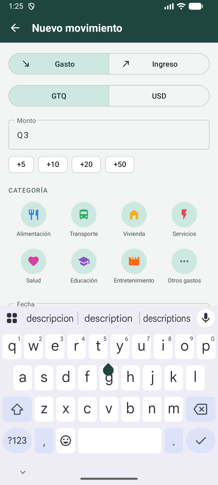 | 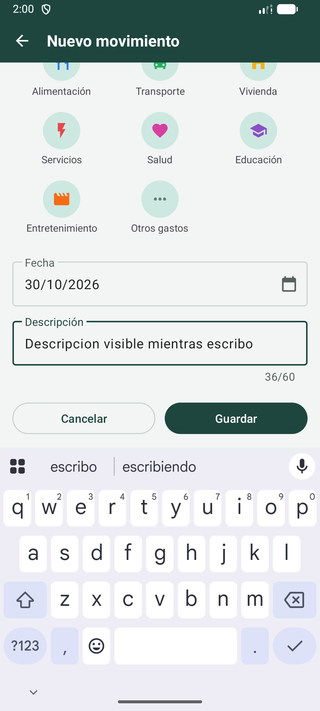 | 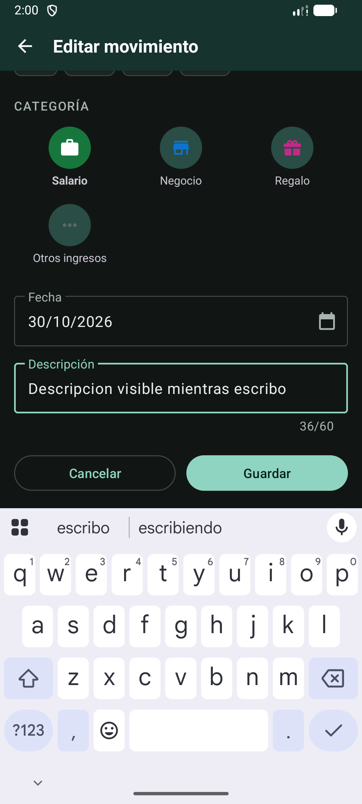 |

El problema se reprodujo con Gboard: el inset inferior se añadía al relleno del ScrollView y Descripción quedaba bajo el IME. Con letra grande, abrir el teclado volvía a medir la cuadrícula y desplazaba el campo. El inset ahora reduce el área del contenedor desde la raíz; el XML usa `NestedScrollView` y la Activity pide mostrar el campo enfocado tras cambios de geometría del layout completo. El seguimiento no se repite al desplazar normalmente hasta Guardar. No se oculta el teclado, no se mueven campos de orden y no se modifica el borrador por esta corrección. Se conserva `adjustResize` en el manifiesto. [Guía Android de bordes e insets](https://developer.android.com/develop/ui/views/layout/edge-to-edge).

| Crear claro, 360 × 640 dp / fuente 2.0 | Editar oscuro, mismo perfil | Guardar con teclado abierto |
|---|---|---|
| 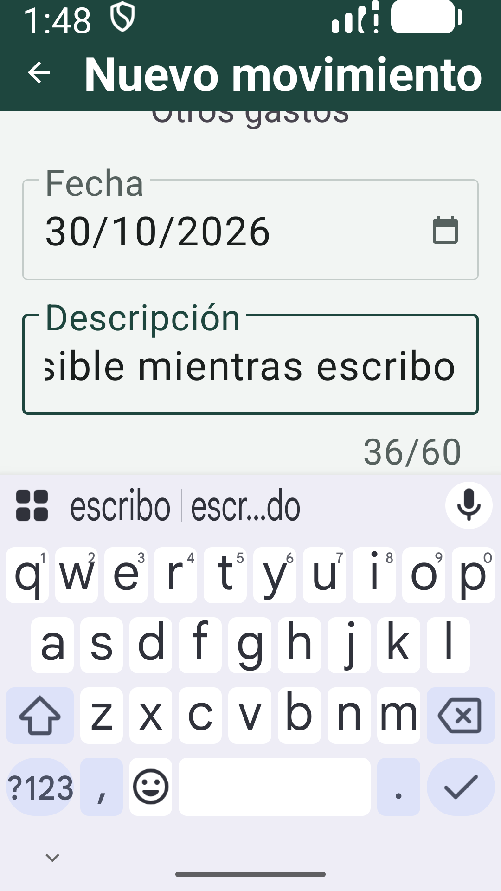 | 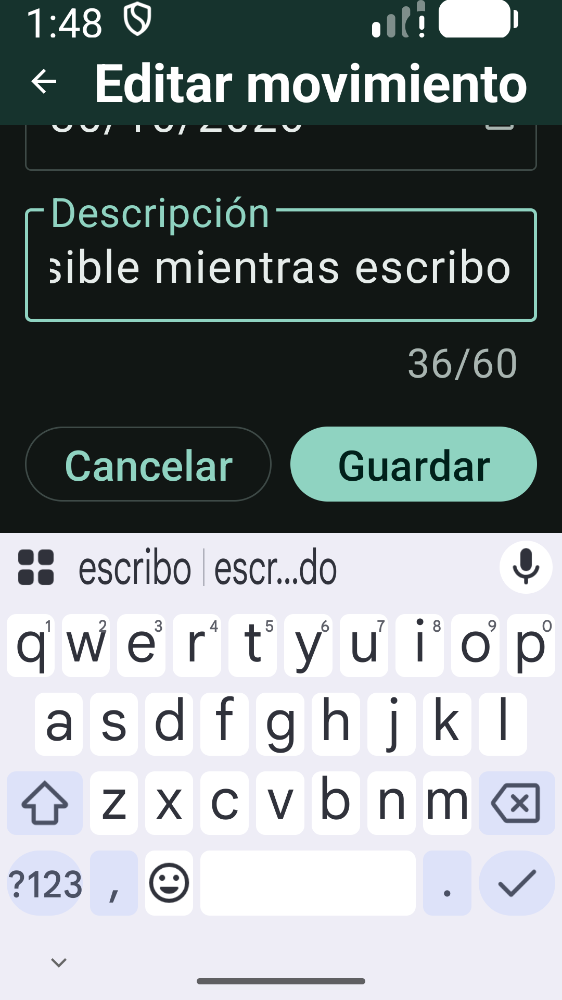 | 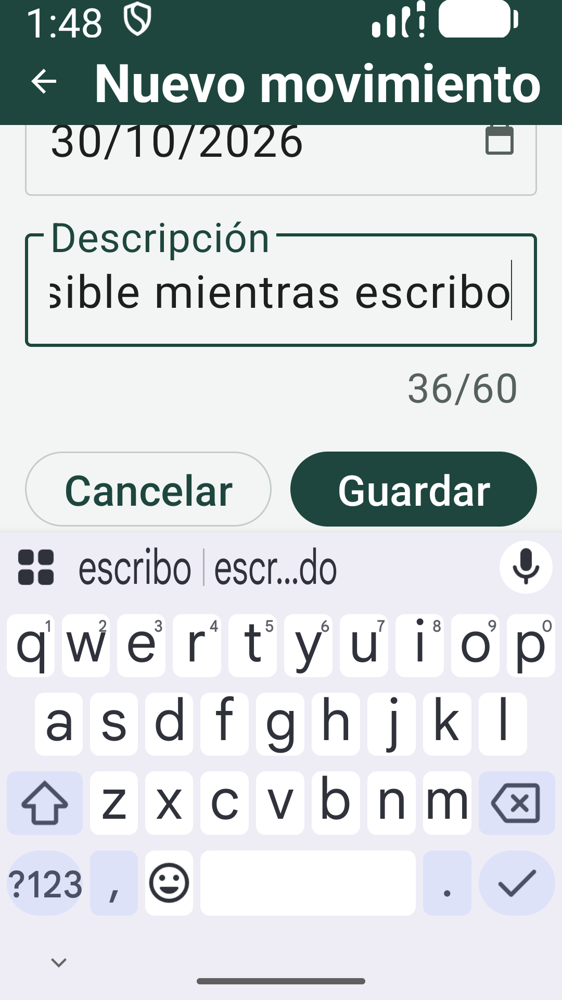 |

`TecladoFormularioTest` comprueba los cuatro cruces crear/editar × claro/oscuro: teclado visible, campo y cursor por encima de su borde, escritura conservada y Guardar alcanzable sin cerrarlo. En un campo de una sola línea, una descripción larga se desplaza horizontalmente con el cursor; no se recorta su contenido guardado. Las capturas usan datos exclusivos de prueba. El teléfono del usuario no está conectado a este entorno: sigue pendiente comprobar su tamaño y teclado reales.

### Lectura y tarjetas

Los tamaños se concentran en `values/themes.xml`: metadatos 14sp, detalles 16sp, cuerpo 17sp, reflexión 18sp, controles 15sp, categorías 13sp y valor de servicio 22sp desde `dimens.xml`. El saldo conserva su jerarquía. La cuadrícula usa de 1 a 4 columnas según ancho/letra; con 360dp/fuente 2.0 usa una, para conservar los nombres completos. Resultado del período separa etiqueta e importe para que no compitan por ancho.

Las tres tarjetas comparten relleno 20dp, separación principal 12dp, radio 20dp, borde 1dp y elevación 1dp. Fondos suaves distintos en claro/oscuro; iconos de banco, clima y libro. La tasa destaca solo la primera línea; fecha/fuente/consulta siguen en el texto existente. La reflexión conserva la traducción **Reina Valera 1909**, referencia y proveedor. Los botones, atribuciones y reintentos conservan sus conexiones.

| Servicio claro | Servicio oscuro |
|---|---|
| 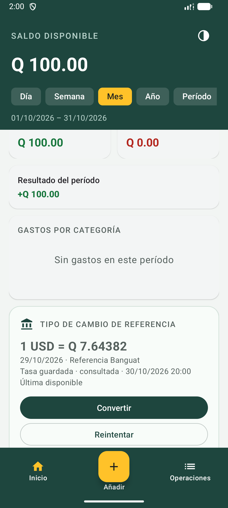 | 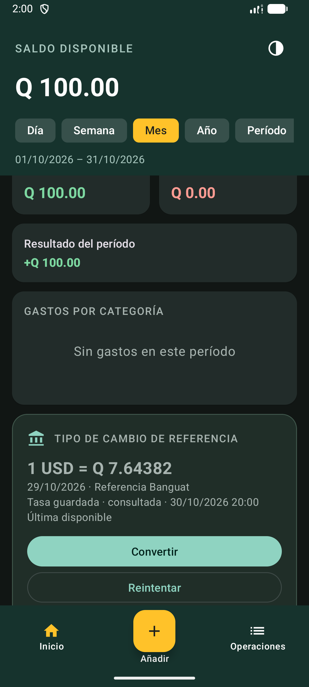 |
| 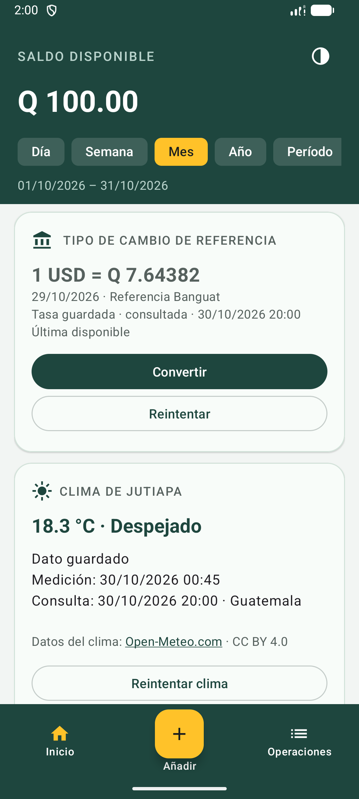 | 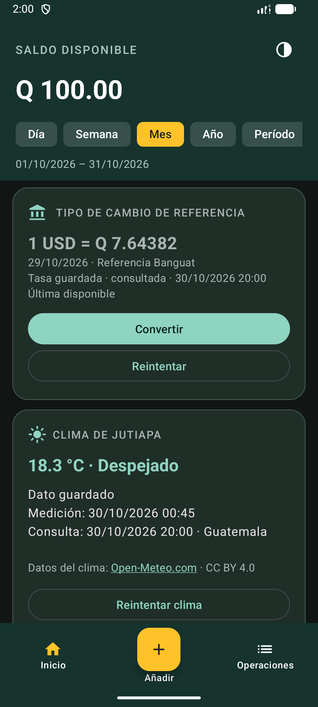 |
| 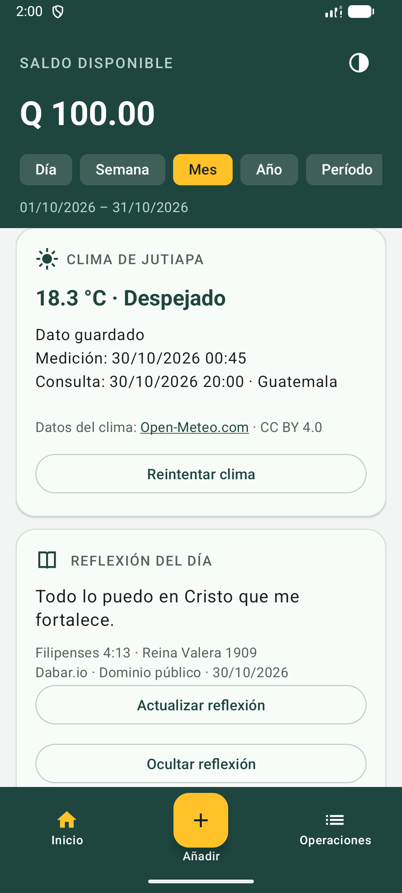 | 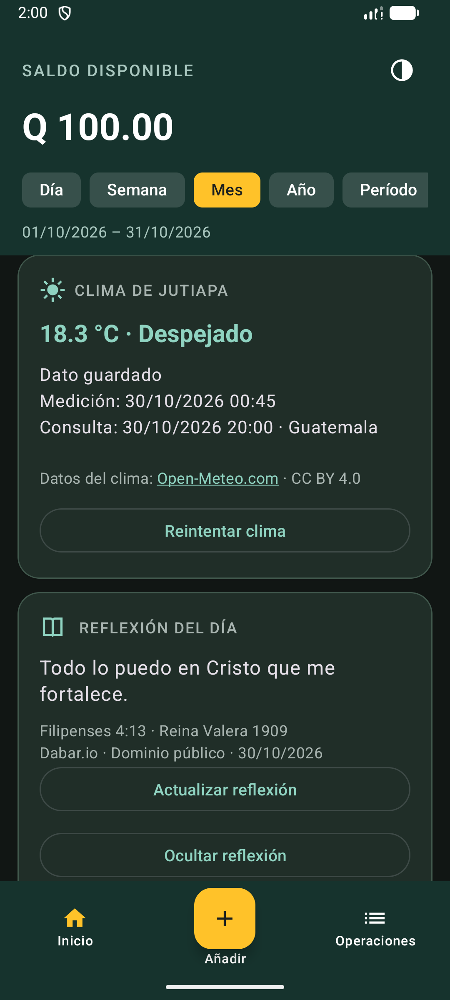 |

Estas comparaciones cargan **las respuestas reales ya guardadas en assets de pruebas**: Banguat 7.64382 del 29/10/2026, Open-Meteo 18.3 °C del 30/10/2026 y Filipenses 4:13 de Dabar. El instante de consulta corresponde a la preparación de la caché de prueba; no representa una nueva consulta remota. No se distribuyen fixtures como datos de producción. `ServiciosVisualesTest` verifica metadatos, traducción y acceso de tema en ambos temas, también con fuente 2.0. Para textos mayores que el área visible, la prueba desplaza hasta su inicio y luego hasta los botones: pedir ver el 90 % de todo el texto mediante Espresso `scrollTo` era imposible y se corrigió la acción de prueba, sin reducir la letra.

| Atribución del clima con fuente 2.0 | Metadatos y acciones de reflexión, fuente 2.0 |
|---|---|
| 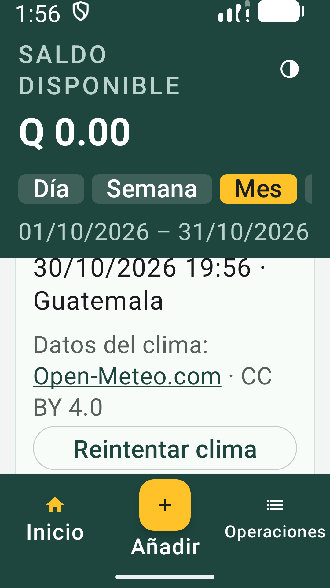 | 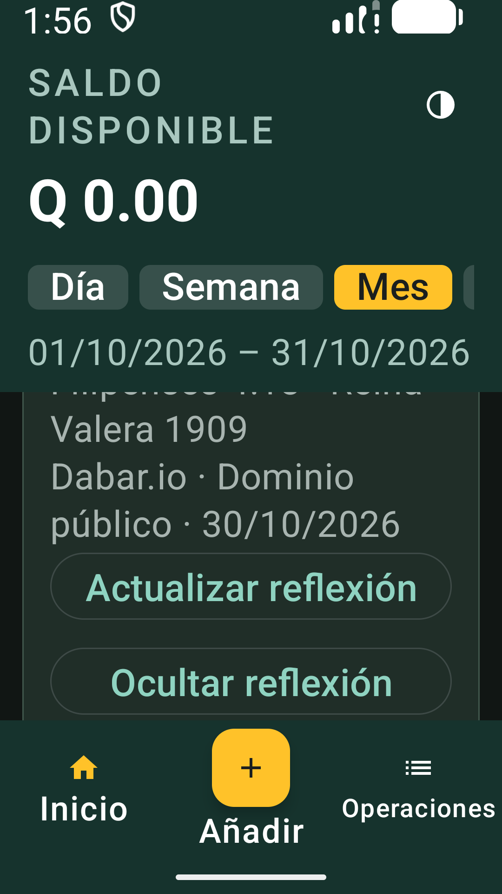 |

Con letra 2.0 las tarjetas requieren desplazamiento vertical; las capturas muestran partes sucesivas del contenido, no campos eliminados. Los períodos siguen desplazándose horizontalmente. Los importes largos pueden ocupar dos líneas en Ingresos/Gastos, conservando todos los dígitos.

| Resultado con Q 9,999,999.99 | Detalle USD largo y acciones alcanzables |
|---|---|
| 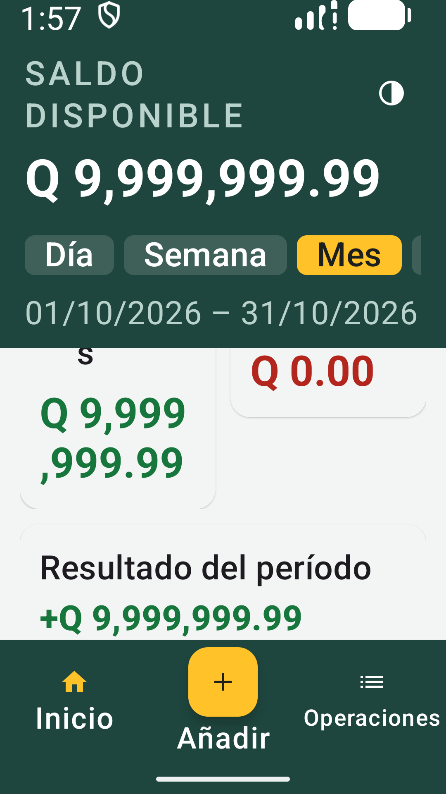 | 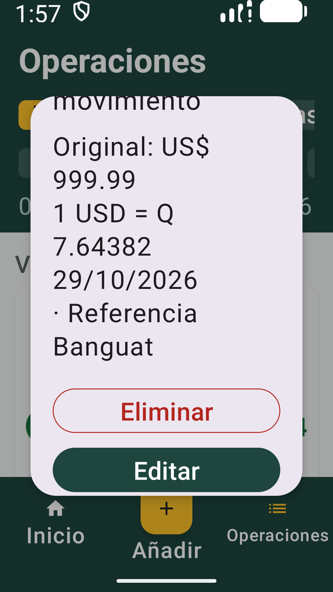 |

Se reprodujo que el detalle USD largo dejaba las acciones con altura cero. Solo su XML cambia: contenido desplazable y botones de ancho completo en dos filas, con las palabras completas. `LegibilidadTest` verifica llegar a ambos, su texto y abrir Editar con el monto original. No cambia la lógica del diálogo ni cierra el pendiente del segundo detalle con interacción propia del usuario.

### Sin red, carga y reintento

| Sin red, claro | Sin red, oscuro | Carga real, oscuro |
|---|---|---|
| 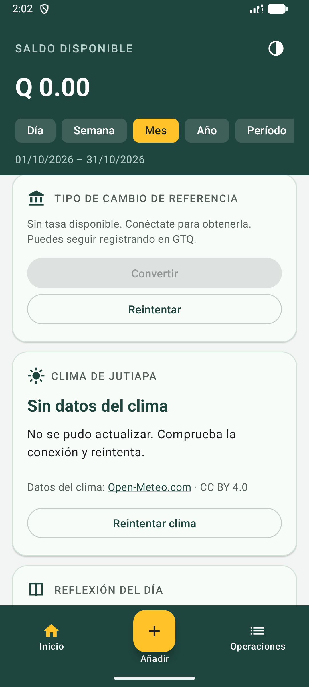 | 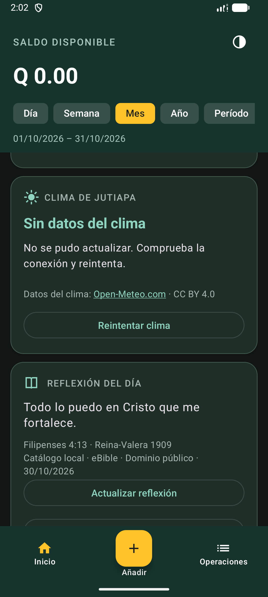 | 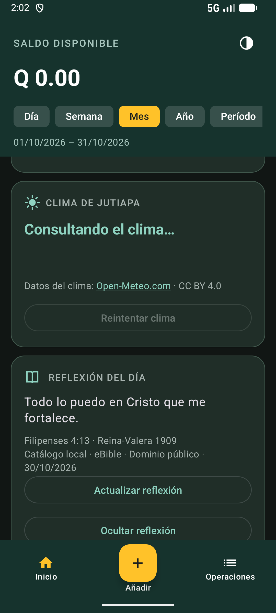 |

Recorrido por ADB sin caché inicial de servicios: tasa no disponible y Convertir deshabilitado, clima sin datos con error, reflexión local RV1909 disponible. Reintentar clima sin red conserva el estado. Al restablecer wifi/datos se capturó «Consultando el clima…», botón deshabilitado y atribución visible; respondió **21.0 °C · Despejado**, medición 30/10/2026 20:00, consulta 20:02. Esta sí fue una petición real de Open-Meteo desde Android, independiente de las capturas con fixtures. No se repitieron Banguat/Dabar en vivo.

| Clima recuperado | Dato conservado con error al cortar otra vez la red |
|---|---|
| 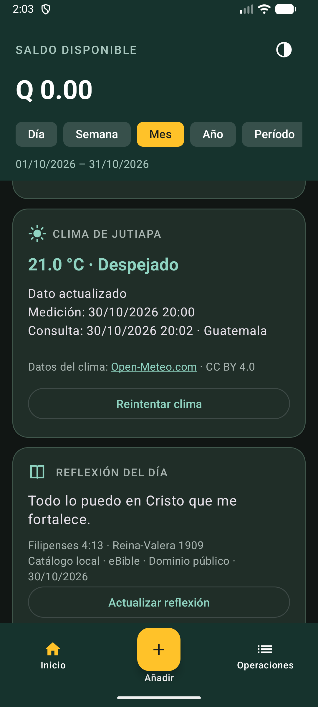 | 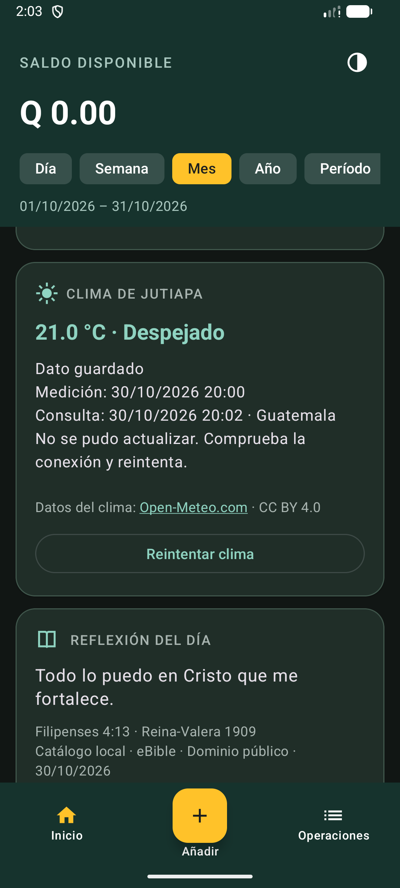 |

La revisión final habitual pasó **76/76** con red desactivada; incluye independencia de las tarjetas, caché/respaldo, conversor, movimientos, persistencia de tema y rotación de diálogos. No equivale a ejecutar de nuevo la muerte real del proceso ni a probar un teléfono físico. Después se restauró la conectividad del emulador.

### Tema y launcher

`opcionTema` es ahora un icono claro/oscuro de contraste, blanco sobre la cabecera, con área 48 × 48dp, ripple y descripción «Cambiar tema». Conserva Sistema, Claro y Oscuro y su persistencia. `ServiciosVisualesTest` comprueba descripción y área táctil; las pruebas existentes comprueban las tres preferencias.

Launcher propio vectorial: billetera blanca y moneda amarilla sobre verde, sin usar `app/img.png`. Normal para API 24–25; adaptable con fondo/frente desde API 26 y capa monocroma desde API 33. La figura se mantiene en la zona central del recurso de 108dp. [Reglas Android de iconos adaptables](https://developer.android.com/develop/ui/compose/system/icon_design_adaptive). No se añade biblioteca ni pantalla inicial.

| Pixel Launcher claro | Pixel Launcher oscuro |
|---|---|
| 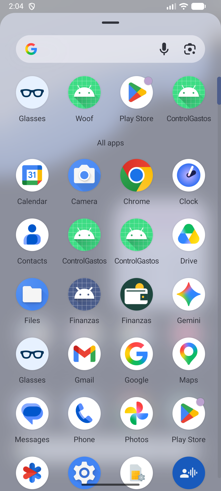 | 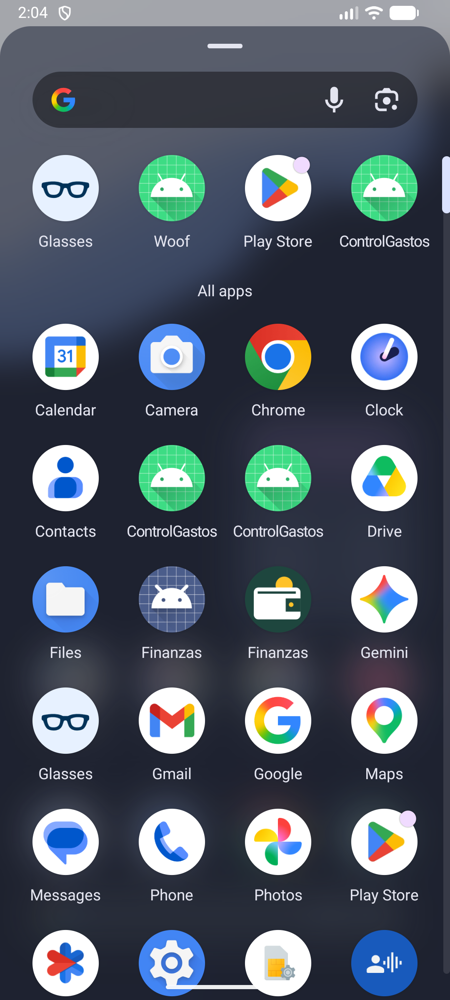 |

La billetera corresponde a `.pruebas`; el Android genérico contiguo corresponde a la instalación normal anterior, que no se actualizó durante la revisión. El frente deja margen dentro de la máscara circular. El icono adaptable se ejecutó en API 37; el recurso normal API 24–25 y la capa monocroma se crearon y compilaron, pero no se ejecutaron en esos modos. Se restauró el tema del sistema claro.

Pendientes: teclado y launcher en el teléfono del usuario, API 24–25 (sin imagen instalada), otros launchers y uso de la capa monocroma. La prueba del segundo detalle **con la propia interacción del usuario** sigue expresamente pendiente. Los resultados anteriores de ciclo de vida no se dan por repetidos por cambiar el XML.

## Bienvenida y acceso — presentación 0.4.2

Referencia recibida: maqueta «Onboarding de Finanzas en tres pantallas» (nombre, saludo, configurar PIN). Se toman composición, verde/amarillo, acentos azul/turquesa e idea de billetera/escudo; se adapta con recursos vectoriales originales y componentes Material nativos. No se incluyen saldo de ejemplo ni saldo real, correo, cuentas ni servidor. Inicio, tarjetas, anillo y navegación financiera no cambian.

`activity_acceso.xml` conserva las entradas y botones probados. Marca e ilustración preceden al título y explicación; campo de nombre con etiqueta flotante; en saludo, «Continuar sin PIN» amarillo y «Configurar PIN» secundario; en ajustes, PIN nuevo y confirmación reales, aviso de no recuperación, Guardar y continuación sin PIN. Con PIN existente se mantienen PIN actual, cambio, desactivación y Volver. El nombre heredado «Principal» sigue ofreciendo «Saltar y entrar sin PIN»; no se reabre una bienvenida ya completada.

### Claro y oscuro

| Estado | Claro | Oscuro |
|---|---|---|
| Pedir nombre | 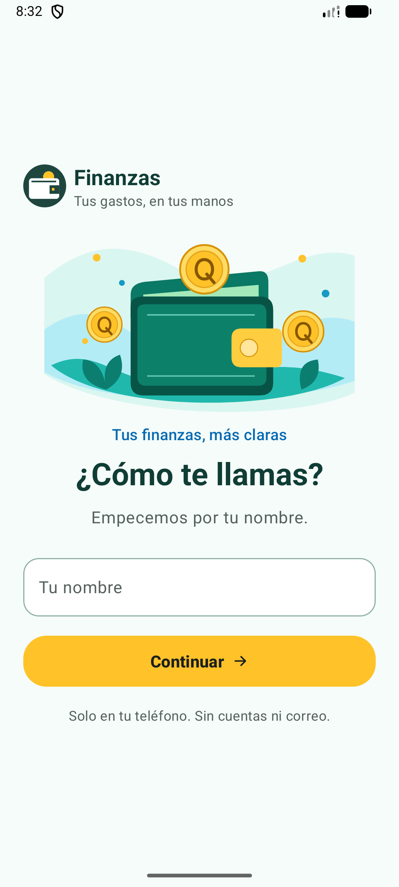 | 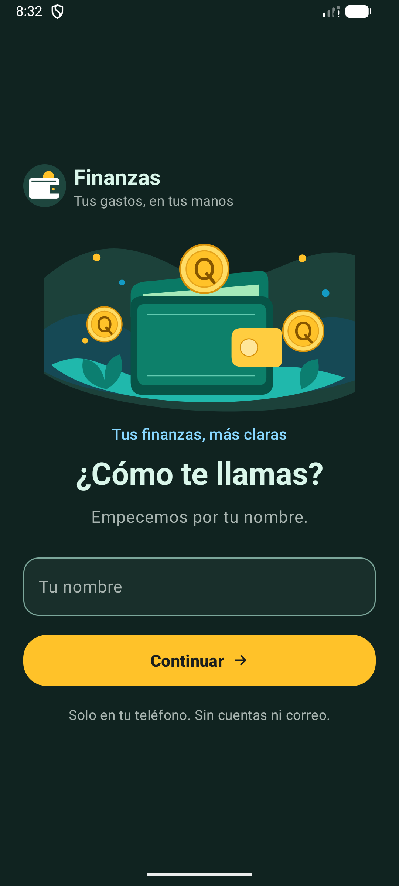 |
| Saludar | 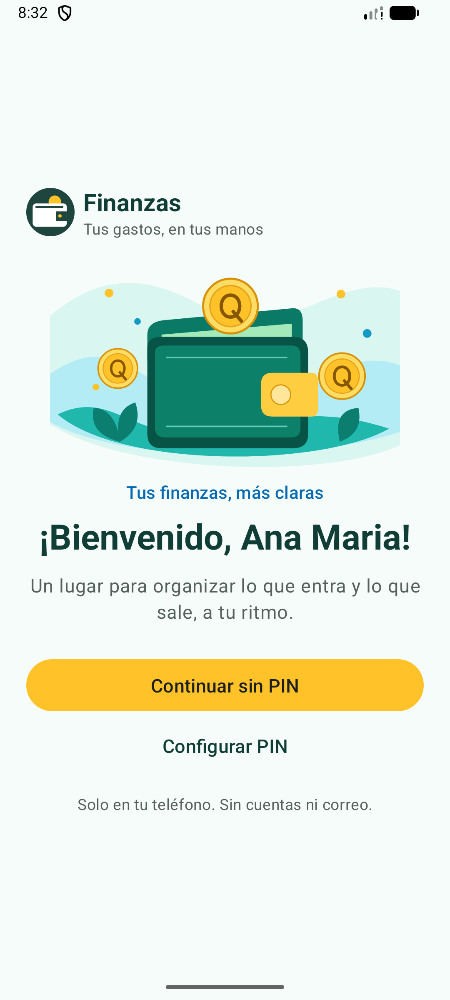 | 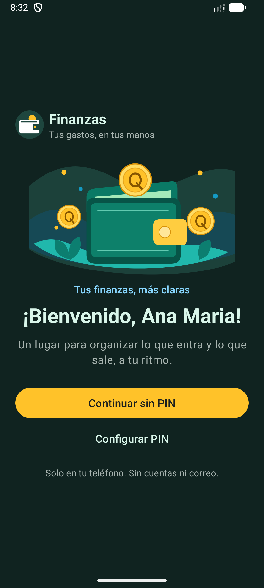 |
| Configurar PIN opcional | 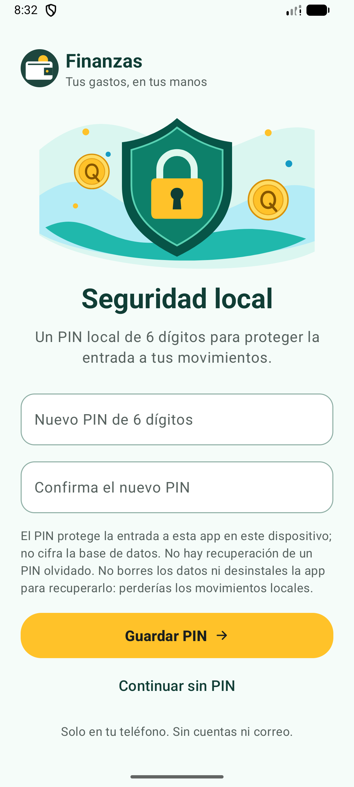 | 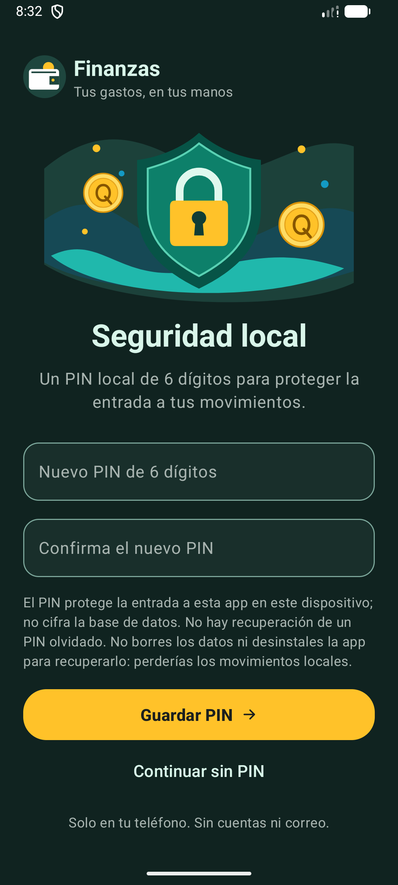 |

Los colores de fondo, texto, ondas y campos tienen variantes nocturnas exclusivas del acceso. Títulos 32sp, cuerpo/botones 17sp y nota local/aviso 14sp; las etiquetas flotantes conservan el contexto del campo al escribir. El nombre puede ocupar varias líneas en el saludo; no se reduce ni se recorta para caber.

### Teclado y letra grande

| Comprobación | Claro | Oscuro |
|---|---|---|
| Nombre con teclado, tamaño normal | 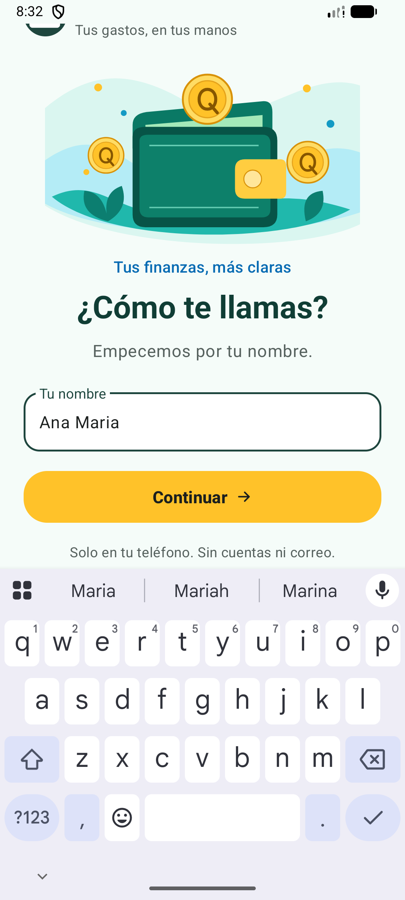 |  |
| Confirmación con teclado, tamaño normal | 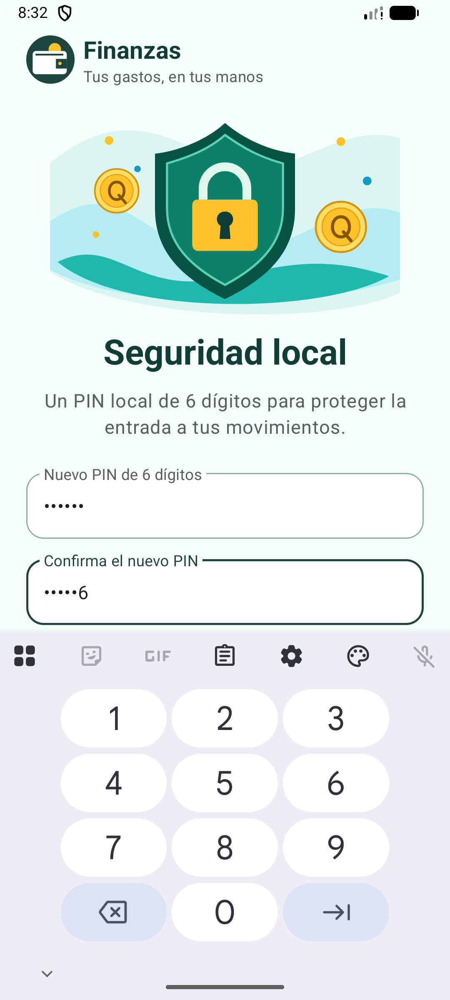 | 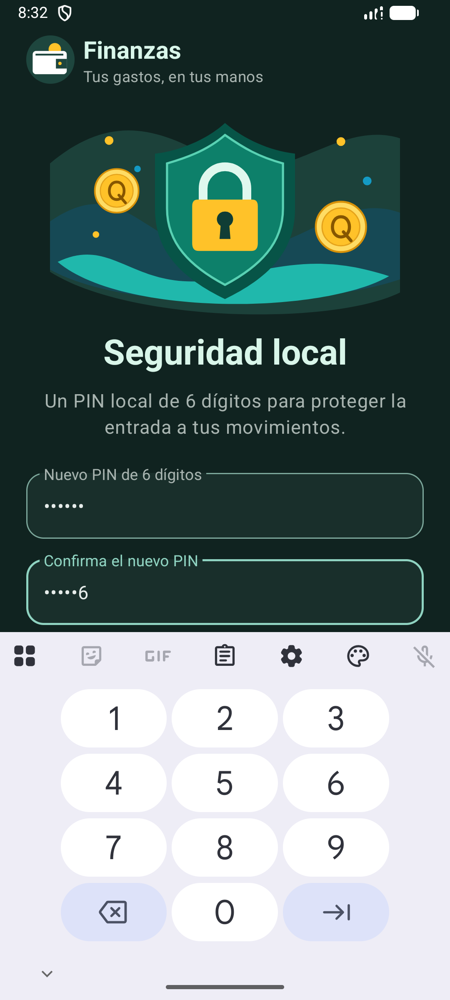 |
| Nombre, 360 × 640 dp / fuente 2.0 | 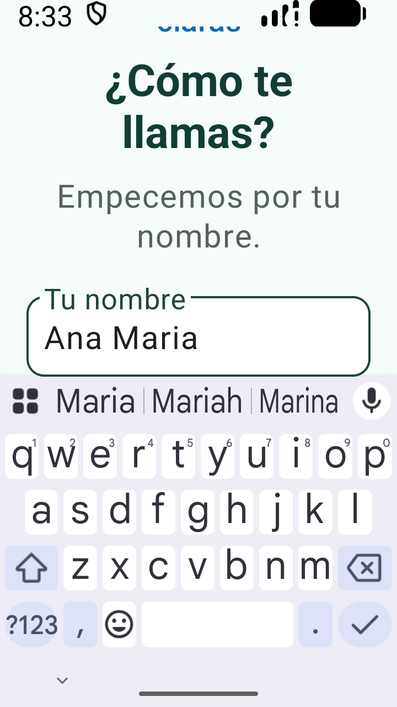 | 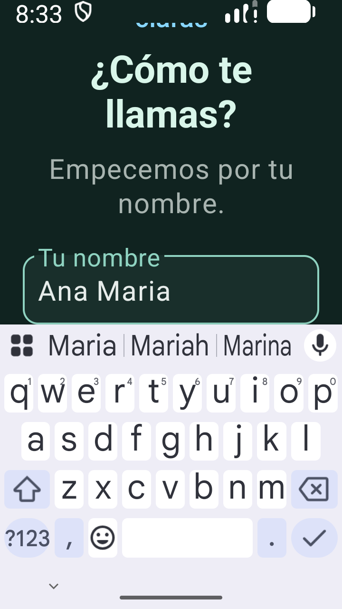 |
| Confirmación, 360 × 640 dp / fuente 2.0 | 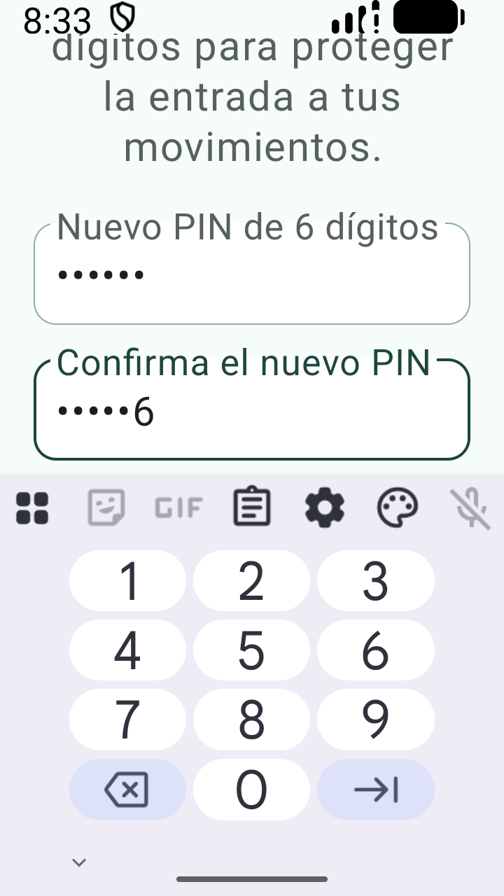 | 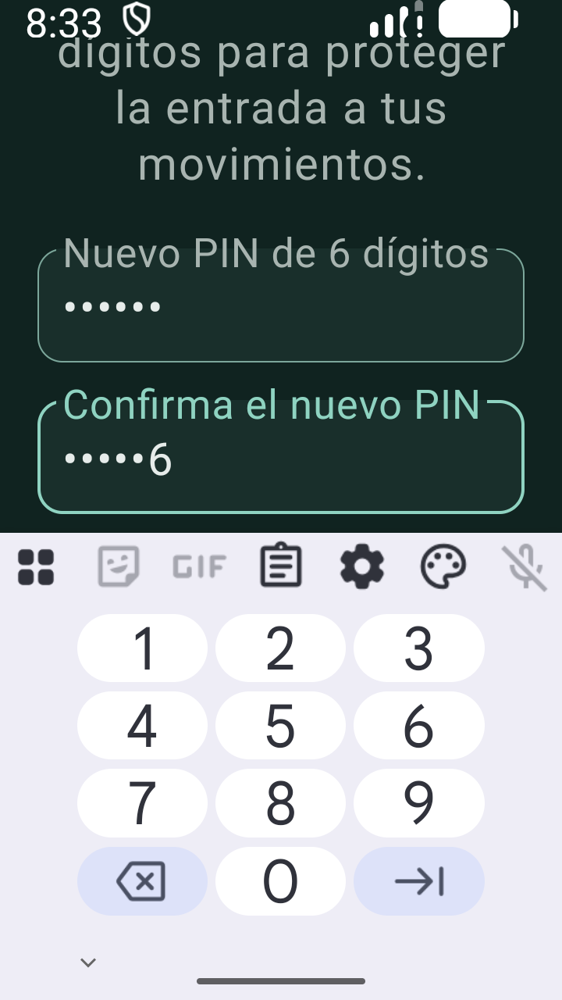 |
| Saludo con fuente 2.0 |  |  |

En pantalla estrecha/letra grande el contenido se desplaza verticalmente, sin suprimir campos, advertencias ni botones. Las capturas muestran partes sucesivas del contenido. Solo se usan datos de `.pruebas`; las capturas de configuración se toman antes de activar el PIN. El bloqueo activo conserva FLAG_SECURE; no se deshabilita para capturar.

### Movimiento

`TransicionAcceso` presenta ilustración, título, descripción y acciones en paralelo durante 220 ms: alpha y desplazamiento de 12dp con desaceleración. Sin delay, espera de bienvenida ni bloqueo de botones por animación. Se dispara al cambiar de paso, no al emitir ocupado/error. Al detener la Activity se cancela y restablecen alpha/posición. La duración sigue la escala nativa y se omite con animaciones desactivadas ([ValueAnimator](https://developer.android.com/reference/android/animation/ValueAnimator#areAnimatorsEnabled())). No hay parpadeo, bucles, animación del dinero ni lectura financiera.

Para repetir la revisión: `-PdatosPrueba :app:connectedDebugAndroidTest '-Pandroid.testInstrumentationRunnerArguments.class=gt.edu.umg.finanzas.app.ui.AccesoAparienciaTest,gt.edu.umg.finanzas.app.ui.TransicionAccesoTest'`; añadir `'-Pandroid.testInstrumentationRunnerArguments.perfilCapturas=estrecho'` para nombrar las capturas del perfil 360 × 640 dp/fuente 2.0 (la resolución y escala se configuran en el emulador). Los PNG se escriben en `/sdcard/Download/usabilidad-acceso-*.png`. Las pruebas de transición ajustan temporalmente Animator a 1/0 y restauran su valor anterior.

En esta revisión se selecciona `$env:ANDROID_SERIAL='emulator-5554'` para Gradle y `adb -s emulator-5554` para las capturas, sin operar el teléfono conectado. Preparación de Gboard del emulador: `settings put secure show_ime_with_hard_keyboard 1` y `settings put secure stylus_handwriting_enabled 0`. Así se comprueba el IME inferior convencional, no la barra flotante de escritura a mano; la app no cambia esas preferencias. Las capturas se repitieron después de ajustar el borde sin foco en oscuro. En letra grande la espera inicial del test comprueba la existencia del campo y después se desplaza hasta él; no exige que toda la pantalla quepa sin desplazamiento.

Resultados finales: apariencia/transición **4/4** en tamaño normal y **4/4** en 360 × 640 dp/fuente 2.0; regresión completa **92/92 sin red**, API 37. Capturas revisadas en ambos temas con teclado inferior y desplazamiento hasta los botones. Se restauran las preferencias del emulador. APK normal 0.4.2 compilado; apariencia, teclado y transiciones en el teléfono y API 24–25 siguen pendientes.

## Vistas y conexiones

| Vista | Orden y controles | De dónde sale lo que muestra |
|---|---|---|
| Inicio | Saldo disponible; Día/Semana/Mes/Año/Período; ingresos y gastos; anillo; categorías; tasa/conversor; clima; reflexión RV1909 ocultable con respaldo local | InicioViewModel observa el servicio del core/Room y expone tres estados auxiliares separados de sus repositorios |
| Formulario | Tipo Ingreso/Gasto; monto; moneda desde Inc. 6; botones +5/+10/+20/+50; cuadrícula de categorías; fecha; descripción; Guardar | FormularioViewModel conserva los campos; el core valida; OperacionesMovimientoRoom guarda |
| Operaciones | Filtros por tipo y fechas; filas con encabezados por día; detalle; Editar; Eliminar con confirmación | OperacionesViewModel observa consultas del intervalo; el mismo Formulario sirve para editar |

Inicio y Operaciones incluyen barra_navegacion.xml con Inicio, Añadir y Operaciones. El botón central abre FormularioActivity. El formulario utiliza Guardar/Cancelar y el regreso de Android; al terminar vuelve a la pantalla que lo abrió.

## Detalles que se conservan

- Los filtros de período se presentan como pestañas o chips en una fila.
- Las tarjetas Ingresos y Gastos quedan juntas cuando el ancho lo permite.
- El anillo se acompaña de categorías, importes y porcentajes en texto.
- El formulario muestra las categorías como cuadrícula, con icono y nombre, filtradas por tipo. Se busca una distribución de cuatro columnas cuando el tamaño de pantalla y de letra lo permiten.
- La maqueta tiene un acceso “Más” para categorías restantes. La app no lo incluye: hay 8 categorías de gasto y 4 de ingreso, y todas caben en la cuadrícula de 4 columnas. Si algún día hay más de las que caben, se añadiría ese acceso, que nunca se guardaría como categoría.
- El detalle de una operación permite revisar y editar el mismo registro.

## Adaptaciones al proyecto

| En la maqueta | En Android |
|---|---|
| Balance depende del período de ejemplo | Saldo disponible histórico; los filtros afectan ingresos, gastos y gráfico |
| Centro del anillo dice Balance | Dice Gastos del período y muestra su total |
| Nota opcional | Descripción breve obligatoria, conforme a la regla del core |
| Varias divisas | Dos sentidos: USD → GTQ y GTQ → USD |
| Valores, tasas y fechas escritos en JavaScript | Datos reales de SQLite y fecha actual; tasa Banguat real desde Inc. 6 |
| Historial con diferentes ordenamientos | Orden por fecha en esta versión, con encabezados coherentes |
| Datos del editor de Canva y sus SDK | Componentes XML nativos, recursos locales e iconos de la app |

El conversor utiliza un selector de sentido con dos opciones, no dos selectores libres de moneda. En el formulario, elegir GTQ registra el monto base; elegir USD calcula su equivalente en Q con una tasa identificada. No se crean saldos separados por divisa.

El clima, la tasa y la reflexión son tarjetas secundarias bajo el contenido financiero. Su estado o ausencia no impide usar el registro de movimientos.

## Comprobación durante la implementación

En los incrementos 3 y 4 se compara la app en el emulador con esta referencia: jerarquía visual, navegación, cuadrícula, estado vacío, teclado y conservación del formulario al rotar. Se revisa también con el tema oscuro y letra grande.

El diseño define los modelos y reglas; este documento define la disposición visual. Las rutas y funciones implementadas se consultan en [el mapa](../MAPA_DEL_CODIGO.md).
