# Referencia de la interfaz

Referencia principal: la maqueta de Canva compartida por el usuario. Se revisaron la captura de Inicio y el HTML con las vistas Inicio, Añadir y Operaciones. Las capturas de Gestor de gastos se usan como apoyo visual.

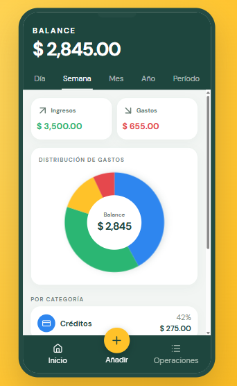

## Apariencia

- Cabecera y barra inferior verde oscuro: #1E463E.
- Acento amarillo: #FFC229, especialmente en el botón central Añadir.
- Fondo claro: #F2F5F3, tarjetas redondeadas y espacios amplios.
- Iconos acompañados de texto; ingresos y gastos con signo y etiqueta.
- Colores definidos en recursos de tema. En oscuro cambian fondo, superficies y texto; se conservan el orden y los mismos layouts.

La imagen contiene montos y símbolos de demostración. En Android, el saldo se muestra en Q.

## Comparación del incremento 3 (emulador API 37)

| Inicio | Formulario | Inicio oscuro | Formulario oscuro |
|---|---|---|---|
| 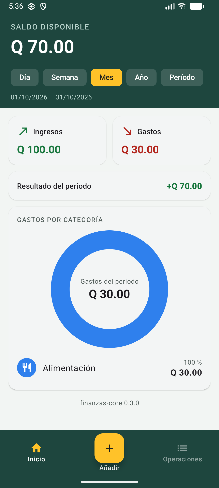 | 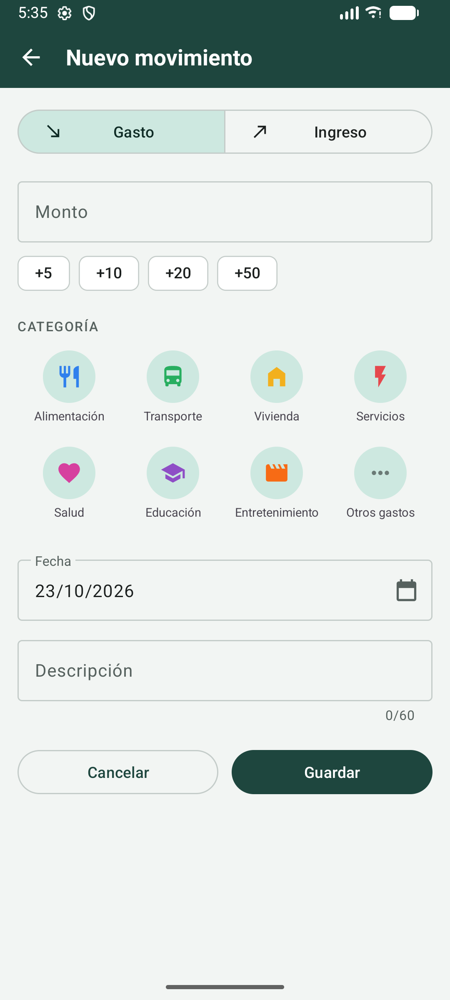 | 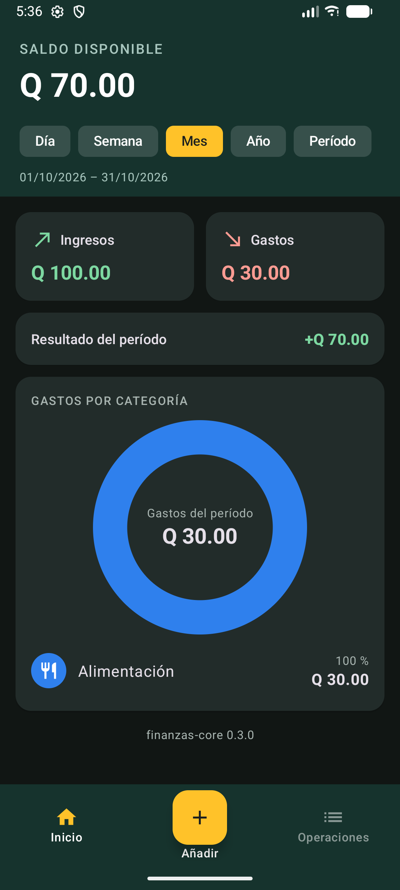 | 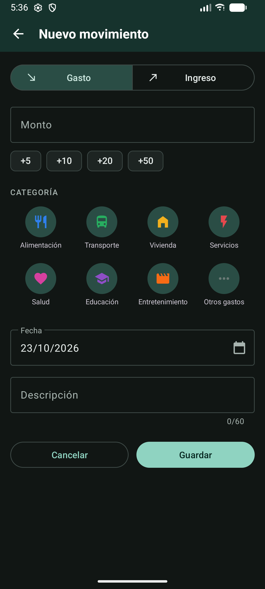 |

- **Igual que la maqueta:** cabecera verde con saldo grande y fila de períodos, pestaña activa en amarillo, tarjetas Ingresos y Gastos juntas con flechas, anillo con leyenda por categoría, barra inferior verde con el botón Añadir amarillo al centro.
- **Adaptado:** el saldo es histórico y los chips solo cambian ingresos, gastos y anillo; se añadió la tarjeta Resultado del período; el centro del anillo dice Gastos del período; Operaciones aparece deshabilitada hasta el Inc. 4.
- **Formulario:** tipo Gasto/Ingreso, monto con prefijo Q, accesos +5/+10/+20/+50, cuadrícula de categorías de 4 columnas filtrada por tipo, fecha y descripción obligatoria con contador.
- **Corregido al comparar:** los chips de período se veían como rectángulos blancos sin texto (superficie de Material 3) y "Entretenimiento" se partía en dos líneas.
- **Letra grande:** revisada y corregida en el Inc. 4 (ver abajo).

## Comparación del incremento 4 (emulador API 37)

| Operaciones | Detalle | Editar | Confirmar eliminación |
|---|---|---|---|
| 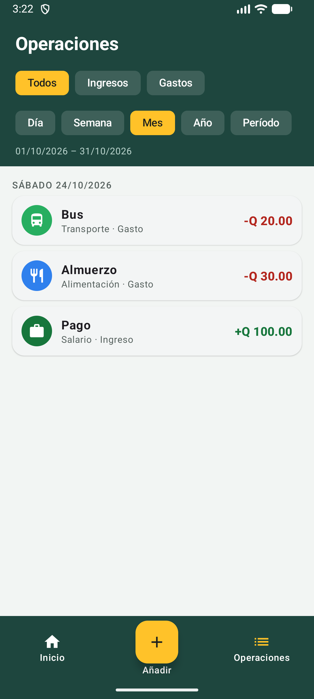 | 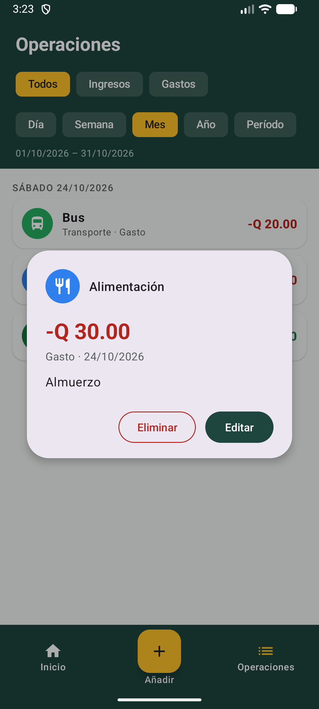 | 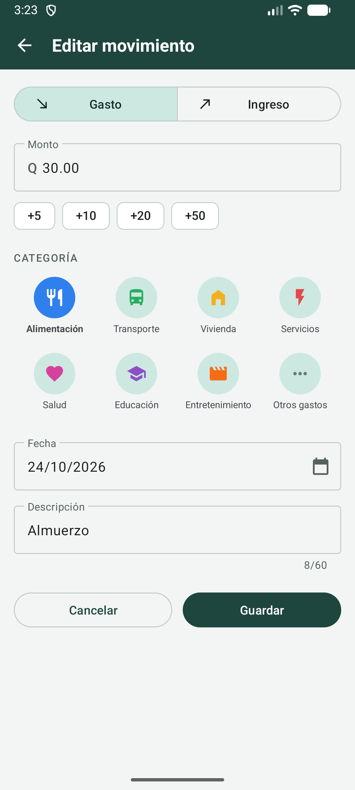 | 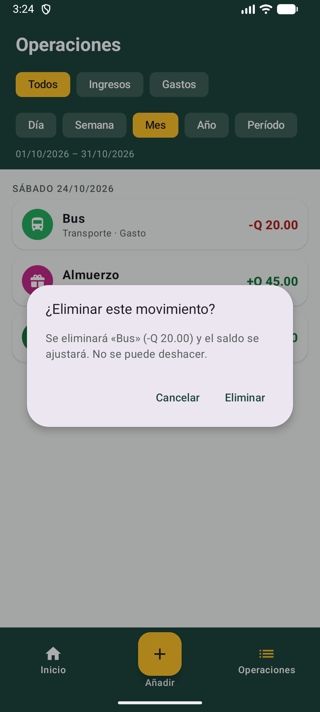 |

- **Igual que la maqueta:** cabecera verde con título y filtros en pastillas, pestaña activa en amarillo, filas en tarjetas con icono de categoría a color, descripción y monto con signo y color, barra inferior con el destino actual en amarillo.
- **Adaptado:** la fecha va en un encabezado por día ("SÁBADO 24/10/2026") en lugar de repetirse en cada fila; la fila muestra "categoría · tipo" para no depender solo del color. El detalle y la confirmación son diálogos sobre la lista; Editar abre el mismo Formulario con el título "Editar movimiento".
- **Estado vacío y tema oscuro:** [lista vacía](capturas/inc4-operaciones-vacia.png) y [Operaciones en oscuro](capturas/inc4-operaciones-oscuro.png).
- **Calendarios:** [rango](capturas/inc4-calendario-rango.png) y [fecha](capturas/inc4-calendario-fecha.png). Son los de Material; sus botones y meses siguen el idioma del sistema.

### Letra grande del sistema (escala 1.3 y 2.0)

| Formulario 1.3 | Formulario 2.0 | Inicio 2.0 | Detalle 2.0 |
|---|---|---|---|
| 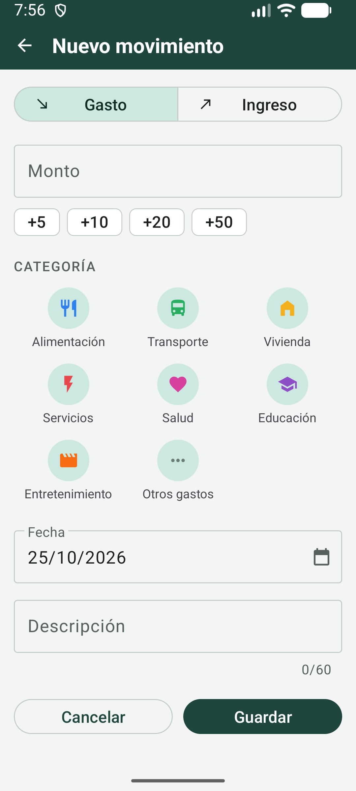 | 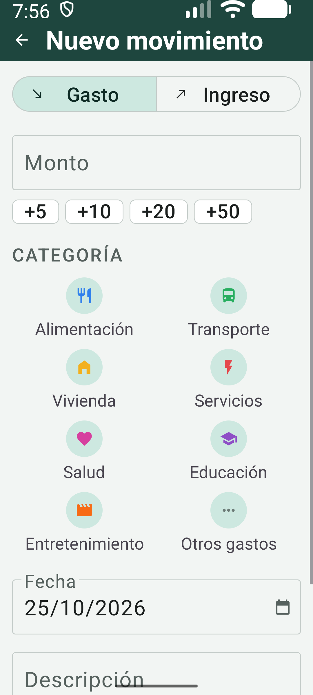 | 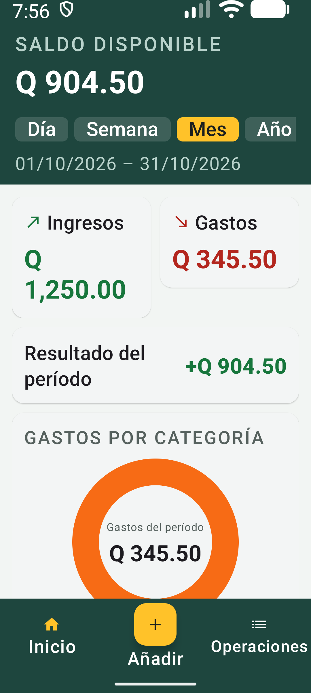 | 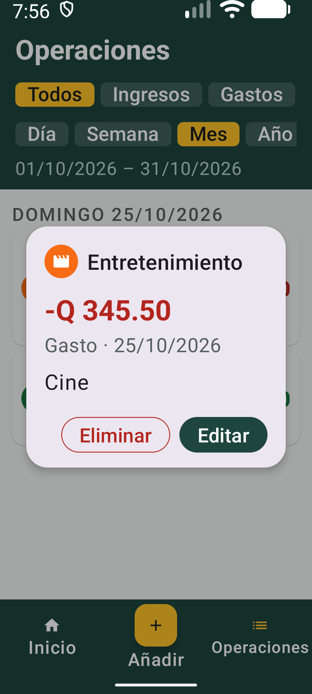 |

- **Corregido:** la cuadrícula partía nombres a mitad de palabra ("Entretenimien-to" con 1.3; "Alimenta-ción", "Educació-n" con 2.0). Ahora usa 4 columnas con letra normal, 3 con 1.3 y 2 con 2.0. La etiqueta "Operaciones" de la barra se partía en "Operacione-s" con 2.0; ahora queda en una línea y se reduce solo lo necesario. En el centro del anillo, "Gastos del período" se salía del hueco con 2.0; ahora el centro tiene medidas fijas y el texto se reduce dentro de él, con un mínimo en dp para que la escala no lo vuelva a agrandar (el mismo total se lee completo en la tarjeta Gastos).
- **Se deja así:** con 1.3 y 2.0 la fila de períodos no cabe entera y se desplaza de lado (Período queda a la derecha); con 2.0 "Q 1,250.00" pasa a dos líneas en la tarjeta Ingresos y "categoría · tipo" ocupa dos líneas en [Operaciones](capturas/inc4-letra-2.0-operaciones.png). Todo sigue legible y sin cortes; el formulario y la lista se desplazan para llegar a Guardar y a las últimas filas.
- El detalle de un movimiento cabe completo con 2.0.

## Vistas y conexiones

| Vista | Orden y controles | De dónde sale lo que muestra |
|---|---|---|
| Inicio | Saldo disponible; Día/Semana/Mes/Año/Período; ingresos y gastos; anillo; categorías | InicioViewModel observa el servicio del core, alimentado por consultas Room |
| Formulario | Tipo Ingreso/Gasto; monto; moneda desde Inc. 6; botones +5/+10/+20/+50; cuadrícula de categorías; fecha; descripción; Guardar | FormularioViewModel conserva los campos; el core valida; OperacionesMovimientoRoom guarda |
| Operaciones | Filtros por tipo y fechas; filas con encabezados por día; detalle; Editar; Eliminar con confirmación | OperacionesViewModel observa consultas del intervalo; el mismo Formulario sirve para editar |

Inicio y Operaciones incluyen barra_navegacion.xml con Inicio, Añadir y Operaciones. El botón central abre FormularioActivity. El formulario utiliza Guardar/Cancelar y el regreso de Android; al terminar vuelve a la pantalla que lo abrió.

## Detalles que se conservan

- Los filtros de período se presentan como pestañas o chips en una fila.
- Las tarjetas Ingresos y Gastos quedan juntas cuando el ancho lo permite.
- El anillo se acompaña de categorías, importes y porcentajes en texto.
- El formulario muestra las categorías como cuadrícula, con icono y nombre, filtradas por tipo. Se busca una distribución de cuatro columnas cuando el tamaño de pantalla y de letra lo permiten.
- La maqueta tiene un acceso “Más” para categorías restantes. La app no lo incluye: hay 8 categorías de gasto y 4 de ingreso, y todas caben en la cuadrícula de 4 columnas. Si algún día hay más de las que caben, se añadiría ese acceso, que nunca se guardaría como categoría.
- El detalle de una operación permite revisar y editar el mismo registro.

## Adaptaciones al proyecto

| En la maqueta | En Android |
|---|---|
| Balance depende del período de ejemplo | Saldo disponible histórico; los filtros afectan ingresos, gastos y gráfico |
| Centro del anillo dice Balance | Dice Gastos del período y muestra su total |
| Nota opcional | Descripción breve obligatoria, conforme a la regla del core |
| Varias divisas | Dos sentidos: USD → GTQ y GTQ → USD |
| Valores, tasas y fechas escritos en JavaScript | Datos reales de SQLite y fecha actual; tasa Banguat cuando se implemente |
| Historial con diferentes ordenamientos | Orden por fecha en esta versión, con encabezados coherentes |
| Datos del editor de Canva y sus SDK | Componentes XML nativos, recursos locales e iconos de la app |

El conversor utiliza un selector de sentido con dos opciones, no dos selectores libres de moneda. En el formulario, elegir GTQ registra el monto base; elegir USD calcula su equivalente en Q con una tasa identificada. No se crean saldos separados por divisa.

El clima, la tasa y la reflexión son tarjetas secundarias bajo el contenido financiero. Su estado o ausencia no impide usar el registro de movimientos.

## Comprobación durante la implementación

En los incrementos 3 y 4 se compara la app en el emulador con esta referencia: jerarquía visual, navegación, cuadrícula, estado vacío, teclado y conservación del formulario al rotar. Se revisa también con el tema oscuro y letra grande.

El diseño define los modelos y reglas; este documento define la disposición visual. Las rutas y funciones implementadas se consultan en [el mapa](../MAPA_DEL_CODIGO.md).
