# Referencia de la interfaz

Referencia principal: la maqueta de Canva compartida por el usuario. Se revisaron la captura de Inicio y el HTML con las vistas Inicio, Añadir y Operaciones. Las capturas de Gestor de gastos se usan como apoyo visual.

## Apariencia

- Cabecera y barra inferior verde oscuro: #1E463E.
- Acento amarillo: #FFC229, especialmente en el botón central Añadir.
- Fondo claro: #F2F5F3, tarjetas redondeadas y espacios amplios.
- Iconos acompañados de texto; ingresos y gastos con signo y etiqueta.
- Colores definidos en recursos de tema. En oscuro cambian fondo, superficies y texto; se conservan el orden y los mismos layouts.

La imagen contiene montos y símbolos de demostración. En Android, el saldo se muestra en Q.

## Comparación del incremento 3 (emulador API 37)

| Inicio | Formulario | Inicio oscuro | Formulario oscuro |
|---|---|---|---|
|  |  |  |  |

- **Igual que la maqueta:** cabecera verde con saldo grande y fila de períodos, pestaña activa en amarillo, tarjetas Ingresos y Gastos juntas con flechas, anillo con leyenda por categoría, barra inferior verde con el botón Añadir amarillo al centro.
- **Adaptado:** el saldo es histórico y los chips solo cambian ingresos, gastos y anillo; se añadió la tarjeta Resultado del período; el centro del anillo dice Gastos del período; Operaciones aparece deshabilitada hasta el Inc. 4.
- **Formulario:** tipo Gasto/Ingreso, monto con prefijo Q, accesos +5/+10/+20/+50, cuadrícula de categorías de 4 columnas filtrada por tipo, fecha y descripción obligatoria con contador.
- **Corregido al comparar:** los chips de período se veían como rectángulos blancos sin texto (superficie de Material 3) y "Entretenimiento" se partía en dos líneas.
- **Letra grande:** revisada y corregida en el Inc. 4 (ver abajo).

## Comparación del incremento 4 (emulador API 37)

| Operaciones | Detalle | Editar | Confirmar eliminación |
|---|---|---|---|
|  |  |  |  |

- **Igual que la maqueta:** cabecera verde con título y filtros en pastillas, pestaña activa en amarillo, filas en tarjetas con icono de categoría a color, descripción y monto con signo y color, barra inferior con el destino actual en amarillo.
- **Adaptado:** la fecha va en un encabezado por día ("SÁBADO 24/10/2026") en lugar de repetirse en cada fila; la fila muestra "categoría · tipo" para no depender solo del color. El detalle y la confirmación son diálogos sobre la lista; Editar abre el mismo Formulario con el título "Editar movimiento".
- **Estado vacío y tema oscuro:** [lista vacía](capturas/inc4-operaciones-vacia.png) y [Operaciones en oscuro](capturas/inc4-operaciones-oscuro.png).
- **Calendarios:** [rango](capturas/inc4-calendario-rango.png) y [fecha](capturas/inc4-calendario-fecha.png). Son los de Material; sus botones y meses siguen el idioma del sistema.

### Letra grande del sistema (escala 1.3 y 2.0)

| Formulario 1.3 | Formulario 2.0 | Inicio 2.0 | Detalle 2.0 |
|---|---|---|---|
|  |  |  |  |

- **Corregido:** la cuadrícula partía nombres a mitad de palabra ("Entretenimien-to" con 1.3; "Alimenta-ción", "Educació-n" con 2.0). Ahora usa 4 columnas con letra normal, 3 con 1.3 y 2 con 2.0. La etiqueta "Operaciones" de la barra se partía en "Operacione-s" con 2.0; ahora queda en una línea y se reduce solo lo necesario. En el centro del anillo, "Gastos del período" se salía del hueco con 2.0; ahora el centro tiene medidas fijas y el texto se reduce dentro de él, con un mínimo en dp para que la escala no lo vuelva a agrandar (el mismo total se lee completo en la tarjeta Gastos).
- **Se deja así:** con 1.3 y 2.0 la fila de períodos no cabe entera y se desplaza de lado (Período queda a la derecha); con 2.0 "Q 1,250.00" pasa a dos líneas en la tarjeta Ingresos y "categoría · tipo" ocupa dos líneas en [Operaciones](capturas/inc4-letra-2.0-operaciones.png). Todo sigue legible y sin cortes; el formulario y la lista se desplazan para llegar a Guardar y a las últimas filas.
- El detalle de un movimiento cabe completo con 2.0.

## Incremento 5: aviso y selector de tema (emulador API 37)

| Aviso claro | Selector | Aviso oscuro | Saldo corregido |
|---|---|---|---|
| 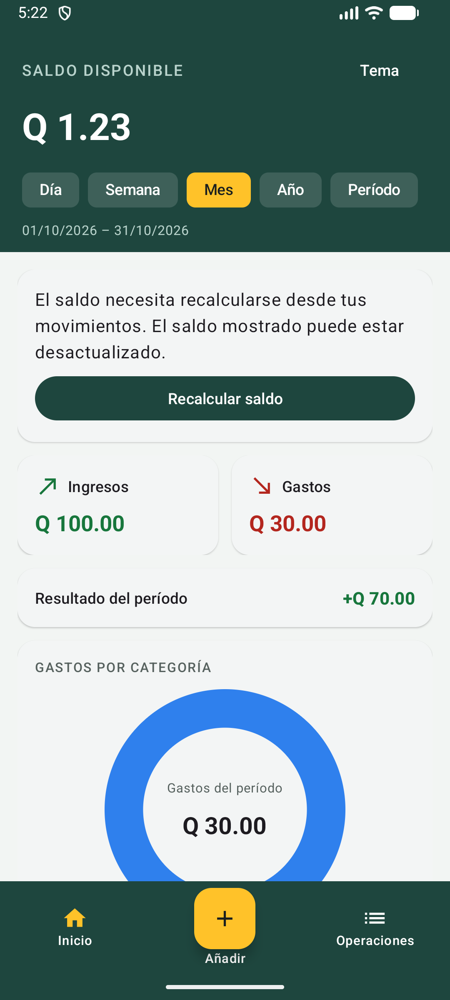 | 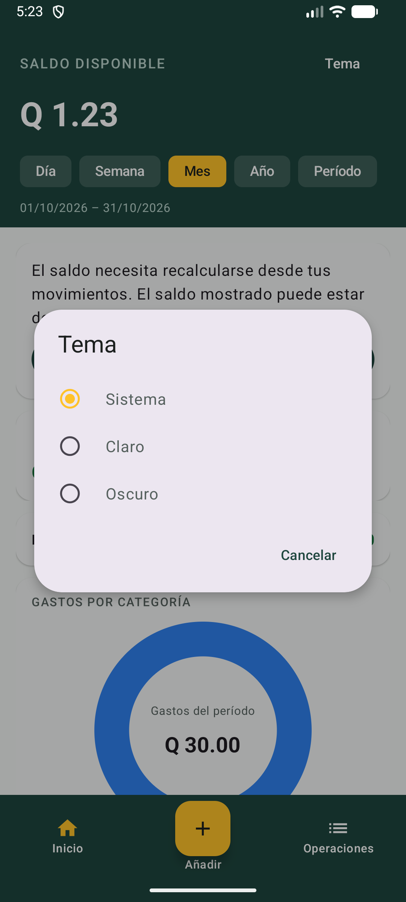 | 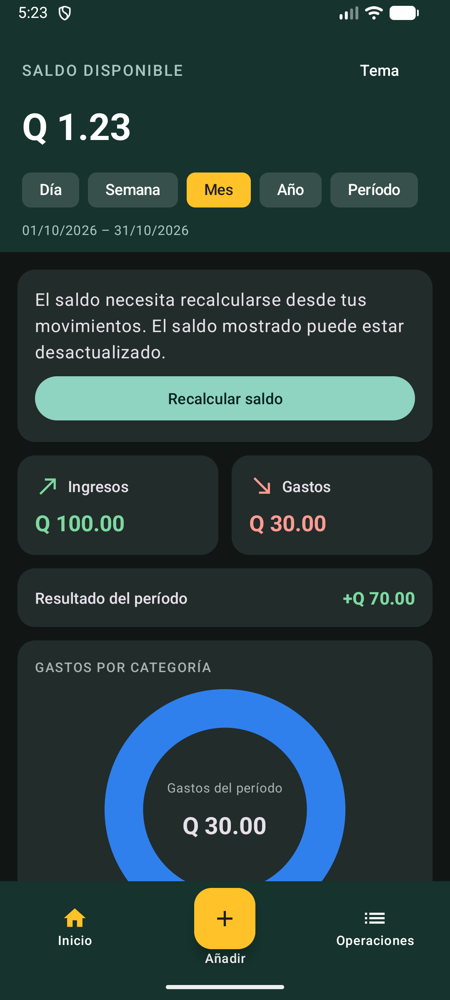 | 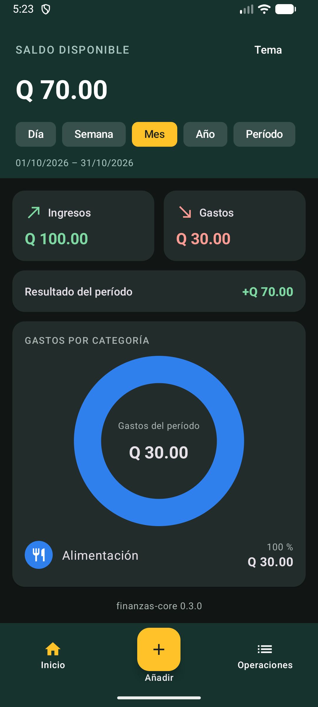 |

- `opcionTema` ocupa el extremo derecho de la cabecera verde. Abre un diálogo Material con Sistema, Claro y Oscuro; los colores y layouts existentes se conservan.
- El aviso aparece antes de las tarjetas solo con bandera pendiente. Explica que el saldo puede estar desactualizado y ofrece Recalcular saldo. Durante la operación el botón indica Recalculando y queda deshabilitado; un error mantiene la tarjeta con opción de reintentar.
- En una base de prueba con Q 100 de ingreso y Q 30 de gasto, el botón cambió Q 1.23 erróneo a Q 70.00 y ocultó la tarjeta. Tema y aviso se revisaron en claro y oscuro; las tres opciones persistieron tras forzar el cierre y abrir otro proceso. Sistema siguió el modo claro/oscuro de Android.
- Revisión mediante capturas, jerarquías Android y acciones individuales de ADB. El [segundo detalle](capturas/inc5-segundo-detalle.png) seguía abierto 372 s después de cancelar una eliminación y reabrirlo; no se declara corregida la observación anterior. Los otros pendientes conservan su estado en el README.

## Incremento 6: tasa y movimientos USD (emulador API 37)

| Tasa clara | Tasa oscura | Conversor claro | Conversor oscuro |
|---|---|---|---|
| 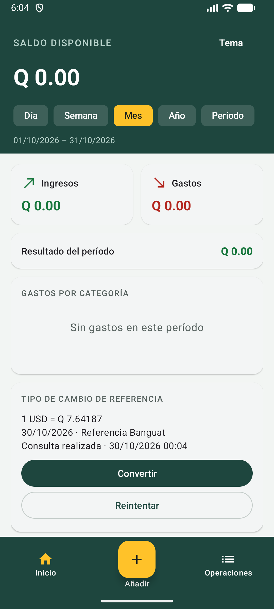 | 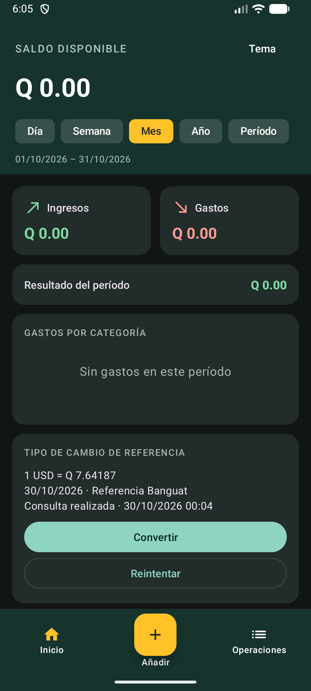 | 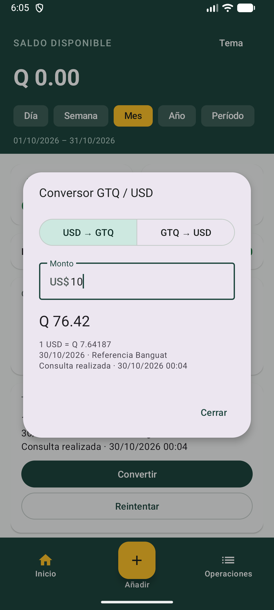 | 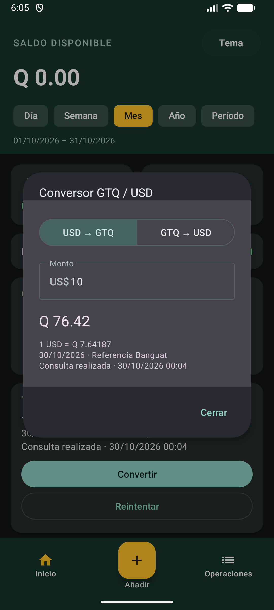 |

| Formulario claro | Formulario oscuro | Detalle claro | Detalle oscuro |
|---|---|---|---|
| 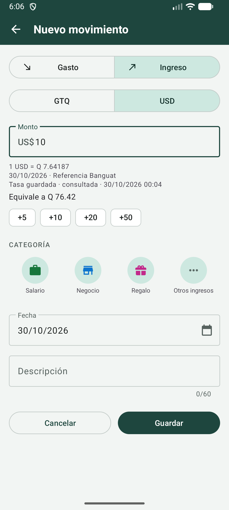 | 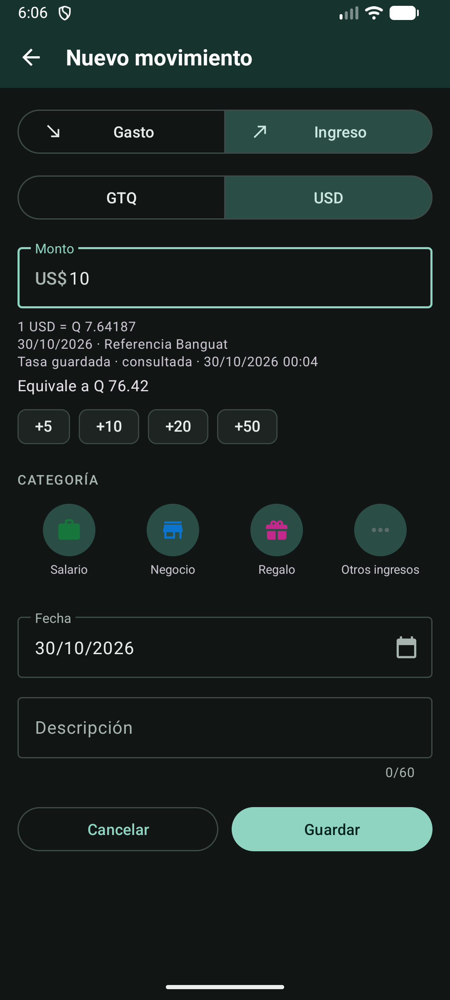 | 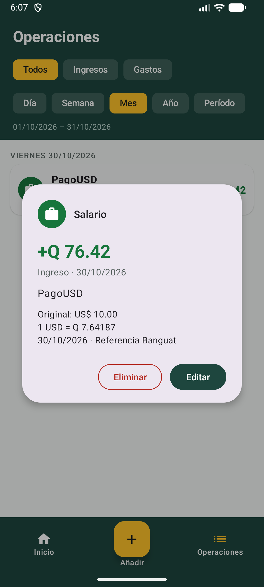 | 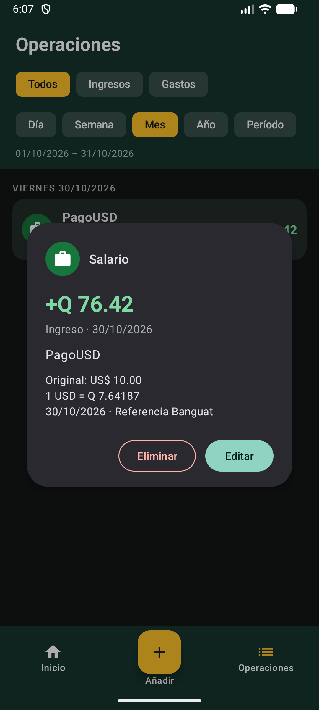 |

- Se conserva la jerarquía de Canva: cabecera verde, saldo en Q, resumen/anillo y navegación verde con Añadir amarillo. `tarjeta_tasa.xml` aparece bajo el contenido financiero, con fuente, fecha del proveedor, momento de consulta, Convertir y Reintentar.
- El conversor ofrece solo USD → GTQ y GTQ → USD en un grupo de dos botones. El monto, el sentido y el resultado se conservaron al cambiar de tema. No hay pares de selectores libres ni otras monedas.
- El Formulario conserva tipo, accesos rápidos y cuadrícula. Añade el selector GTQ/USD antes del monto y, debajo, los metadatos de la tasa y el equivalente. USD se deshabilita sin tasa disponible. Al editar se muestra la tasa histórica y se conserva el monto original.
- [Operaciones](capturas/inc6-operaciones-usd-claro.png) mantiene el equivalente con signo en Q y añade «Original: US$ …». El detalle muestra original, tasa, fecha y fuente. El detalle USD de prueba también se revisó con letra 2.0 y sus acciones quedaron visibles; no se declara revisada toda la app con esa escala en este incremento.
- Datos reales del servicio en una instalación separada de prueba: referencia 7.64187 del 30/10/2026; US$ 10 → Q 76.42. [Sin red](capturas/inc6-tasa-sin-red.png), el saldo y la tasa real guardada se conservaron al reiniciar; Reintentar mostró que no se pudo actualizar sin borrar el dato. La conectividad y el tema del sistema se restauraron al terminar.
- Comparación por capturas y acciones de ADB. Las pruebas instrumentadas adicionales usan tasas explícitamente ficticias y la instalación `.pruebas`; no se reemplazan datos de la instalación normal.

## Incremento 7: clima y reflexión local (emulador API 37)

| Tarjetas claras | Tarjetas oscuras |
|---|---|
| 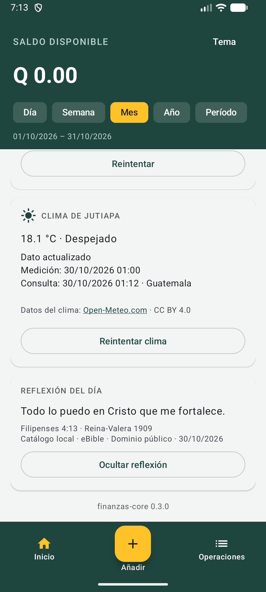 | 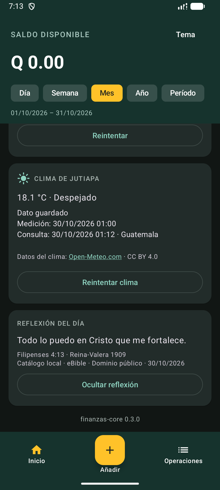 |

- Se compararon con Canva y las capturas anteriores: misma cabecera verde, saldo en Q, filtros, resumen financiero y navegación con Añadir amarillo. [Inicio claro](capturas/inc7-inicio-claro.png) e [Inicio oscuro](capturas/inc7-inicio-oscuro.png) conservan esa jerarquía. Las nuevas tarjetas están en el contenido desplazable, en orden **tasa → clima → reflexión**, con el estilo de tarjeta y los colores del tema existentes.
- `tarjeta_clima.xml` muestra temperatura, condición WMO en español, fecha de medición, fecha de consulta en Guatemala y origen guardado/actualizado. Incluye atribución enlazada Open-Meteo.com, CC BY 4.0 y **Reintentar clima**. El icono del título identifica el clima; la condición actual siempre se expresa en texto. No se añade GPS ni otra pantalla.
- Dato real observado: **18.1 °C · Despejado**, medición 30/10/2026 01:00, consulta 01:12. Al cambiar de tema se mostró «Dato guardado» conservando valores y fechas. Las dos tarjetas y sus botones quedaron legibles, sin solaparse con la navegación, en la escala normal del emulador.
- `tarjeta_reflexion.xml` muestra la cita, referencia, RV1909, **Catálogo local · eBible · Dominio público** y fecha. **Ocultar reflexión** contrae el contenido y deja **Mostrar reflexión** disponible; la preferencia y la cita sobreviven a recrear la Activity (prueba instrumentada). No presenta el contenido como descargado de Bolls.
- Con wifi/datos desactivados, [el reintento conservó el clima guardado](capturas/inc7-clima-guardado-sin-red.png) y añadió el error, mientras reflexión y navegación seguían disponibles. `am force-stop` y abrir otra vez conservó los datos y la misma cita. Tras restaurar internet, [Reintentar actualizó la consulta a 01:14](capturas/inc7-clima-recuperado.png) y quitó el error; durante la petición se observó «Consultando el clima…».
- En una instalación `.pruebas` vaciada expresamente para este recorrido, [sin red y sin caché](capturas/inc7-clima-sin-datos.png) se mostró «Sin datos del clima», error y reintento; la reflexión local siguió disponible desde el primer arranque. La base de la app normal nunca se vació ni se reinstaló. Se restauró wifi/datos al terminar.
- Revisión por capturas, jerarquía Android y acciones de ADB. No se repite aquí la revisión de toda la app con letra 2.0 ni API 24–25. La integración remota de reflexión queda pendiente por el bloqueo documentado en [la verificación de proveedores](SERVICIOS_INCREMENTO_7.md); las capturas muestran el catálogo local permitido.

## Vistas y conexiones

| Vista | Orden y controles | De dónde sale lo que muestra |
|---|---|---|
| Inicio | Saldo disponible; Día/Semana/Mes/Año/Período; ingresos y gastos; anillo; categorías; tasa/conversor; clima; reflexión local ocultable | InicioViewModel observa el servicio del core/Room y expone tres estados auxiliares separados de sus repositorios |
| Formulario | Tipo Ingreso/Gasto; monto; moneda desde Inc. 6; botones +5/+10/+20/+50; cuadrícula de categorías; fecha; descripción; Guardar | FormularioViewModel conserva los campos; el core valida; OperacionesMovimientoRoom guarda |
| Operaciones | Filtros por tipo y fechas; filas con encabezados por día; detalle; Editar; Eliminar con confirmación | OperacionesViewModel observa consultas del intervalo; el mismo Formulario sirve para editar |

Inicio y Operaciones incluyen barra_navegacion.xml con Inicio, Añadir y Operaciones. El botón central abre FormularioActivity. El formulario utiliza Guardar/Cancelar y el regreso de Android; al terminar vuelve a la pantalla que lo abrió.

## Detalles que se conservan

- Los filtros de período se presentan como pestañas o chips en una fila.
- Las tarjetas Ingresos y Gastos quedan juntas cuando el ancho lo permite.
- El anillo se acompaña de categorías, importes y porcentajes en texto.
- El formulario muestra las categorías como cuadrícula, con icono y nombre, filtradas por tipo. Se busca una distribución de cuatro columnas cuando el tamaño de pantalla y de letra lo permiten.
- La maqueta tiene un acceso “Más” para categorías restantes. La app no lo incluye: hay 8 categorías de gasto y 4 de ingreso, y todas caben en la cuadrícula de 4 columnas. Si algún día hay más de las que caben, se añadiría ese acceso, que nunca se guardaría como categoría.
- El detalle de una operación permite revisar y editar el mismo registro.

## Adaptaciones al proyecto

| En la maqueta | En Android |
|---|---|
| Balance depende del período de ejemplo | Saldo disponible histórico; los filtros afectan ingresos, gastos y gráfico |
| Centro del anillo dice Balance | Dice Gastos del período y muestra su total |
| Nota opcional | Descripción breve obligatoria, conforme a la regla del core |
| Varias divisas | Dos sentidos: USD → GTQ y GTQ → USD |
| Valores, tasas y fechas escritos en JavaScript | Datos reales de SQLite y fecha actual; tasa Banguat real desde Inc. 6 |
| Historial con diferentes ordenamientos | Orden por fecha en esta versión, con encabezados coherentes |
| Datos del editor de Canva y sus SDK | Componentes XML nativos, recursos locales e iconos de la app |

El conversor utiliza un selector de sentido con dos opciones, no dos selectores libres de moneda. En el formulario, elegir GTQ registra el monto base; elegir USD calcula su equivalente en Q con una tasa identificada. No se crean saldos separados por divisa.

El clima, la tasa y la reflexión son tarjetas secundarias bajo el contenido financiero. Su estado o ausencia no impide usar el registro de movimientos.

## Comprobación durante la implementación

En los incrementos 3 y 4 se compara la app en el emulador con esta referencia: jerarquía visual, navegación, cuadrícula, estado vacío, teclado y conservación del formulario al rotar. Se revisa también con el tema oscuro y letra grande.

El diseño define los modelos y reglas; este documento define la disposición visual. Las rutas y funciones implementadas se consultan en [el mapa](../MAPA_DEL_CODIGO.md).
